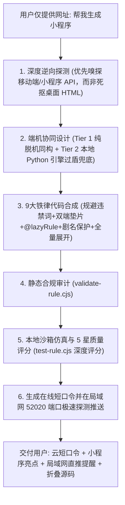

# 移动端与 PC 端双端同构海阔规则极速生成与全生命周期工程 Skill (Isomorphic Hiker Rule Architect)

> **最高纲领**：一份规则代码，双端脱机自治，PC 引擎算力加持，深度逆向真源。
> 生成的规则必须 100% 同时在 **Android 原生海阔视界客户端** 与 **DeepCloud PC 桌面端** 完美运行。
> 覆盖「**极简输入 -> 移动端API深挖 -> PC引擎协同 -> 静态审计 -> 沙箱深度评分 -> 口令/局域网直推交付**」全生命周期工程闭环。

---

## 〇、用户极简交互哲学与零提示词全自治契约 (Zero-Prompt Protocol)

> [!IMPORTANT]
> **真实用户习惯与工程自治铁律**：
> 现实中用户不会也不应该记忆复杂的爬虫术语或工程规范，**用户通常仅提供一个目标网址，并附带一句极简需求**（例如：“帮我把这个网站做成小程序：https://v.qq.com/” 或 “根据这个网站生成海阔规则”）。
> 智能体在接收到此类需求时，**严禁向用户抛出反爬、选择器或双端技术细节追问**，必须**自动将下述 PC 引擎协同拓扑、深度逆向准则与 9 大铁律作为不可妥协的内置默认行为**！

### 智能体后台自治流水线 (Silent Autonomous Pipeline)

无论用户提出的需求多么简单，智能体都必须在后台默默执行以下六步标准闭环：



---

## 一、PC 独有 Python 爬虫引擎协同与三阶加速梯队 (Hybrid Python-Engine Synergy)

DeepCloud PC 桌面端内置专有的单文件 Python 边缘爬虫引擎（`scraper-service`，默认运行在 `127.0.0.1:18000`）。海阔规则必须具备**端机感知协同能力**，实现“手机端轻量脱机、PC 端重型算力”的无缝升降级：

### 1. PC 端 Python 爬虫引擎的四大王牌资产
1. **常驻无头浏览器池 (`fetcher.py / BrowserPool`)**：
   - `static`：基于高性能异步网络库，毫秒级抓取；
   - `dynamic`：基于 Playwright / Scrapling 常驻 Chromium 内核，自动执行客户端 JS 并完成 SPA 水合；
   - `stealthy`：注入真实硬件指纹，轻松穿透 Cloudflare 5秒盾、Akamai 与滑块风控。
2. **PySpider 插件与 MacCMS 协议中枢 (`pyspider.py / spider_runner.py`)**：
   - 兼容成熟的 Python 爬虫插件源；
   - 通过 `/api.php/provide/vod?spider=...` 统一输出标准多源数据。
3. **局域网 52020 端口极速热推 (`hiker_service.py`)**：
   - 自动扫描同一 WiFi 下的海阔设备，调用 `/saveRule` 将规则直接写入手机客户端 SQLite 数据库，免扫码、免复制口令！
4. **微内核动态 Loader (`copilot_core.js`)**：
   - 客户端规则只需一行引导代码，核心逻辑由本地 Python 服务实时分发，0 重启永久在线热更。

### 2. 规则中的三阶端机协同加速梯队 (Acceleration Ladder)

| 梯度 | 运行环境 | 适用场景 | 规则代码实现逻辑 |
|---|---|---|---|
| **Tier 1：轻量同构模式**<br>(Lightweight Isomorphic) | 双端脱机运行<br>(手机 + 电脑) | 公开、防爬弱、免密、小程序/移动端 REST API 站点。 | 纯 JS 编写，基于 `request(url, options)` 直接请求，毫秒级响应，零外部依赖。 |
| **Tier 2：PC 引擎加速模式**<br>(Engine-Assisted Mode) | PC 桌面端运行<br>(或局域网打通) | 目标站有高防风控（如小红书详情 302 重定向、反爬验证码、SPA 纯动态渲染）。 | 规则脚本在 JS 中自动探测本地 `127.0.0.1:18000`。若在线，调度 Python 引擎的 `stealthy` 隐身浏览器池代理解析；若未开启，平滑降级走 Tier 1。 |
| **Tier 3：全源 PySpider 沉淀**<br>(Full PySpider Pipeline) | 深度逆向与重度采集 | 具有高难度加密签名 (如 Wbi、SO 混淆、需本地持久化 Cookie 池) 的站点。 | 编写 `scraper-service` 对应的 Python 爬虫类 (`SpiderRunner`)，由 PC 引擎全托管调度，通过本地 Hiker API 统一向海阔视界输出。 |

📖 详细端机协同代码参考详见：[`references/python-engine-synergy.md`](./references/python-engine-synergy.md)。

---

## 二、海阔视界双端同构函数字典与页面生命周期规范 (API & Page Lifecycle)

海阔视界是一套卡片数据流驱动架构。在编写规则前，必须透彻掌握各页面生命周期、注入变量与原生排版类型：

### 1. 五大核心页面模型与上下文变量注入

| 页面类型 | 对应规则字段 | 触发时机 | 运行时注入变量 (Context Variables) | 返回驱动契约 |
|---|---|---|---|---|
| **一级频道页** | `url` + `find_rule` | 点击小程序、切换分类 Tab、下拉刷新、触底翻页 | • `MY_URL`: 当前频道 URL (已替换 fyclass/fypage)<br>• `MY_PAGE`: 当前页码 (首屏为 1)<br>• `MY_CATE`: 当前分类标识<br>• `MY_RULE`: 规则元数据<br>⚠️ *未注入 input 变量，禁止裸写* | 必须调用 `setResult(d)` 输出卡片数组 |
| **全局搜索页** | `search_url` + `search_rule` | 顶部搜索栏输入关键字提交 | • `MY_URL`: 已将 `**` 替换为编码关键词的 URL<br>• `KEY`: 原始搜索词文本<br>• `MY_PAGE`: 分页页码 | 必须调用 `setResult(d)` 输出卡片数组 |
| **二级详情页** | `detail_col_type` + `detail_find_rule` | 点击列表卡片，移动端启动 `DetailActivity` | • `MY_URL`: 点击卡片的 `url` 属性<br>• `MY_PAGE`: 默认为 1<br>⚠️ *移动端仅注入 MY_URL，必须使用同构垫片* | 必须调用 `setResult(d)`；<br>**首卡必须为 `pic_1_card` 注入剧名契约** |
| **三级级联页** | 卡片 `url` 包含 `@rule=` | 点击多季卡片、多线路卡片或分段集数卡片 | • `MY_URL`: `@rule=` 前面的目标 URL<br>• 执行 `@rule=` 后面的下游解析代码 | 必须调用 `setResult(d)`；<br>首项必须持续传递父剧名 |
| **选集惰性解析** | 卡片 `url` 包含 `@lazyRule=` | 用户点击具体某个选集播放按钮 | • `input`: 包含选集的待解析地址<br>• 执行 `@lazyRule=` 后面的自执行函数 | 必须 `return playUrl` 返回真实播放直链 |

### 2. 原生卡片排版布局字典 (`col_type` Guide)

| `col_type` 布局 | 视觉表现 | 经典应用场景 | 关键规范与属性 |
|---|---|---|---|
| **`movie_3`** | 三列竖版海报卡片 (3:4) | 影视、动漫、长视频首页列表 | `title`, `pic_url`, `url`, `desc` |
| **`movie_2`** | 双列竖版瀑布流卡片 | 小红书社区、微短剧、抖音快手横流 | `title`, `pic_url`, `url`, `desc` |
| **`pic_1_card`** | 详情页大头卡片 (剧名保护) | 影视/笔记二级详情页首项 | `title: '剧名：' + name`, `pic_url`, `url` |
| **`pic_1_full`** | 全屏满宽大图 (自适应高) | 图集原图连续浏览、漫画阅读 | `title`, `pic_url`, `url: pic_url` (点击放大) |
| **`pic_3`** | 三列正方形九宫格相册 | 朋友圈动态、商品多图 | `title`, `pic_url`, `url` |
| **`text_1`** | 单行通栏大标题 / 分割线 | 线路切换标题（如【蓝光专线】）、正文段落 | `title`, `col_type: 'text_1'` |
| **`text_2`** | 双列中型卡片按钮 | 多线路切换、分季选择（第1季、第2季） | `title`, `desc`, `url` |
| **`text_3`** | 三列方块按钮 | 电视剧/动漫标准选集 (第01集、第02集) | `title`, `url` (带 `@lazyRule=`) |
| **`text_4`** | 四列紧凑型小方块 | 80+ 集超长短剧密集排布 | `title`, `url` (带 `@lazyRule=`) |
| **`flex_button`** | 自适应宽度流式胶囊按钮 | 快捷分类标签、热搜词、追问快捷按钮 | `title`, `url` |

### 3. 内置同构函数 API 清单
- **网络**：`request(url, options)`、`post(url, options)`；
- **解析**：`pdfa(html, selector)`（严禁带逗号！）、`pdfh(html, selector)`、`pd(html, selector, baseUrl)`；
- **存储**：`setItem(k, v)`、`getItem(k, defaultVal)`、`clearItem(k)`；
- **驱动**：`setResult(items)`；
- **反馈**：`toast(msg)`、`showLoading(text)`、`hideLoading()`。

📖 详细手册详见：[`references/hiker-api-lifecycle.md`](./references/hiker-api-lifecycle.md)。

---

## 三、图文多图画册与视频免嗅播放沉浸式处理规范

针对“图片不仅只有一张、视频如何保证真正播放”等深度诉求，必须严格执行以下实战策略：

### 1. 图文全量多图展开与画册浏览策略 (Multi-Image Gallery)
- **多图提取规范**：
  在详情页中，绝不允许只输出封面图一张图片！必须逆向详情数据中的多图数组（如 `imageList`, `photos`）：
  ```javascript
  // 遍历所有高清配图，以 pic_1_full 输出原生连续瀑布流
  for (var p = 0; p < imageList.length; p++) {
      var picUrl = imageList[p];
      d.push({
          title: '图 ' + (p + 1) + ' / ' + imageList.length,
          pic_url: picUrl + '@Referer=' + base + '/',
          url: picUrl + '@Referer=' + base + '/', // 点击直接唤起海阔原生画廊缩放查看
          col_type: 'pic_1_full'
      });
  }
  ```
- **渐进式风控穿透**：
  若在纯移动端遭遇类似小红书 `xhs_sec_server` 302 风控拦截：
  1. 首屏封面去水印高清化，作为大图保底；
  2. 规则提供「🌐 在海阔内置无痕浏览器中滑动查看完整图集与评论」入口，条目 `url` 设为 `input://https://www.xiaohongshu.com/explore/...`，用户在海阔内直接唤起全功能无痕 WebView 沉浸滑动，100% 避开接口拦截！

### 2. 视频真实直链与免嗅探探针策略 (Video Stream & Sniffer)
- **直链提取优先**：
  若逆向数据中包含真实流媒体字段（`m3u8`、`h264/masterUrl`、`mp4`），使用标准 `@lazyRule=` 输出：
  ```javascript
  d.push({
      title: '▶️ 播放视频笔记',
      url: videoUrl + '@lazyRule=.js:(() => { return input + ";{Referer@' + base + '/&&User-Agent@PC}"; })()',
      col_type: 'text_1'
  });
  ```
- **免嗅探协议兜底**：
  若视频源有动态签名保护，使用海阔视界原生的网页嗅探协议：
  `url = playPageUrl + '#isVideo=true##noLoading#'`；
  海阔视界客户端在后台自动静默嗅探拦截视频流并唤起硬件加速播放器秒播！

---

## 四、双端同构九大防踩坑铁律 (Isomorphic Iron Laws)

由智能体在后台全自动内化执行，严禁要求用户手动介入：

1. **🔴 铁律 1 (RULE-NO-DOM)**：严禁调用裸 `window` / `document` / `fetch`，统一使用 `request`、`pdfa`、`pdfh`、`pd`；
2. **🔴 铁律 2 (RULE-FORBIDDEN-DOMAIN-SHIELD)**：入口 `url` 必须使用 `hiker://empty#fyclass#fypage[hiker://empty#fyclass]` 虚拟协议，真实目标域名在 JS 中动态拼接，防移动端正版黑名单拦截；
3. **🔴 铁律 3 (RULE-LAZY-RULE-PROTOCOL)**：选集必须使用标准 `@lazyRule=.js:(() => { return playUrl; })()` 闭包协议，绝对禁止伪前缀 `lazy:`；
4. **🔴 铁律 4 (RULE-HOTLINK-GUARD)**：流媒体直链与图片必须附加防盗链注解（`;{Referer@...&&User-Agent@PC}` 与 `@Referer=`）；
5. **🔴 铁律 5 (RULE-SERIES-NAME-GUARD)**：二级详情页首个卡片必须显式注入 `title: '剧名：' + cleanTitle`，保护播放历史不退化；
6. **🔴 铁律 6 (RULE-INTEGER-VERSION)**：版本号 `version` 必须为正整数（如 `1`, `2`），严禁使用字符串；
7. **🔴 铁律 7 (RULE-NO-COMMA-SELECTOR)**：选择器严禁使用英文逗号 `,`，防止移动端 MyJsoup 触发 `NumberFormatException` 原生崩溃；
8. **🔴 铁律 8 (RULE-ISOMORPHIC-VARS)**：二级页面及各级函数首行统一使用双端安全变量垫片：
   `var currentUrl = (typeof MY_URL !== 'undefined' && MY_URL) ? MY_URL : (typeof input !== 'undefined' ? input : '');`；
9. **🔴 铁律 9 (RULE-MULTI-TIER-TRAVERSAL)**：复杂多季/多线路采用模式 A（`@rule=` 级联路由）与模式 B（二次异步接口合并），深层页面持续贯穿父剧名。

---

## 五、全生命周期工具箱 CLI (含质量深度评分与局域网热推)

| 工具脚本 | 核心功能 | 命令行示例 |
|---|---|---|
| `validate-rule.cjs` | 静态同构审计（违禁域名、裸DOM、防盗链、剧名卡片、变量垫片） | `node scripts/validate-rule.cjs my-rule.json` |
| `test-rule.cjs` | 本地沙箱仿真测试 + **5 星质量评分**（条目丰富度、真源流媒体、图集瀑布流） | `node scripts/test-rule.cjs my-rule.json` |
| `export-command.cjs` | 一键生成**在线云短口令** + **自动探测局域网 52020 端口/PC 引擎直推** | `node scripts/export-command.cjs my-rule.json` |
| `import-rule.cjs` | 多模态导入（短口令、云链接、Base64口令一键反解为规则 JSON） | `node scripts/import-rule.cjs "云6oooole/xxxxxx/id" out.json` |
| `patch-rule.cjs` | 规则动态微调（修改标题、版号自增、换布局、改防盗链） | `node scripts/patch-rule.cjs in.json out.json --bump-version` |
| `quick-scaffold.cjs` | 快速骨架脚手架（支持 vod, json, comic, drama, cascade） | `node scripts/quick-scaffold.cjs "名称" "URL" cascade` |

---

## 六、标准极简交付规范 (Standard Delivery Format)

AI 执行完所有后台闭环并取得沙箱 5 星评分后，必须以以下**专业、极简且高质**的格式交付给用户：

````markdown
### 📱 视界小程序 / 海阔规则已生成就绪！

#### 1. 一键导入口令 (手机端海阔视界)
复制下方口令后，打开手机端海阔视界，即可自动弹出导入窗口安装：
```text
云6oooole/xxxxxx/xxxxxx
```

#### 2. 在线分享与直达查看
- **网页直达**：`https://pasteme.tyrantg.com/xxxxxx`
- **局域网免口令直推**：若手机与电脑在同一 WiFi，可直接在 PC 端控制台调用一键推送至手机海阔客户端（52020 端口）。

#### 3. 小程序核心特性与深度逆向亮点
- **端机协同高阶解析**：支持双端脱机秒开，在 PC 端自动感知并借力本地 Python 爬虫引擎的无头渲染能力；
- **全量沉浸式呈现**：已深度穿透真实数据源，完整展开全部分集/高清图集瀑布流，绝非静态空壳；
- **风控自愈与防盗链**：动态会话维持，全链路注入 Referer 标头与 `@lazyRule=` 惰性求值。

<details>
<summary><b>点击展开查看规则完整源码 (JSON)</b></summary>

```json
{
  "title": "...",
  ...
}
```
</details>
````
