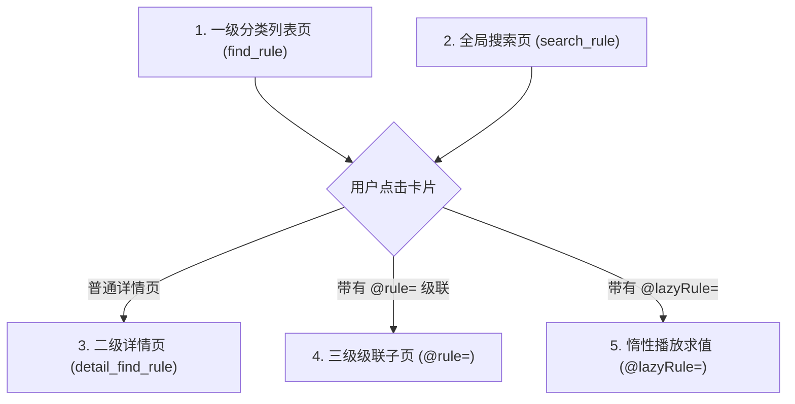

# 海阔视界 (HikerView) 双端同构函数字典与页面生命周期全景手册 (API & Page Lifecycle Specification)

> **核心原则**：海阔视界是一套基于**卡片数据流驱动 (Card-Driven Architecture)** 的轻量级脱机运行时。
> 掌握海阔视界在 Android 原生端（Rhino/QuickJS）与 PC 桌面端（Node.js/V8）的**页面生命周期、变量注入规则、原生布局 `col_type` 与内置函数字典**，是杜绝代码报错、白屏卡死与界面错位的根本前提。

---

## 一、五大页面模型与生命周期 (Page Lifecycles & Contexts)

海阔视界共有五种核心求值阶段，每一阶段注入的上下文变量和执行时机截然不同：



### 1. 一级页面 (Home / Channel Page)
- **对应规则字段**：`url` + `find_rule`
- **触发场景**：用户打开小程序、切换顶部分类频道 Tab、下拉刷新或触底加载下一页。
- **上下文注入变量**：
  - `MY_URL`（String）：当前频道请求的完整 URL（已将 `fyclass`、`fypage` 完成动态替换）。
  - `MY_PAGE`（String / Number）：当前页码，首屏默认为 `1`，翻页时递增为 `2, 3...`。
  - `MY_CATE`（String）：当前选中的分类参数（由 `class_url` 映射）。
  - `MY_RULE`（Object）：当前规则的完整元数据对象。
  - ⚠️ **红线警示**：移动端 Rhino 原生环境在 `find_rule` 中**未注入 `input` 变量**！必须使用 `var currentUrl = (typeof MY_URL !== 'undefined' && MY_URL) ? MY_URL : (typeof input !== 'undefined' ? input : '');` 垫片！
- **返回契约**：必须调用 `setResult(d)`，其中 `d` 为包含卡片对象的数组。

### 2. 搜索页面 (Search Page)
- **对应规则字段**：`search_url` + `search_rule`
- **触发场景**：用户在全局搜索栏输入关键词后按回车提交。
- **上下文注入变量**：
  - `MY_URL`（String）：已将 `**` 替换为经过 URL 编码的关键字地址。
  - `KEY`（String）：用户输入的原始搜索词。
  - `MY_PAGE`（String / Number）：搜索分页页码。
- **返回契约**：必须调用 `setResult(d)`。

### 3. 二级详情页 (Detail Page)
- **对应规则字段**：`detail_col_type` + `detail_find_rule`
- **触发场景**：用户在列表或搜索结果中点击某个卡片后，移动端海阔视界启动全新的 `DetailActivity` 页面容器。
- **上下文注入变量**：
  - `MY_URL`（String）：所点击卡片的 `url` 属性。
  - `MY_PAGE`（String / Number）：默认为 `1`。
- **返回契约**：
  - 必须调用 `setResult(d)`。
  - **首张卡片铁律**：必须输出带有 `title: '剧名：' + name` 的 `pic_1_card`，注入剧名契约上下文！

### 4. 三级/多级级联路由页 (Cascade Page)
- **触发语法**：卡片的 `url` 携带 `@rule=` 语法：`routeUrl + '@rule=' + nextTierRule`。
- **运作机理**：截取 `@rule=` 前面的部分作为新页面的目标 URL，后面的脚本作为该页面的渲染规则，压栈启动全新页面。
- **返回契约**：在新页面脚本末尾调用 `setResult(d)`。

### 5. 选集惰性解析求值 (@lazyRule= Evaluation)
- **触发语法**：分集条目采用 `playUrl + '@lazyRule=.js:(() => { return ...; })()'`。
- **触发场景**：用户在选集列表中点击某一具体集数时按需执行，杜绝预先解析被封 IP。
- **上下文注入变量**：
  - `input`（String）：海阔视界**正式注入了 `input` 变量**，其值为 `@lazyRule=` 前面的地址！
- **返回契约**：必须 `return playUrl`（支持返回附带防盗链注解的流媒体地址）。

---

## 二、海阔视界原生排版类型字典 (`col_type` Reference)

海阔视界通过卡片对象的 `col_type` 字段控制界面视觉渲染，双端 100% 深度支持：

| `col_type` 布局标识 | 视觉形态与宽高比 | 核心属性要求 | 最佳使用场景 |
|---|---|---|---|
| `movie_3` | 三列竖版海报网格 (3:4) | `title`, `pic_url`, `desc`, `url` | 电影、电视剧、动漫首页列表推荐 |
| `movie_2` | 双列竖版大卡片瀑布流 | `title`, `pic_url`, `desc`, `url` | 小红书社区、微短剧、抖音快手双列 |
| `movie_1_vertical_pic` | 单列宽幅海报卡片 (大封面+多行文字) | `title`, `pic_url`, `desc`, `url` | 详情页头部、精选专栏 |
| `pic_1_card` | 顶部大卡片 (承载剧名契约) | `title: '剧名：' + cleanTitle`, `pic_url`, `desc`, `url` | 二级详情页首张卡片 (防止播放历史退化) |
| `pic_1_full` | 全屏满宽大图 (宽度 100%，自适应高) | `title`, `pic_url`, `url: pic_url` | 漫画阅读、图集瀑布流、小红书原图连续阅览 |
| `pic_3` | 三列正方形九宫格相册 | `title`, `pic_url`, `url` | 朋友圈相册、商品多图 |
| `text_1` | 单行通栏大标题 / 分割栏 | `title`, `col_type: 'text_1'` | 线路切换标题（如“【蓝光专线】”）、正文说明 |
| `text_2` | 双列中型按钮 | `title`, `desc`, `url` | 线路选择、多季分栏选择 (第1季、第2季) |
| `text_3` | 三列方块按钮 | `title`, `url` (带 `@lazyRule=`) | 电视剧、动漫标准选集 (第01集、第02集) |
| `text_4` | 四列紧凑型小按钮 | `title`, `url` (带 `@lazyRule=`) | 80+ 集超长短剧平铺排布 |
| `flex_button` | 自适应宽度流式胶囊按钮 | `title`, `url` | 分类快速标签、热搜词、追问快捷动作 |
| `rich_text` | 富文本/气泡卡片 | `title`, `desc` (支持换行与样式) | AI 视界副驾对话气泡、系统公告 |

---

## 三、海阔视界内置同构函数 API 全集 (Isomorphic API Reference)

移动端 Rhino/QuickJS 与 PC 桌面端 V8 均原生支持的标准内置函数：

### 1. 网络请求类
- **`request(url, options)`**：
  - 同步阻塞 HTTP 请求；
  - `options` 参数字典：
    ```javascript
    {
      method: 'GET' | 'POST',
      headers: { 'User-Agent': '...', 'Referer': '...', 'Cookie': '...' },
      body: '...', // POST 请求体 (String)
      timeout: 10000 // 超时毫秒
    }
    ```
  - 返回值：HTTP 响应体字符串文本。
- **`post(url, options)`**：
  - POST 请求快捷方法，同 `request(url, { ...options, method: 'POST' })`。
- **`fetch(url, options)`**：
  - 部分旧版移动端海阔视界的别名方法，双端同构开发时优先推荐使用 `request()`。

### 2. DOM / CSS 选择器类 (MyJsoup / Cheerio)
- **`pdfa(html, selector)`**：
  - 提取符合 CSS 选择器的所有 DOM 节点，返回包含 HTML 片段的字符串数组 `string[]`；
  - ⚠️ **死刑铁律**：严禁在 `selector` 中使用英文逗号 `,`！
- **`pdfh(html, selector)`**：
  - 提取单个节点的属性值或文本内容；
  - 常用提取语法：
    - `".title&&Text"`：提取文本（自动剔除内部 HTML 标签）；
    - `"a&&href"`：提取 href 属性；
    - `"img&&src"` 或 `"img&&data-original"`：提取图片链接；
    - `".content&&Html"`：提取内联原始 HTML。
- **`pd(html, selector, baseUrl)`**：
  - 提取属性并根据 `baseUrl` 自动转换为绝对路径（免手写 URL 拼接）。

### 3. 本地键值持久化存储 (Storage)
- **`setItem(key, value)`**：持久化写入数据（String），双端本地独立加密存储。
- **`getItem(key, defaultValue)`**：读取持久化存储，若不存在则返回 `defaultValue`。
- **`clearItem(key)`**：删除指定 Key 的存储数据。

### 4. 驱动与结果呈现
- **`setResult(items)`**：
  - 海阔核心卡片驱动入口；
  - `items` 必须是包含上述 `col_type` 规范对象的数组；
  - 严禁直接 return 数组，必须通过 `setResult(items)` 驱动渲染。

### 5. 交互与状态反馈
- **`toast(message)`**：在屏幕底部弹出提示气泡。
- **`showLoading(text)`** / **`hideLoading()`**：唤起或关闭加载指示器。
