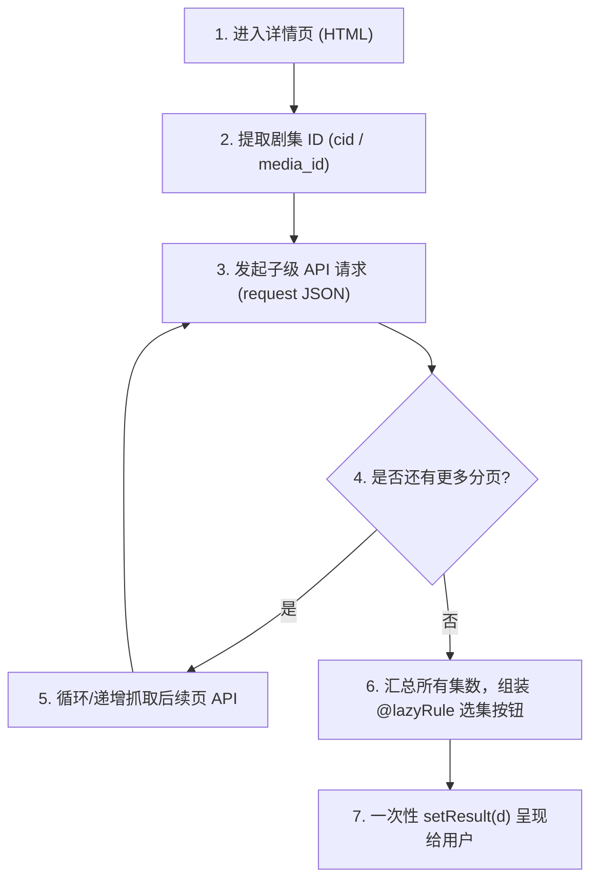

# 海阔视界多层级级联与深度穿透技术规范 (Multi-Tier Traversal Specification)

> **核心宗旨**：影视聚合站、正版大厂与多线路资源站的数据结构往往不是简单的“列表 -> 详情直接出选集”，而是呈现多层级级联（Multi-Tier Navigation）与异步子接口深潜特性。
> 本规范指导开发者与 AI 构建具备**深度穿透能力**的双端同构规则。

---

## 一、两大多层级架构模式体系

在海阔视界中，处理多层级数据有两种标准解法，取决于目标站点的业务形态与用户体验诉求：

| 模式 | 适用场景 | 交互体验 | 技术机制 |
|---|---|---|---|
| **模式 A：显式 UI 级联路由**<br>(Explicit UI Cascade) | 多季/多版本切换（如第1季、第2季、加长版）；<br>多播放线路（如蓝光专线、备用专线）；<br>超长剧集分段（如 1-50 集、51-100 集）。 | 用户在详情页看到“季/线路”卡片，点击后**平滑压栈跳转至下一级选集页**。 | 基于海阔原生 `@rule=` 级联协议 |
| **模式 B：代码层深度异步穿透**<br>(Deep Async Traversal) | 详情页 HTML 仅有封面和简介，真实剧集藏在异步 JSON API 中；<br>剧集需要二次分页合并（如首屏仅 10 集，需拉取全部 40 集）。 | 用户进入详情页后，**一次性看到完整选集**，无需额外点击换页。 | 在 `detail_find_rule` 内部根据主剧 ID 自动发起子级 `request` 并合并 |
| **模式 C：混合级联**<br>(Hybrid Traversal) | 模式 A + 模式 B 组合：详情页展示多线路，点击某线路后，下潜页面再异步拉取该线路的选集。 | 结构清晰，加载极快，抗改版能力最强。 | `@rule=` 路由 + 子请求合并 |

---

## 二、模式 A：海阔标准 `@rule=` 级联路由协议

### 1. 源码运作机理（Android 原生 `ArticleListFragment.java`）

```java
// 查阅 ArticleListFragment.java:1376-1397
String[] urlRule = url.split("@rule=");
if (urlRule.length > 1) {
    String r = StringUtil.arrayToString(urlRule, 1, "@rule=");
    String nextRule = r.split("==>")[0];
    // 启动新页面，并将 @rule= 后的脚本作为下游页面的解析规则！
    dealRule(articleListRule, urlRule[0], codeAndHeader, nextRule, colType, title, position);
    return;
}
```

- **解析逻辑**：只要卡片的 `url` 包含 `@rule=`，海阔视界（移动端与 PC 端）就会截取 `@rule=` 前面的部分作为新页面的目标 URL，将 `@rule=` 后面的部分作为该页面的渲染规则，压入导航栈打开新页面！
- **支持无限级联**：甚至在新页面的结果中，某个卡片的 `url` 依然可以携带 `@rule=`，支持无限向下钻取。

### 2. 标准写法规范

在详情页 `detail_find_rule` 中输出季/线路列表：

```javascript
// 详情页首项：必须注入父剧名（见铁律 5）
d.push({
    title: '剧名：' + seriesTitle,
    desc: intro,
    pic_url: cover,
    url: currentUrl,
    col_type: 'pic_1_card'
});

// 分割线/提示：多季或多线路选择
d.push({
    title: '请选择播放线路或分季：',
    col_type: 'text_1'
});

// 输出多线路/多季卡片，利用 @rule= 下潜到三级选集页
routes.forEach(function(route) {
    // 下游解析规则 (Next-Tier Rule)，可采用 .js: 自执行函数
    var nextRule = '.js:(' + function(parentTitle) {
        var d = [];
        var currentUrl = (typeof MY_URL !== 'undefined' && MY_URL) ? MY_URL : (typeof input !== 'undefined' ? input : '');
        
        // 三级页面首项：必须继续保持父剧名！
        d.push({
            title: '剧名：' + parentTitle,
            desc: '当前线路：' + routeName,
            url: currentUrl,
            col_type: 'text_1'
        });

        // 抓取该线路下的真实分集
        var html = request(currentUrl);
        var episodes = pdfa(html, '.playlist&&a');
        episodes.forEach(function(ep) {
            var epTitle = pdfh(ep, 'a&&Text');
            var epUrl = pd(ep, 'a&&href', currentUrl);
            d.push({
                title: epTitle,
                url: epUrl + '@lazyRule=.js:(() => { return input + ";{Referer@' + currentUrl + '&&User-Agent@PC}"; })()',
                col_type: 'text_3'
            });
        });
        setResult(d);
    }.toString() + ')(' + JSON.stringify(seriesTitle) + ')';

    d.push({
        title: route.name,
        desc: route.tip || '点击进入选集',
        pic_url: route.icon || '',
        url: route.url + '@rule=' + nextRule,
        col_type: 'text_2'
    });
});
```

> [!IMPORTANT]
> **多层级剧名贯穿守卫 (Series Name Propagation)**：
> 凡是使用 `@rule=` 下潜的新页面，**新页面的第一条卡片必须依然输出 `title: '剧名：' + parentTitle`**！
> 否则用户在三级选集页点击分集时，播放器历史足迹将抓取不到父剧名，而把线路名（如“蓝光专线”）误识别为电视剧名称。

---

## 三、模式 B：代码层深度异步穿透（Deep Async Traversal）

很多现代视频平台（如腾讯、B站、各类爱优腾聚合解析站）其详情页 HTML 极度精简，分集数据存放在独立的 JSON 接口中，甚至分多页拉取。

### 1. 架构逻辑流程



### 2. 标准实战代码模式（以腾讯/爱奇艺类 API 穿透为例）

```javascript
js:
var d = [];
var currentUrl = (typeof MY_URL !== 'undefined' && MY_URL) ? MY_URL : (typeof input !== 'undefined' ? input : '');

// 1. 提取主剧唯一 ID（例如从 URL 提取 cid）
var cidMatch = currentUrl.match(/\/cover\/([a-zA-Z0-9]+)/);
var cid = cidMatch ? cidMatch[1] : '';

// 2. 先请求一次页面主元数据
var html = request(currentUrl);
var seriesTitle = pdfh(html, '.video_title&&Text') || '影视详情';
var intro = pdfh(html, '.video_desc&&Text') || '';
var cover = pdfh(html, '.video_cover img&&src') || '';

// 详情页首项：注入大剧名
d.push({
    title: '剧名：' + seriesTitle,
    desc: intro,
    pic_url: cover,
    url: currentUrl,
    col_type: 'pic_1_card'
});

d.push({
    title: '播放列表：',
    col_type: 'text_1'
});

// 3. 深度穿透：异步调独立的分集接口获取完整剧集（处理分页）
if (cid) {
    var page = 1;
    var hasMore = true;
    var totalEpisodes = 0;
    
    // 最多穿透抓取 5 页（防止极端死循环）
    while (hasMore && page <= 5) {
        var apiUrl = 'https://api.example.com/vsite/episodes?cid=' + cid + '&page=' + page + '&page_size=30';
        try {
            var jsonResp = JSON.parse(request(apiUrl, { headers: { 'User-Agent': 'PC' } }));
            var list = jsonResp.data && jsonResp.data.list ? jsonResp.data.list : [];
            
            if (list.length === 0) {
                hasMore = false;
                break;
            }
            
            list.forEach(function(item) {
                totalEpisodes++;
                var epTitle = item.title || ('第' + totalEpisodes + '集');
                var epUrl = item.play_url;
                
                d.push({
                    title: epTitle,
                    url: epUrl + '@lazyRule=.js:(() => { return input + ";{Referer@https://v.qq.com/&&User-Agent@PC}"; })()',
                    col_type: 'text_3'
                });
            });
            
            // 判断是否已到最后一页
            hasMore = jsonResp.data.has_next === true;
            page++;
        } catch (e) {
            hasMore = false;
        }
    }
}

setResult(d);
```

---

## 四、模式 C：大跨度分段集数卡片（如海贼王 1000+ 集）

对于集数超过 100 集的长篇动漫或短剧，若全部平铺在单一页面会导致手机海阔视界卡顿或渲染白屏。此时应采用**分段折叠路由**：

```javascript
// 在详情页输出分段按钮：
var totalCount = 1050; // 假设共 1050 集
var pageSize = 50;

d.push({ title: '分集选段：', col_type: 'text_1' });

for (var i = 0; i < totalCount; i += pageSize) {
    var start = i + 1;
    var end = Math.min(i + pageSize, totalCount);
    var rangeTitle = '第 ' + start + ' - ' + end + ' 集';
    
    // 点击该卡片进入对应分段的选集列表
    var nextRule = '.js:(' + function(cid, startEp, endEp, parentTitle) {
        var d = [];
        d.push({
            title: '剧名：' + parentTitle,
            desc: '当前范围：第 ' + startEp + ' - ' + endEp + ' 集',
            col_type: 'text_1'
        });
        
        var apiUrl = 'https://api.example.com/episodes?cid=' + cid + '&offset=' + (startEp - 1) + '&limit=' + (endEp - startEp + 1);
        var json = JSON.parse(request(apiUrl));
        json.items.forEach(function(item) {
            d.push({
                title: item.name,
                url: item.url + '@lazyRule=.js:(() => { return input; })()',
                col_type: 'text_3'
            });
        });
        setResult(d);
    }.toString() + ')(' + JSON.stringify(cid) + ', ' + start + ', ' + end + ', ' + JSON.stringify(seriesTitle) + ')';
    
    d.push({
        title: rangeTitle,
        url: currentUrl + '#range=' + start + '@rule=' + nextRule,
        col_type: 'text_3'
    });
}
```

---

## 五、多层级开发四大避坑铁律

1. **绝对禁止在深层页面丢失父剧名**：
   每一层级（Level 2, Level 3, Level 4）的顶层卡片，必须带上 `title: '剧名：' + seriesTitle`。
2. **绝对分清 `@rule=` 与 `@lazyRule=`**：
   - `@rule=`：**页面导航压栈**，用于打开新层级页面（如进入第2季、进入线路2、进入分段选集）；
   - `@lazyRule=`：**选集求值播放**，用于分集点击后返回真实的播放 URL。
   - 严禁在选集上写 `@rule=`，也严禁在线路切换卡片上写 `@lazyRule=`！
3. **深层子请求必须加异常防护与限流**：
   在 `while` 或 `forEach` 中做异步穿透抓取时，必须设置最大循环安全边界（如 `maxPages = 5`），并用 `try...catch` 包裹单次网络请求，防止某个子页超时导致整个详情页崩溃白屏。
4. **防盗链标头全链路穿透**：
   深层页面中生成的视频播放地址与封面图片，依然必须附带 `;{Referer@...&&User-Agent@PC}` 防盗链注解！
