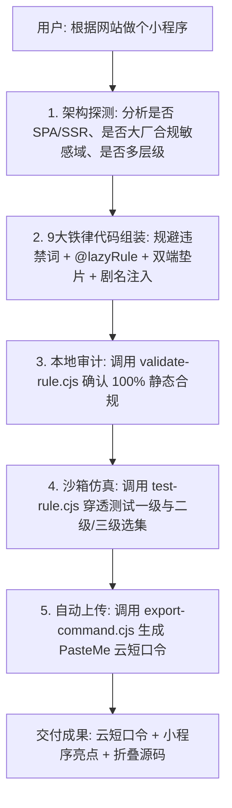

# 快速通过 AI 生成双端海阔规则/小程序手册 (Prompt & Autonomous Playbook)

> **核心原则**：**用户极简，AI 自治**。
> 用户通常只发一个目标网址或一句简明需求，AI 必须自动在幕后遵循 9 大工程铁律，完成分析、规约注入、沙箱测试并生成云短口令。

---

## 一、真实用户的高频极简输入范式

用户在使用时，只需使用任意一句最自然的口语，无需输入任何繁琐的工程参数：

### 1. 经典极简提问（单句 + URL）
```text
根据这个网站帮我生成一个小程序：https://v.qq.com/
```
或
```text
帮我把这个网站做成海阔规则：https://xxx.com/
```
或直接发链接：
```text
https://xxx.com/
```

### 2. 带有轻量偏好的提问
```text
帮我把这个漫画站做成小程序，支持连续滚动瀑布流：https://manga.example.com
```
或
```text
这个影视站有多条播放线路，帮我做成支持线路切换的海阔小程序：https://vod.example.com
```

---

## 二、AI 接收极简需求后的自治执行基准 (Autonomous Contract)

当 AI 接收到上述极简输入时，**严禁要求用户提供工程细节**，内部必须自动启动以下标准化流水线：



---

## 三、AI 标准化最终交付格式 (Standard Delivery)

AI 自治运行完毕后，必须以对用户最友好、最清爽的结构交付：

````markdown
### 📱 视界小程序 / 海阔规则已生成就绪！

#### 1. 一键导入口令 (手机端海阔视界)
复制下方口令后，打开手机端海阔视界，即可自动弹出导入窗口安装：
```text
云6oooole/xxxxxx/xxxxxx
```

#### 2. 在线分享与直达查看
- 网页直达: `https://pasteme.tyrantg.com/xxxxxx`

#### 3. 小程序核心特性
- **双端同构脱机运行**：完美支持 Android 原生海阔视界与 DeepCloud PC 桌面端；
- **多层级剧集深度穿透**：已适配多季、多播放线路与分页全集拉取；
- **防盗链与播放守卫**：全链路注入 Referer 标头与 `@lazyRule=` 惰性按需解析，杜绝批量风控。

<details>
<summary><b>点击展开查看规则完整源码 (JSON)</b></summary>

```json
{
  "title": "...",
  ...
}
```
</details>
````
