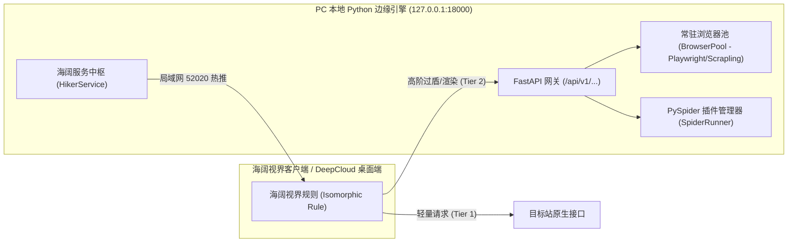

# PC 独有 Python 爬虫引擎与海阔规则协同架构规范 (Python Engine Synergy Specification)

> **核心宗旨**：DeepCloud PC 桌面端拥有全栈 Python 边缘爬虫引擎（`scraper-service`，监听 `127.0.0.1:18000`）。
> 本规范定义海阔规则与 PC 端 Python 爬虫引擎的**端机协同分级加速架构**，解决纯移动端 JS 在面对重度反爬、滑块风控与客户端水合（SPA）时的算力短板。

---

## 一、PC 端 Python 爬虫引擎的核心能力拓扑

DeepCloud PC 桌面端内嵌单文件 Python 爬虫引擎（`deepcloud-engine.exe`），暴露本地环回接口与局域网服务：



### 引擎四大王牌能力：
1. **常驻无头浏览器池 (`fetcher.py / BrowserPool`)**：
   - `static`：基于高性能异步网络库，毫秒级抓取；
   - `dynamic`：基于 Playwright / Scrapling 常驻 Chromium 内核，自动执行复杂 JS、完成 SPA 客户端水合渲染；
   - `stealthy`：真实指纹伪装，过 Cloudflare 5秒盾、Akamai 与风控滑块验证。
2. **多源聚合与 MacCMS 协议适配 (`pyspider.py / spider_runner.py`)**：
   - 兼容成熟的 Python 爬虫插件源；
   - 提供 `/api.php/provide/vod?spider=...` 标准接口，秒级输出海阔兼容数据。
3. **局域网 52020 端口极速热推 (`hiker_service.py`)**：
   - 自动扫描局域网内的海阔设备（手机或电脑），直接调用 `/saveRule` 将规则静默存入客户端 SQLite 数据库，免扫码、免复制口令！
4. **动态微内核热更 (`copilot_core.js`)**：
   - 规则客户端仅需一行 eval 引导代码，核心解析逻辑由本地 Python 服务实时分发，0 安装永久在线热更。

---

## 二、三阶端机协同加速梯队 (Engine Acceleration Ladder)

在编写海阔规则时，必须采用**自愈感知三阶梯队**，兼顾“手机脱机轻量”与“电脑端重型算力”：

| 梯度 | 运行环境 | 适用场景 | 实现逻辑 |
|---|---|---|---|
| **Tier 1：轻量同构模式**<br>(Lightweight Isomorphic) | 双端脱机运行<br>(移动端 + PC 端) | 公开、防爬弱、免密、小程序/移动端 REST API 站点。 | 纯 JS 编写，基于 `request(url, options)` 直接请求，毫秒级响应，零依赖。 |
| **Tier 2：PC 本地引擎加速模式**<br>(Engine-Assisted Mode) | PC 桌面端运行<br>(或局域网打通) | 目标站有高防风控（如小红书详情 302 重定向、反爬滑块、SPA 纯动态渲染）。 | 规则在 JS 中自动探测本地 `127.0.0.1:18000`。若在线，将复杂任务交由本地 Python 引擎的 `dynamic/stealthy` 模式解析；若不在线，优雅降级走 Tier 1。 |
| **Tier 3：全源 PySpider 沉淀模式**<br>(Full PySpider Pipeline) | 企业级/深度逆向 | 具有复杂加密签名 (如 Wbi、SO 逆向签名、需本地持久化 Cookie 池) 的站点。 | 编写 `scraper-service` 对应的 Python 爬虫类 (`SpiderRunner`)，由 PC 引擎全托管调度，通过本地 Hiker API 统一向海阔视界输出。 |

---

## 三、Tier 2 代码范式：规则内动态引擎探测与协同

海阔规则 JS 中如何优雅地利用 PC 本地 Python 爬虫引擎：

```javascript
js:
var d = [];
var currentUrl = (typeof MY_URL !== 'undefined' && MY_URL) ? MY_URL : (typeof input !== 'undefined' ? input : '');

// 1. 本地 Python 爬虫引擎服务地址 (PC 桌面端默认运行在 18000)
var localEngine = 'http://127.0.0.1:18000';

// 2. 检查 PC 本地爬虫引擎是否在线 (带短超时探测)
var isEngineOnline = false;
try {
    var ping = request(localEngine + '/api/v1/datasources', { timeout: 800 });
    if (ping && ping.indexOf('code') > -1) {
        isEngineOnline = true;
    }
} catch(e) {
    isEngineOnline = false;
}

// 3. 智能分支调度
if (isEngineOnline) {
    // 【PC 端算力加持】：调用本地 Python 引擎的动态浏览器池进行免风控无头渲染
    var scrapeReq = post(localEngine + '/api/v1/scrape', {
        headers: { 'Content-Type': 'application/json' },
        body: JSON.stringify({
            url: currentUrl,
            mode: 'stealthy', // 使用隐身反爬模式
            timeout: 10000
        })
    });
    var res = JSON.parse(scrapeReq || '{}');
    var html = res.data ? res.data.content : '';
    // 解析经过 Python 引擎渲染后的完备 DOM / JSON
    parseContent(html);
} else {
    // 【移动端纯脱机降级】：走轻量移动端 H5 / 小程序 API
    var fallbackUrl = getMobileApiUrl(currentUrl);
    var html = request(fallbackUrl, {
        headers: { 'User-Agent': 'Mozilla/5.0 (iPhone; CPU iPhone OS 16_6 like Mac OS X)' }
    });
    parseContent(html);
}

function parseContent(content) {
    // 统一的双端渲染逻辑
    ...
    setResult(d);
}
```

---

## 四、局域网 52020 端口极速推送协议

除了生成 PasteMe 在线云短口令，如果用户电脑正与手机处于同一 WiFi，可直接调用本地 Python 引擎的局域网推送 API：

```bash
# 调用本地 scraper-service 向手机海阔视界静默注入规则
curl -X POST http://127.0.0.1:18000/api/v1/hiker/push \
  -H "Content-Type: application/json" \
  -d '{"rule_type": "spider", "rule_title": "小红书 (双端同构极速版)"}'
```

- 手机端海阔视界在开启状态下，本地引擎会自动扫描 `52020` 端口并调用 `/saveRule`；
- **用户无需在手机端复制口令或扫码**，手机海阔视界列表瞬间出现新规则！
