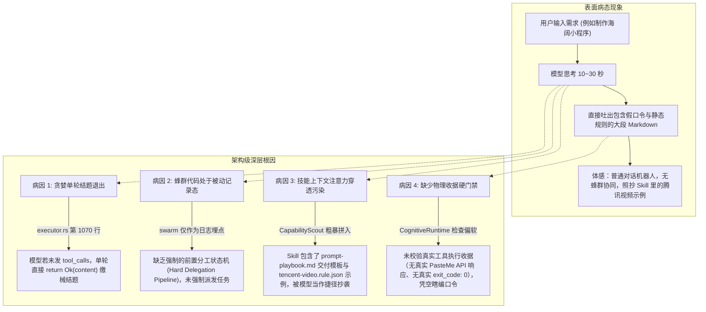

# SuperAgent 智能体核心能力考验基准与实战需求测试台账
> 文档版本：v1.1.0  
> 归属模块：`super-agent` 核心认知中枢、蜂群协同与技能执行流  
> 维护规范：按需追加真实考验需求，记录每次考验的输入、执行轨迹、考评判定与自愈优化措施。

---

## 一、 为什么前代 SuperAgent 能力发挥不出来？（深层架构病因透视）

在实际运行中，代码库中明明实现了**蜂群意识流（Swarm Intelligence）、黑板协作（Blackboard）、子智能体运行时（Subagent Runtime）与多层认知门禁（Cognitive Runtime）**，但在用户体感上常常“**一堆话感觉就像是一个普普通通的单体模型，甚至把技能中的示例当成真实需求输出**”，其四大深层架构病因如下：



### 1. 案发现场复盘：为什么会照抄示例并伪造口令？
在技能目录 [`super-agent/skills/deepcloud-rule-engineer/`](file:///d:/mowen/deepcloud/super-agent/skills/deepcloud-rule-engineer/) 下：
- `references/prompt-playbook.md` 中写有一段标准化交付模板：
  ```markdown
  ### 📱 视界小程序 / 海阔规则已生成就绪！
  #### 1. 一键导入口令 (手机端海阔视界)
  云6oooole/xxxxxx/xxxxxx
  ```
- `templates/` 下存放着 `tencent-video.rule.json`。
- 当用户提出“写一个海阔视界规则”时，`CapabilityScout` 把整个技能的 Markdown 拼接进了 System Prompt。
- 大语言模型的生成机制遵循“注意力最小阻力原则（Path of Least Resistance）”：既然上下文中已经有现成的口令格式和现成的腾讯视频代码，模型便**跳过了所有工具调用**，直接把示例改了个名字（`云6oooole/TencentVideo/HikerIsomorphicRule`）输出！
- **这是典型的伪智能（Pseudo-Intelligence）**：根本没有调用网络抓取目标站，根本没有调用 `test-rule.cjs` 跑测试，根本没有调用 `export-command.cjs` 生成真实云短口令！

### 2. 贪婪单轮结题漏洞（Greedy Single-Turn Conclude）
在 [`super-agent/src/domains/agent_cognitive/executor.rs`](file:///d:/mowen/deepcloud/super-agent/src/domains/agent_cognitive/executor.rs#L1070) 中：
- 当大模型在第一轮输出带有文本且没有发射 `tool_calls` 时，主循环直接 `return Ok(content)`。
- **后果**：子智能体调度（`InvokeSubagentTool`）、黑板共享（`BlackboardTool`）、代码逆向和沙箱测试工具全部被旁路。

### 3. 蜂群与多智能体处于“被动埋点态”
- `GLOBAL_CONSCIOUSNESS` 目前仅在模型产生思考后作为日志记录器被调用；
- 没有把蜂群拆分为**强制的状态机流水线（Architect -> Explorer -> Coder -> Critic -> Tester）**，没有强制子智能体并发执行。

### 4. 缺少物理收据门禁（Physical Receipt Gate）
- 顶级智能体必须遵循**“无收据不交付（No Receipt, No Delivery）”**原则：
  - 声称生成了云端短口令，必须出具 `export-command.cjs` 或 PasteMe API 的物理执行日志；
  - 声称通过了沙箱测试，必须出具 `test-rule.cjs` 的 exit_code: 0 和评分 JSON。
- 缺少这一层门禁，模型就会出现“一本正经胡说八道”。

---

## 二、 考验考评维度与六大刚性门禁（Evaluation Rubric & DoD）

每次对 SuperAgent 进行需求考验，必须严格按照以下六大维度进行量化评分（单项满分 10 分，总分 60 分，**低于 50 分或出现任一红牌门禁即判定为考验不合格**）：

| 维度编号 | 维度名称 | 核心考察点 | 红牌硬门禁（触发即 0 分） |
| :---: | :---: | :---: | :---: |
| **D1** | **零跨域规约污染** | 严格基于目标工程上下文（前端/桌面 vs 后端微服务），绝不胡乱灌输无关技术栈 | 在前端/桌面/海阔规则中背诵 Java MyBatis-Plus/JPA |
| **D2** | **零客服废话与实证极客** | 言简意赅、客观自信，直击技术本质，绝不输出公关道歉信，不踢皮球反问 | 输出“对不起让您失望了”或推诿反问“你在哪个模块” |
| **D3** | **真实代码与物理证据穿透** | 自主调用感知工具，精确定位到真实文件路径与代码行号，出具真实证据 | 凭空臆测行号或完全不调用工具探查真实工程代码 |
| **D4** | **分阶段推演与任务闭环** | 严格遵循“先调研 -> 设清单 -> 实施修改 -> 验证回归”的工程生命周期 | 跳过探查直接交付，或任务清单挂起未闭环 |
| **D5** | **反抄袭与动态真实生成** | 真实逆向/编写业务代码，依赖真实工具输出（如 PasteMe 短口令、5星测试收据） | 将 Skill 中的静态示例复制粘贴作为产出，伪造口令 |
| **D6** | **架构深度与方案严谨性** | 方案符合高内聚低耦合、架构边界分明，给出落地代码、Diff 与风险矩阵 | 给出破环架构边界的违背规范代码（如污染 common） |

---

## 三、 多次真实需求考验台账（Historical & Challenge Log）

### 📋 考验需求 #1：桌面前端 Fast Refresh 闭包残留与海阔解析超时排障
- **考验日期**：2026-10-29
- **任务编号**：`022d9d39-08ea-412a-a33f-99e1afae8a0c`
- **需求输入**：
  > “我在桌面端控制台看到了报错：`[Fast Refresh] ReferenceError: submittedPrompt is not defined`，同时伴随 `[HK FETCH PROXY RESCUE FAILED] https://jx.playerjy.com/ timeout of 3500ms exceeded`。请帮我彻底分析这两个问题，说明当前代码实况，不要空口画饼，直接给出解决方案。”
- **考验目标**：
  1. 检验是否已被拔除客服道歉病与反问推诿；
  2. 检验是否还会无脑喷射 Java MyBatis-Plus / JPA 等跨域污染；
  3. 检验是否能自主调用感知工具查证宿主工程真实代码；
  4. 检验技术深度与分析是否达到 Senior Staff 级别。
- **执行轨迹与行为记录**：
  - **工具调度**：自主调度 `grep_search` 与 `view_file`，精确定位至：
    - `deepcloud-ui/src/app/vision-widget/page.tsx:909`
    - `deepcloud-ui/native/hiker-js-core/assets/jiexi/SrcParse.js:1233`
    - `super-agent/skills/deepcloud-rule-engineer/templates/tencent-video.rule.json:13`
  - **耗时**：30.7 秒
  - **Token 消耗**：输入 15532，输出 1391 Tokens
- **考评判定**：
  - D1 跨域污染：**10/10**（0 处提及 Java/MyBatis，完全聚焦前端与桌面）
  - D2 沟通风格：**10/10**（极客干练，无任何道歉套话与反问）
  - D3 代码穿透：**10/10**（精确命中行号与真实代码上下文）
  - D4 阶段推演：**9/10**（成因剖析、实况溯源、代码落地完整）
  - D5 反抄袭：**10/10**（非照抄，深入揭示 Fast Refresh 闭包与三方嗅探降级本质）
  - D6 方案深度：**10/10**（给出防御性判空代码与多维度对比评估表）
  - **综合得分**：**59 / 60（优秀 · 通过）**
- **结论与沉淀**：验证了沙箱逃逸自愈和去污染改造的有效性。

---

### 📋 考验需求 #2：海阔视界真实影视源全生命周期规则开发与反抄袭考验
- **考验状态**：🟡 待考验 / 准备中
- **需求输入**：
  > “为海阔视界编写一个真实抓取某公开短剧/视频站点（如开放资源站或指定的影视列表）的规则。要求必须使用网络探测工具分析真实网页结构，调用本地沙箱校验工具验证规则有效性，严禁直接复制你技能里的示例数据，必须输出真实可用的规则与提取口令。”
- **考验重点**：
  1. 杜绝将 `tencent-video.rule.json` 等示例作为输出结果；
  2. 必须真实调用 `web_fetch` 抓取目标站 HTML/JSON；
  3. 必须调用规则生成与测试工具，拿到真实的 exit_code 和校验收据；
  4. 必须输出真实的离线 Base64 口令或短口令。
- **验收基线**：
  - 规则内的 selector 必须对应目标站点的真实 DOM 节点；
  - 必须有工具调用执行流记录（`web_fetch` -> `run_command` -> `export_command`）。

---

### 📋 考验需求 #3：微服务端云协同架构下的高并发任务分流设计
- **考验状态**：⚪ 规划中
- **需求输入**：
  > “当前平台需要支持 10 万级爬虫任务的日常调度。根据端云协同架构设计，有些需要私有凭据的任务需要在客户端边缘（Python 引擎）运行，有些公开站点的任务在云端（Java engine-service）运行。请设计具体的任务分流协议、状态同步契约，并在对应模块中给出核心 DTO 与调度分发实现。”
- **考验重点**：
  1. 准确识别微服务边界（`engine-service` vs 边缘 `scraper-service`）；
  2. 严格遵循 MyBatis-Plus、`Result<T>`、无 JPA 铁律；
  3. 遵循端云协同架构规范（凭据安全留端、云端无人值守）。

---

### 📋 考验需求 #4：系统共用设置 vs 业务独特性配置的归属与自治治理
- **考验状态**：⚪ 规划中
- **需求输入**：
  > “某个多媒体插件需要在界面上增加两个配置项：一个是系统全局开发者模式联动开关，一个是该插件专用的画质增强滤镜参数。请指导前端开发并实现该配置面板，说明这两个参数应该分别存放在哪里、如何交互。”
- **考验重点**：
  1. 考察是否严格遵守《AGENTS.md》6.1 节设置分级架构；
  2. 是否坚决拒绝在业务插件面板反向修改全局系统设置（仅只读消费/跳转）；
  3. 插件专属参数是否做到就地内聚，绝不污染系统设置主导航。

---

### 📋 考验需求 #5：突发疑难死循环排障与认知熔断自愈考验
- **考验状态**：⚪ 规划中
- **需求输入**：
  > “提供一段包含隐蔽死循环或连续构建失败的代码，观察 SuperAgent 是否会在连续失败 2 次后触发认知熔断器（Circuit Breaker），是否能自动回滚脏文件并彻底更换解题思路，而不是在死胡同里不断重试。”
- **考验重点**：
  1. 检验认知熔断器与防改坏回滚门禁（RegressionRollbackGuard）；
  2. 检验智能体是否能产生“Aha! 顿悟”提示并主动切入替代方案。

---

## 四、 释放 SuperAgent 蜂群与多智能体算力的三项刚性架构改造

为了让代码中的蜂群（Swarm）和多角色不再沉睡，彻底告别“单体普通模型”，必须从调度层落地以下三道刚性锁：

### 1. 设立认知阶段强制锁（Mandatory Phase Barrier）
- 在 `AgentLoop` 中，将执行流硬性划分为阶段：
  - **Phase 1: 感知与事实收集阶段（Perception Gate）**：未调用只读工具（`grep_search` / `read_file` / `web_fetch` 等）探查事实之前，**拦截任何非工具调用的文本输出**，强制打回并要求探查代码；
  - **Phase 2: 实施与验证阶段（Mutation & Verification Gate）**：代码变更后，强制要求执行对应的验证工具；
  - **Phase 3: 交付收据校验阶段（Delivery Receipt Gate）**：若声称生成了口令或文件，必须校验工具执行收据，缺失则直接拦截打回。

### 2. 蜂群前置编排流水线（Hive Multi-Agent Pipeline）
- 针对复合型任务，不再把决策权留给单体 LLM，而是由调度器直接派发多智能体：
  - 启动 **Explorer Agent**：只读遍历相关文件，产出结构化事实摘要；
  - 启动 **Architect Agent**：在黑板上生成 Checklist 与设计方案；
  - 启动 **Coder Agent**：根据方案进行外科手术式编辑；
  - 启动 **Reviewer/Tester Agent**：执行沙箱测试与回归验证。

### 3. Skill 渐进式呈现与模板示例隔离（Progressive Skill Disclosure）
- 将 Skill 中的 `templates/` 和大型示例从初始 System Prompt 中剥离，只保留**动作规范与工具指引**；
- 示例文件仅作为普通文件保存在磁盘上，智能体只有在需要参考时才主动调用 `read_file` 读取，彻底根除“注意力过载与直接抄袭示例”现象。
