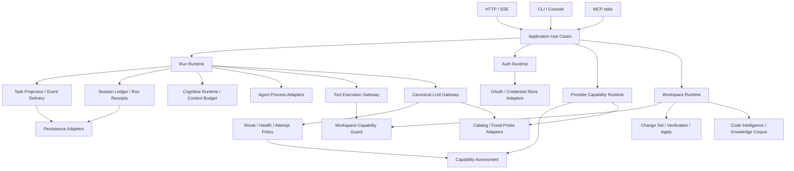
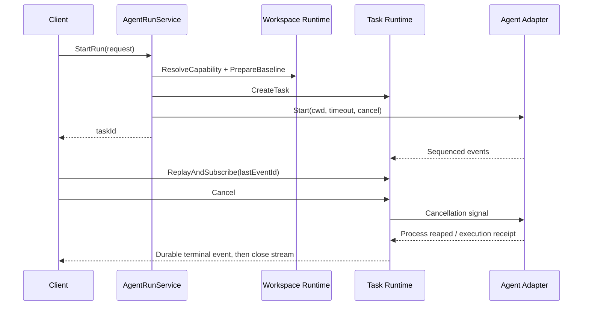

> 历史设计草案：当前架构入口已统一为 [系统架构设计](../../系统架构设计.md)，边界要求见 [领域边界与迁移契约](领域边界与迁移契约.md)。下文保留原审查时点，不作为当前代码完成证明。

# SuperAgent 系统架构设计 v2

版本：2026-09-07。状态：基于实现的目标设计，尚未整体实施。

事实基线：提交 `0904160` 与本轮工作区三个目录拆分；具体文件 SHA-256、对应源码行和验证结果见 [拆分审查](../reviews/2026-09-07-拆分功能校验.md) 及 [机器证据](../reviews/2026-09-07-split-evidence.json)。本文使用 [CONTEXT.md](../../CONTEXT.md) 的领域词汇，并延续 [architecture_manifesto.md](../../architecture_manifesto.md) 的能力认证、统一运行账本、工作区门控和标准模型网关原则。

## 1. 设计决策

继续采用本地模块化单体，保留 `hub` 控制进程与 `superagent` 执行进程。当前问题主要是运行规则散落、测试认证不足和文档失真，不能靠增加服务、进程或目录解决。先收拢状态所有权和可验证契约，再判断是否需要拆 crate。

每个模块必须隐藏一组完整的不变量，而不是仅转发一个函数。接口包括输入、授权、超时、错误、幂等和恢复语义；文件变短不等于接口变简单。只有存在真实替换需求的地方引入 trait，例如多个 Agent CLI、多个 Provider、多个视觉插件。

目标达成标准：同一用户操作从 HTTP、MCP 或 CLI 进入时，消费相同的工作区授权、任务状态、模型路由和工具执行规则；不同入口只承担协议转换。

## 2. 当前实现与目标之间的差距

| 领域 | 当前源码事实 | 目标 |
|---|---|---|
| 进程入口 | `src/bin/hub.rs` 调用 CLI 分派；`src/bin/superagent.rs` 装配 AgentLoop | 保留双进程角色，共享应用用例和领域契约 |
| Agent HTTP | `routes/agents/run.rs` 同时包含校验、隔离工作区准备、后台执行、SSE | HTTP 层只转换请求和响应；执行准备归 Run 用例，SSE 归事件适配器 |
| 任务 | TaskManager 管理状态文件、事件、取消和交互通道 | 明确 Task 投影与 Run 事实的关系，避免多处独立判定终态 |
| 鉴权 | `cli_auth/ui.rs`、`flow.rs`、`server.rs` 已按文件分组，仍共享大批导入并直接交互 | 登录事务拥有超时和资源回收；UI、OAuth 网络、凭据存储分别适配 |
| Provider 能力 | Runtime 已包含发现上限、固定 Probe、TTL 和规范结果；拆分后常量重复 | 单一策略来源；目录、探测、纯评估与配置提交显式连接 |
| 模型协议 | Gemini 与 Responses 已有转换实现，Responses 明确拒绝无状态适配器不能承载的会话参数 | 按 Provider × Profile × 请求/响应/流式能力认证，不能由“文件存在”推定全兼容 |
| 测试 | 默认生产目标可检查；历史翻译测试调用签名过期 | 生产构建、测试构建、契约测试、真实认证分开报告 |

## 3. 目标依赖关系



这是目标依赖图，不是对当前调用图已完成的宣称。`AppState` 是装配入口，不能成为全仓库服务定位器；纯策略层不应依赖 Axum、Dialoguer、具体凭据存储或具体子进程协议。入口模块不得互相调用。

## 4. 状态和数据所有权

| 对象 | 唯一业务所有者 | 持久化与恢复约束 |
|---|---|---|
| Session / Run | Session Ledger 与 Run Runtime | Session 含多个 Run；每个 Run 恰好一条终态收据；恢复补齐中断事实 |
| Task | Task Runtime | Task 是外部执行句柄；状态由合法转换产生，不从日志文本猜测 |
| 子进程 | Agent / Subagent Adapter | 启动、stdin、stdout、stderr、取消和回收由同一对象负责 |
| Tool Call / Result | Tool Execution Gateway + Session Ledger | 调用先持久化；恢复不留下无结果调用；大型结果通过受限引用读取 |
| Approval | Tool Approval Store | 参数指纹绑定、有限有效期、原子单次消费；模型不能自批 |
| Workspace | Workspace Capability Registry | 先登记规范路径，后消费授权；传入路径本身不构成授权 |
| Change Set | Workspace Change 用例 | 绑定基线、隔离工作区、文件哈希和 Verification Receipt |
| Account / Token | 配置仓储与 Credential Store | 秘密值不出现在收据和通用日志；失败提交不覆盖原配置 |
| Capability Observation | Provider Capability Runtime | 按账户、模型、Profile、来源、时间标识；过期证据降为 Unknown |
| Corpus Manifest / Chunk | Knowledge Corpus Runtime | 同一检查点提交；相同内容哈希幂等；删除可追溯全部分块 |

不能把 Task、Run、Session 简化为一个万能状态枚举。Task 的 `timeout` 与恢复时 Run 的 `interrupted` 都有独立含义。统一的是状态所有权和事实来源，不是抹平领域区别。

## 5. 三个拆分模块的具体设计

### 5.1 Agent 运行与事件

保留现有 `/api/agents/*` 路径、HTTP 方法、camelCase 字段和 SSE 事件名称。目标入口只负责反序列化、调用应用用例、映射 HTTP 错误。

建议新增 `AgentRunService`，负责：验证 agent/timeout/workspace → 创建 Task → 捕获 Baseline → 准备隔离目录 → 启动 Adapter → 收集事件 → 提交终态。任何准备失败也必须产生可查询的失败 Task；禁止 Task 已返回但后台启动失败后无收据。



时序图是目标契约；当前实现创建 Task 早于工作区复制，迁移时应保留失败任务可观测性，不能机械交换顺序。回放与订阅必须在同一个同步边界建立；广播 lag 通过持久化序号补读。终态、取消胜出和进程回收由同一用例协调，HTTP 处理器不独立推算成功。

`Change Set` 从 `diff.rs` 提取为用例，公开 Inspect、Verify、Apply 三个操作。Apply 必须核对“验证时的内容指纹”仍等于“应用时的内容指纹”；用户选择的文件集合、删除操作和 bypass 原因进入收据。后续补部分写入失败的恢复策略：先预检全部文件，生成应用日志，再提交；不能仅在最后写一个成功标记。

### 5.2 Auth Runtime

`ui.rs` 只呈现账户选择和登录进度；它不持有 OAuth 网络客户端或本地服务器。`AuthRuntime` 拥有 LoginAttempt，包含 attempt_id、Provider、截止时间、PKCE/state 和取消信号。Provider Adapter 隐藏端点、参数与 Token 响应差异，Credential Store 隐藏 Windows Keyring 或配置写入方式。

建议契约：`begin_login(provider)` 返回待展示的授权动作；`complete_login(attempt_id)` 返回不含秘密值的账户摘要；`cancel_login(attempt_id)` 回收监听端口和等待任务。外部仍可通过兼容 facade 保留 `ensure_logged_in` 和现有 refresh 入口。

登录状态：`created → awaiting_callback → exchanging → completed | failed | cancelled | timeout`。先绑定 loopback listener，再展示/打开 URL；state 校验通过后才消费待处理事务。空 code、错误 state、重复 callback、用户不操作、端口占用和上游非 JSON 都必须有确定终态。错误只保留 HTTP 状态和受控分类，不拼接 Token 响应正文。

当前 `execute_pkce_flow` 等待 `rx.await` 无显式超时，`handle_callback` 在验证 state 前取走 sender，DeepCloud 流在绑定 listener 前打开浏览器；这些是已有实现风险，不是目录拆分引入的变化。

### 5.3 Provider Capability Runtime

保留当前外部 facade 与公开类型路径，内部目录改为私有：

```text
provider_capability_runtime/
  mod.rs           # facade、Runtime 装配、明确 pub use
  types.rs         # 请求、报告、Observation、Verdict
  policy.rs        # 唯一 Limits / EvidencePolicy
  assessment.rs    # 纯判定；显式 now 与 policy
  discovery.rs     # 请求规范化、计划与报告合并
  catalog.rs       # Provider Catalog Adapter
  probe.rs         # 固定输入、受限读取、回包判定
  tests.rs         # 一层测试模块
```

具体修正：删除当前 15 个常量的 8 份副本，改为单一只读策略；`types.rs` 不依赖网络头、HTTP 流或 Adapter；删除 `use super::*` 与 `pub use xxx::*`，按实际依赖导入；跨同级模块只需要 `pub(super)` 的辅助函数不扩大为 `pub(crate)`。`tests.rs` 直接存放测试，避免 `tests::tests` 嵌套。

当前预算应作为兼容默认值保留：Catalog 2 MiB / 256 models / 30 秒，最多选 4 models、4 profiles，Probe 总数不超过 8、单次 45 秒、响应 128 KiB、输出 8 tokens；Catalog TTL 24 小时，Probe TTL 168 小时，有效期配置范围 1～2160 小时。下一步增加整个 Discovery 的 deadline 和取消，不能只约束每个 Probe，导致总耗时达到多次超时之和。

Probe 与 Health half-open Probe 是不同概念。健康检查、Gateway Eval 和普通对话不自动触发真实能力探测；真实 Catalog/Probe 仍消费本地控制面授权和显式网络确认。Failed 表示这次尝试失败，不是 Unsupported。

新鲜度判断需补时钟异常用例：`observedAt` 在未来、`expiresAt < observedAt`、过长 TTL 和解析失败应产生明确结果。配置提交先在候选副本完成全部验证，再原子替换；HTTP 返回成功必须晚于提交成功。

## 6. 全系统关键契约

1. Run 完成必须基于工具与验证收据，模型声明“完成”不改变执行事实。
2. 同一 Task 的终态只能提交一次；取消后的迟到成功不能覆盖 cancelled。
3. 模型尝试上限由 Route 和 Attempt Policy 决定；上下文错误回到 Compaction，不能无界重试。
4. Session 压缩保持当前 Run、Tool Call/Result 配对和最近证据；提交失败不丢旧记录。
5. Steering 采用 lease/ack/release；Ledger 记录注入后才能 ack，恢复不能静默丢消息。
6. 子执行结果按不可变 parent/session/correlation 身份回投；超时和取消必须到达进程。
7. 文件、Git、QA、知识导入和 Agent cwd 均消费 Workspace Capability。
8. 外部协议差异停留在 Adapter；上层只处理规范请求、事件和错误分类。
9. 目录元数据、真实 Probe、测试认证是不同证据，报告必须保留来源和有效期。
10. 有持久化含义的写操作必须明确原子边界、锁、恢复与幂等键；不默认“JSON 文件写入”天然可靠。

## 7. 能力认证和测试架构

| 层级 | 验证什么 | 不能据此声称什么 |
|---|---|---|
| 源码对比 | 拆分没有遗漏声明、修改常量/字面值/属性 | 不能证明名称解析或真实外部行为 |
| 默认/feature 构建 | 入口、导出、类型和条件编译合法 | 不能证明功能已执行 |
| 纯策略测试 | timeout、TTL、路由、错误分类、状态转换 | 不能证明进程和网络链路 |
| 本地契约测试 | Axum、mock Provider、fake CLI、SSE、临时存储 | 不能代表真实厂商协议的全部版本 |
| 真机认证 | 指定版本 CLI、Provider、OS 和原生 SDK | 不自动覆盖别的版本/配置 |

能力记录建议含：capability、adapter_version、platform、feature_set、test_suite、source_revision、status、checked_at、expires_at、limitations。`Certified` 只能覆盖明确通过的组合，缺证据是 `Experimental` 或 `Unknown`，配置关闭是 `Disabled`，三者不能混为“不可用”。

必须优先补的契约：

- Agent：无效输入、未授权 Workspace、隔离目录准备失败、正常输出、非零退出、超时、取消竞态、子进程回收。
- SSE：历史回放与 live 交界、Last-Event-ID、lag 补读、重复去除、终态后关闭。
- Auth：正确/错误 state、重复回调、无回调超时、Token 非 JSON/4xx、错误脱敏、登录取消。
- Capability：目录裁剪、受限响应、网络确认缺失、Tools/Vision/Streaming 回包、过期证据、固定时钟和原子保存失败。
- Change Set：验证后再改动、文件删除、路径越界、符号链接、部分应用失败和重试。
- 存储：两个写者、半行 JSONL、崩溃检查点、终态恢复、旧格式迁移。

测试环境统一隔离 app data、workspace、PATH 中的 fake CLI 和临时端口。涉及环境变量的测试串行运行或使用独立进程。测试过滤器迁移时按完整测试名集合核对，不能让重命名后的测试悄悄漏跑。

## 8. 迁移步骤与回滚

| 阶段 | 改动 | 合并门禁 | 回滚方式 |
|---|---|---|---|
| A：可信基线 | 修复过期测试调用，保存前后测试清单和指纹，纠正文档 | 默认构建、测试构建可重现；失败有归因 | 单独回退测试/文档提交 |
| B：封装收口 | 显式导入导出、合并常量、去重复 tests 包装 | 公共类型路径和 17 条 Agent 路由不变；契约测试通过 | 回退内部重排，存储不变 |
| C：提取用例 | AgentRunService、Change Set 用例、AuthRuntime | fake CLI、SSE、OAuth mock、Apply 竞态验证 | 保留旧 facade，按用例逐个切换 |
| D：统一运行事实 | Task/Run 事实映射、恢复与幂等 | 崩溃注入、取消竞态、重启回放 | 版本化记录、向后读取；禁止旧代码覆写新格式 |
| E：能力认证 | CI 矩阵和真实 Adapter 版本认证 | 认证报告含范围和有效期 | 降级 Experimental/Disabled，不伪造成功 |

每阶段独立提交，不把协议改变、存储迁移与文件移动混在同一个 PR。若新增存储格式，先双读、验证迁移，再切写；失败保留原记录与备份。此阶段不引入微服务或额外消息队列。

## 9. 可观测性与文档维护

日志以 session_id、run_id、task_id、attempt_id、event_sequence、adapter 和错误分类关联。事件与收据是事实，日志用于诊断。记录取消到回收延迟、SSE lag、模型 failover、Probe 超时、配置提交失败和恢复计数；不记录凭据或完整用户正文。

每次发布自动产出：二进制/feature 清单、路由清单、测试数量及失败、Adapter 认证矩阵、文档引用失效检查。架构文档标注源码版本与验证日期，禁止把某次历史“117 passed”长期作为当前可用性的证据。

尚未决策：是否需要 Session 多进程写入；是否将所有持久化迁移 SQLite；是否拆分视觉依赖为独立 crate。这些决定需由部署需求和失败证据推动。当前优先级是恢复测试可信度、消除策略副本、建立运行/鉴权契约，再收拢跨入口的业务用例。
