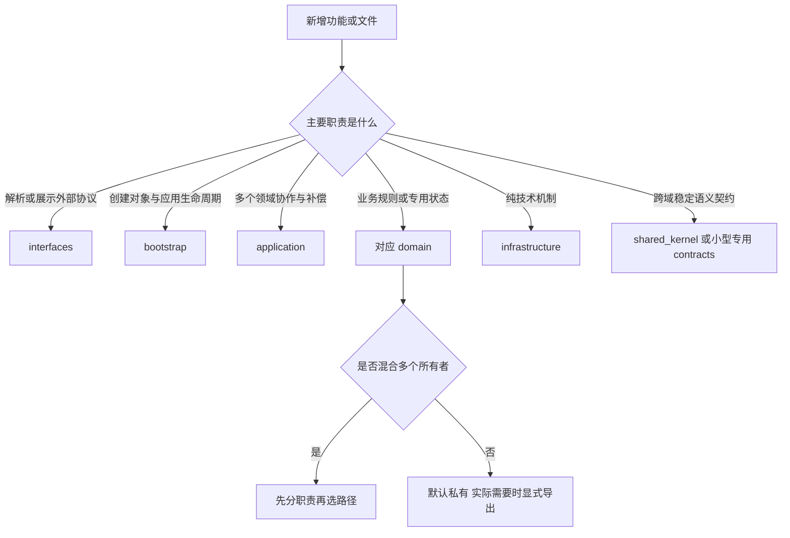

# 项目目录结构与文件分组指南

> 版本：2026-09-07。性质：目标目录设计与渐进迁移指南，不表示这些目录已经全部创建或现有功能已完成认证。
>
> 架构入口：[系统架构设计](../../系统架构设计.md)。领域规则：[领域边界与迁移契约](领域边界与迁移契约.md)。本文回答“文件放在哪里、为什么、怎样迁移”；领域契约回答“允许做什么、由谁拥有状态”。

## 1. 适用范围与基本原则

适用于 Hub-RS 的 Rust 主项目、原生媒体依赖、测试和工程文档。当前项目主要使用 `routes/`、`services/`、`services/brain/` 组织代码；目标改为业务领域为主、入口与装配独立的模块化单体。

九个领域不等于九个进程、九个微服务或九个 crate。首先在同一 crate 中建立接口、所有权和契约测试，只有需要独立依赖、构建、发布或平台隔离时才拆 crate。

文件放置遵循以下顺序：

1. 确定它维护什么业务规则、拥有什么状态。
2. 确定它是协议入口、跨领域用例、领域实现还是通用机制。
3. 放到唯一业务所有者的目录，通过接口向其他模块提供能力。
4. 若一个文件同时属于多个所有者，先提取职责，再迁移文件。
5. 若只是被多个地方调用，不立即判定为通用代码；先确认调用方需要的规则是否相同。

**目录结构只能表达边界，不能自动执行边界。** Rust 可见性、依赖装配、契约测试与审查必须同时落实。

## 2. 仓库根目录

```text
superagent/
├── Cargo.toml                         # 根包、bin、feature 与依赖
├── Cargo.lock                         # 依赖锁定
├── README.md                          # 使用入口及架构导航
├── CONTEXT.md                         # 领域词汇与不变量
├── API_CONTRACTS.md                    # 外部协议契约
├── 系统架构设计.md                    # 当前架构总览
├── src/                               # Hub 主程序源码
├── tests/                             # 跨模块、跨进程契约测试
├── examples/                          # 可运行示例，不承载生产逻辑
├── scripts/                           # 构建、审查、发布等工程脚本
├── docs/
│   ├── architecture/                  # 边界、目录、部署设计
│   │   └── history/                   # 历史设计，标注失效范围
│   ├── reviews/                       # 版本化审查与验证证据
│   └── adr/                           # 重要架构决策；有决策时再建立
├── skills/                            # 随项目分发的 Skill 内容
├── snow-crates/                       # 独立原生 workspace，保留自身边界
├── vendor/                            # 固定第三方源码及最小补丁
└── target/                            # 构建产物，不是业务数据目录
```

此处包含建议目录，未要求现在创建所有空文件夹。根目录现有启动脚本可先保留，以免破坏安装器或用户习惯；后续迁入 `scripts/` 时保留兼容入口。

不要把用户 Token、真实配置、Session 历史、截图、视频、索引 DB 或模型缓存提交到这些源码目录。运行数据位置由 AppPaths/RuntimeConfig 决定，与源码结构独立，见第 10 节。

## 3. 主源码目录总图

```text
src/
├── lib.rs
├── bin/
│   ├── hub.rs                         # 调用 hub bootstrap
│   └── superagent.rs                  # 调用 worker bootstrap
├── bootstrap/
│   ├── mod.rs
│   ├── hub.rs                         # Hub 对象装配与启动
│   ├── worker.rs                      # Worker 对象装配与启动
│   ├── settings.rs                    # 原始配置解析与装配映射
│   └── shutdown.rs                    # 停止准入、取消、有界等待
├── interfaces/
│   ├── http/                          # 按领域分组的 HTTP 接口
│   ├── sse/                           # 事件与 SSE 协议适配
│   ├── cli/                           # 命令、终端展示和输入
│   └── mcp/                           # Hub 作为 MCP Server 的入口
├── application/
│   ├── agent_runs/
│   ├── project_analysis/
│   ├── change_delivery/
│   ├── configuration_sync/
│   └── tasks/
├── domains/
│   ├── model_gateway/
│   ├── media/
│   ├── agent_connectors/
│   ├── agent_runtime/
│   ├── project_intelligence/
│   ├── reverse_engineering/
│   ├── extensions/
│   ├── identity/
│   └── workspace/
├── shared_kernel/
│   ├── ids.rs
│   ├── event_envelope.rs
│   └── cancellation.rs
└── infrastructure/
    ├── filesystem/
    ├── process/
    ├── network/
    ├── clock/
    └── observability/
```

目录中的名称是建议落点，不是需要一次性生成的脚手架。小模块可以只有 `mod.rs` 和一两个文件；当职责增加时再分目录。不要为了符合图形制造大量只转发一次调用的文件。

## 4. 六类顶层目录如何使用

### 4.1 bin：二进制入口

只做启动角色选择和调用 bootstrap，保持短小。不要在 bin 中创建完整工具注册清单、构造所有 Provider 或实现执行循环；这些装配工作应进入对应 bootstrap。

`hub` 与 `superagent` 是同一 package 中使用库的不同 crate 目标，不能假设 bin 可以访问库的 `pub(crate)` 项。因此 `lib.rs` 可以公开极少量启动函数，内部领域仍保持 crate 内可见。

### 4.2 bootstrap：谁创建对象、谁负责关闭

负责加载配置、选择 Adapter、创建共享对象、连接领域接口、建立运行句柄登记和统一关闭顺序。

例如：读取 app data root → 创建 Credential Store → 创建 Gateway → 创建工具 Adapter → 创建 Agent 用例 → 装配 HTTP Router。领域对象不自行读取全部全局配置再创建另一套运行实例。

不要将业务规则放入 bootstrap。这里可以决定使用哪个 Provider Adapter，但不决定重试次数、登录状态转换或 Apply 冲突策略。

### 4.3 interfaces：协议入口

建议 HTTP 内继续按领域分组：

```text
interfaces/http/
  router.rs
  middleware.rs
  agents.rs
  models.rs
  media.rs
  workspaces.rs
  extensions.rs
  identity.rs
  error_response.rs
```

职责包括请求解析、调用者上下文、字段合法性检查、调用用例、错误与响应映射。业务不变量仍需在用例/领域接口校验，不能只依赖 HTTP 校验，以免 CLI/MCP 绕过。

不直接遍历模型账户、不直接刷新 Token、不直接操作图数据库、不直接运行长时间 QA 命令。SSE 层转换事件名称、序号和编码，不拥有任务业务终态。

网络传输 DTO 可以含 `serde` 属性；领域模型不应为了兼容某个入口被迫携带 Axum 状态或 HTTP StatusCode。简单稳定 DTO 可以共享，不为分层机械复制每个字段。

### 4.4 application：完整用例

当操作跨两个以上领域，或需要管理多阶段失败与恢复时，通常放这里。例如 Agent 启动涉及 Workspace、Agent Adapter 和 Task 投影。

```text
application/agent_runs/
  mod.rs
  start.rs                   # 授权、基线、启动和登记
  interact.rs                # 纠偏/回复关联
  cancel.rs                  # 发出取消并协调执行收据
  receipt.rs                 # 对外用例结果
```

不把全部状态重新定义一遍。Application 关联 ID、阶段和补偿；领域拥有自己的状态机；Adapter 拥有 Child、socket 等资源。对于只调用一个领域且无额外规则的简单查询，不必增加空用例类。

### 4.5 domains：业务所有者

领域目录包含业务类型、规则、运行对象以及领域专用 Adapter。专用 Adapter 与领域核心是同一领域的不同部分，不是新增业务领域。

纯规则不依赖外部 SDK；核心通过本领域定义的 port 使用外部能力，Adapter 实现 port，并由 bootstrap 注入。必要时先在同一领域目录内隔离 SDK，再通过 feature 或 crate 限制编译依赖。

### 4.6 shared_kernel 与 infrastructure：范围必须小

`shared_kernel` 只承载跨域语义真正相同且稳定的少量契约，例如 TaskId、事件信封和取消协议。不要放 Account、Recording、RunPlan 等完整业务对象。

`infrastructure` 提供通用实现机制，例如同目录临时文件替换、文件锁、受限子进程、HTTP 客户端构建、时钟实现和日志脱敏。领域专用存储仍留在对应领域，不集中建立一个可随意访问所有表的总 Repository。

## 5. 九个领域的详细文件分组

### 5.1 model_gateway：模型网关

```text
model_gateway/
  mod.rs                         # 显式公开 facade
  gateway.rs                     # 唯一模型调用用例的领域执行部分
  contracts.rs                   # Canonical 请求、响应、流与错误
  routing/                       # 候选、能力筛选、优先级、有限切换
  health/                        # circuit 与健康观测
  capabilities/                  # Catalog、Probe、TTL、评估
    policy.rs                    # 唯一限制值和证据策略
  protocols/                     # 外部协议 ↔ Canonical
    openai_chat/
    openai_responses/
    anthropic/
    gemini/
    sse.rs                       # 通用 SSE framing，非厂商业务规则
  providers/                     # 目标端点、请求准备与网络适配
  metering/                      # 用量、成本与脱敏调用收据
```

`protocols/` 转换协议语义，`providers/` 处理目标 Provider 请求准备，二者不要各实现一遍相同转换。可将高度耦合的协议和 Provider 适配合并到一个内部模块，通过明确函数分工减少重复。

代理 HTTP 处理器留在 interfaces；路由、重试和健康规则归网关。登录与 Token 刷新归 identity。HTTP Proxy、Agent、翻译、项目分析共用 Gateway，而非仅引用相同的 Route 类型后各执行一套循环。

注意保留 Responses 的能力子集及拒绝语义，不因移动目录就宣布支持所有 stateful 参数。流式成功须依据上游终态，不能把连接关闭一律视为完成。

### 5.2 media：视觉与媒体

```text
media/
  mod.rs
  capture/                       # 截图请求、区域、显示器
  ocr/                           # OCR 输出与模型生命周期
  translation/                   # 翻译请求和 Provider
  recording/                     # Recording 状态机
    runtime.rs
    state.rs
    export.rs
  audio/                         # 音频设备、录入、TTS 接入
  artifacts/                     # UUID、存储、校验、配额、清理
  native_ui/                     # 原生选区、工具栏、贴图窗口
  adapters/
    xcap/
    paddleocr/
    rapidocr/
    ffmpeg/
    snow/
```

原生交互 UI 属于媒体能力的内部适配，不等于产品 Web UI。它应向 Recording/Capture Runtime 发命令，而非直接修改全局录制状态。

播放 TTS、录制音频和视频音轨是不同生命周期，可在 audio 中分组，不因为都处理声音就共用一个状态机。

采集、编码、导出验证、Artifact 发布是不同步骤。失败临时片段由媒体域决定保留与回收。用户导出路径需要单独授权，不能默认只能写项目内，也不能因此允许任意调用者写任意路径。

内置 SDK Adapter 不要求动态插件化；插件是可选分发方式，Trait 是代码替换边界，两者不等价。

### 5.3 agent_connectors：本地智能体接入

```text
agent_connectors/
  mod.rs
  backend.rs                     # AgentBackend 与启动结果
  contracts.rs                   # ExecOptions、事件、执行收据
  registry/                      # 可运行 Adapter 的注册与查询
  discovery/                     # CLI 路径/版本探测
  protocols/
    stream_json/
    json_lines/
    acp/
    app_server/
  backends/                      # Claude/Codex 等具体组合
  process/                       # CLI Child 与协议 IO 生命周期
```

负责启动、stdout/stderr、交互、取消和回收；不直接写 Task 状态文件，不拥有 Hub 的 RunPlan。安装和配置同步归 extensions，探测接口可以被安装用例复用。

CLI 的 resume ID 与 Hub SessionId 不应混用；建立带 Provider/CLI 身份的映射。外部 CLI 自己的模型流量不默认受 Hub Gateway 管控，不能在目录迁移时改变这一事实。

### 5.4 agent_runtime：自主智能体内核

```text
agent_runtime/
  mod.rs
  execution/                     # AgentLoop 与轮次预算
  planning/                      # Cognitive、RunPlan、Replan
  context/                       # token 预算、压缩与工作上下文
  sessions/                      # Ledger、事件、迁移和恢复
  tools/
    registry.rs
    gateway.rs                   # 风险、审批、调用与收据
    policy.rs
    pairing.rs
    results.rs
    adapters/                    # 注入外部领域能力的工具包装
  subagents/                     # Handle、谱系、深度/并发和交付
  interaction/                   # 用户回复与 Steering
  evolution/                     # Candidate/Promoted/Rejected
  worker/                        # 执行进程协议与 worker 生命周期
```

工具包装只负责将工具参数转换为领域命令并返回结果；例如 Apply 工具调用 workspace 接口，不复制文件应用算法。Skill/MCP 扩展发现属于 extensions，运行时工具注册和执行事实归内核。

Session 持久化仍属于内核，不因“长期保存”迁到项目知识。知识检索通过 port 获取 Evidence；模型协议和厂商健康规则从 brain 迁出后，由网关提供。

Supervisor 启动整个应用、创建 Worker 的装配部分放 bootstrap；Worker 内部运行协议可保留本域。一个文件同时含两者时先拆职责。

### 5.5 project_intelligence：项目理解与知识

```text
project_intelligence/
  mod.rs
  indexing/                      # 外部索引执行和版本切换
  graph/
    queries.rs                   # 稳定结构查询接口
    schema.rs                    # 图 DB 验证与兼容
    adapter.rs                   # SQLite/图工具适配
  retrieval/                     # 关键词、向量、融合评分
  analysis/                      # 架构、领域、影响与导读
  knowledge/
    runtime.rs                   # 文档生命周期
    manifest.rs                  # 文档与分块版本关系
    extractors/                  # Text/DOCX/PDF
    chunking.rs
    citations.rs
    store.rs
  inventory/                     # 文件清单与源码指纹
  cache/                         # 可重建缓存与失效规则
```

对项目源文件只读，但可以写本领域索引、语料与缓存。图 DB 和 Supermemory 当前不是同一个存储；不要以建立 retriever 为由把版本提交拆散。

向规划返回结构化 Evidence，而非 DB Connection 或要求调用者知道 nodes/edges 表名。索引版本、文档版本、源码指纹分别定义；查询过期索引必须返回 freshness 或限制说明。

通用用户偏好不属于项目知识；现有 Supermemory 中不同语义记录需要分类后迁移，不能整库改名即完成。

### 5.6 reverse_engineering：逆向与变更规划

```text
reverse_engineering/
  mod.rs
  requirements/                  # 需求解析与规范化
  evidence_mapping/              # 需求与项目事实对应
  planning/                      # 差距、方案、步骤与依赖
  acceptance/                    # 验收条件与验证计划
  rules/                         # 可审计规则与模板
  reports/                       # 版本化方案与结果表示
```

输入为需求和项目证据，输出为变更意图与验收计划。不得直接写源码、启动 Agent 或 Apply；这些由 Application 编排。

代码层的影响分析属于 project_intelligence；基于影响结果选择改造策略属于 reverse_engineering。避免两边分别维护影响推演算法。

### 5.7 extensions：能力扩展与同步

```text
extensions/
  mod.rs
  catalog/                       # 扩展身份、版本、Manifest
  skills/                        # Skill 内容发现与管理
  mcp/                           # MCP Server 声明及目标配置
  plugins/                       # 插件 Manifest/包生命周期
  installation/                  # 下载、解包、安装及卸载计划
  sync/
    planner.rs
    coordinator.rs
    transaction.rs
    history.rs
    adapters/                    # Claude、Codex 等配置文件适配
```

拥有配置期生命周期，不拥有正在执行的 MCP Tool Call。`interfaces/mcp/` 是 Hub 对外 MCP Server；本目录是 MCP 扩展管理，二者必须在命名与文档中区分。

Skill 更新、CLI 可执行文件安装、MCP 配置同步是不同资源操作，不共用一个过宽的 Installed 状态。安装完成不证明可运行，需要独立的 detect/probe 结果。

同步将通用网络/文件机制与目标格式区分。锁内复核 revision、保留未知字段、条件回滚和逐目标 Receipt 属于 sync，不放 infrastructure。原始秘密值不进入 plan preview、history 或普通配置 Diff。

### 5.8 identity：身份与凭据

```text
identity/
  mod.rs
  accounts/                      # 账户身份及非秘密摘要
  oauth/
    runtime.rs                   # LoginAttempt
    pkce.rs
    device_flow.rs
    callback.rs                  # OAuth 专用 loopback Adapter
  credentials/
    port.rs
    keyring.rs                   # 凭据存储 Adapter
  refresh/                       # 单账户刷新协调
  adapters/                      # Provider 特化认证
```

主 HTTP 服务的登录 API 放 interfaces/http；OAuth 临时 loopback listener 是登录事务内部 Adapter，可以放此处。身份核心状态不依赖 Axum；callback 适配器转换请求后调用状态机。

终端菜单、颜色和浏览器展示提示放 interfaces/cli。Token 生命周期、state 校验、超时、刷新互斥和保存属于身份域，不能放 UI。

不要公开包含所有秘密字段的 Account 给全部领域；账户摘要、路由元数据和受限凭据访问应区分。为兼容旧配置，迁移阶段可使用转换 Adapter，不需立即重写所有存储。

### 5.9 workspace：工作区与变更管理

```text
workspace/
  mod.rs
  authorization/                 # Registry、Capability、路径保护
  isolation/                     # 隔离目录与工作副本
  baselines/                     # 源码清单与基线版本
  changes/                       # added/modified/deleted
  verification/                  # QA 计划、执行收据、内容指纹
  apply/                         # 冲突、选择、提交和恢复
  git/                           # Git/Shadow Git 业务适配
  files/                         # 已授权项目文件操作
```

授权根与文件操作绑定，不同时接收 Guard 和不相关的原始 project 字符串。读取已有文件与创建新文件的路径校验不同：创建目标可能不存在，应验证最近存在的父目录和最终路径，而不能简单 canonicalize 目标后失败。

普通 Git 查询、恢复、Patch、Apply 有不同风险和前置条件。共享 Guard 不能抹平这些差异。隔离副本路径不能嵌套到源目录内形成递归复制。

QA 属于代码变更验证能力；Application 协调 Verify→Apply，workspace 实现验证有效性和应用规则。底层进程机制不决定“通过哪些检查才能应用”。

## 6. 易混淆功能的放置判定

| 功能/文件内容 | 推荐位置 | 原因 |
|---|---|---|
| `/proxy/v1/...` 请求处理 | interfaces/http | 对外 HTTP 契约 |
| Anthropic 请求转换 | model_gateway/protocols | 模型协议知识 |
| Provider 失败后切账户 | model_gateway/routing | 网关业务策略 |
| 登录选择菜单 | interfaces/cli | 人机展示 |
| OAuth callback listener | identity/oauth 的 Adapter | 隶属单次登录事务 |
| 主 HTTP 登录路由 | interfaces/http | 主服务入口 |
| Claude CLI stdout 解析 | agent_connectors/protocols | 外部执行协议 |
| Claude 配置文件合并 | extensions/sync/adapters | 配置期业务 |
| Hub MCP initialize/tools/list | interfaces/mcp | Hub 服务端协议 |
| 安装一个 MCP Server 配置 | extensions/mcp + sync | 能力声明与同步 |
| 在 Agent Run 中调用 MCP 工具 | agent_runtime/tools/adapters | 运行期工具调用及收据 |
| MCP 通用 JSON-RPC 传输 | infrastructure/network 或专用协议库 | 仅限可复用传输机制 |
| 分析结果供规划使用 | project_intelligence 的查询接口 | 版本化项目事实 |
| Session 崩溃恢复 | agent_runtime/sessions | 执行历史所有权 |
| 文档分块幂等更新 | project_intelligence/knowledge | 文档版本事务 |
| 原子文件替换 | infrastructure/filesystem | 通用实现机制 |
| 验证后才能 Apply | workspace | 变更交付规则 |
| HTTP 错误映射 | interfaces/http | 传输层表示 |
| 业务错误分类 | 对应领域 | 不受具体协议约束 |
| 截图结果清理策略 | media/artifacts | 媒体数据生命周期 |
| 停机取消所有用例 | bootstrap + application | 应用生命周期协调 |

一个名字在多个目录出现时，应确保语义不同且名称足够具体；不要都叫 runtime.rs 而没有模块上下文。对外文档引用完整领域路径。

## 7. 现有代码到目标目录的迁移清单

下表是主要落点映射，不是逐文件搬迁命令。源码会继续变化，执行迁移前重新确认文件内容、调用者和未提交修改；不要把历史审查中的错误当成当前仍存在。

| 当前文件/目录 | 目标位置 | 迁移方式及注意事项 |
|---|---|---|
| `src/bin/hub.rs`、`src/bin/superagent.rs` | 保留 bin | 装配逻辑逐步下沉 bootstrap |
| `src/server.rs` | bootstrap/hub、shutdown + interfaces/http | 先分装配、Router 和停机职责 |
| `src/cli.rs`、`src/cli_commands.rs`、`src/repl.rs` | interfaces/cli + bootstrap | CLI 输出与业务操作分开 |
| `src/mcp_server.rs` | interfaces/mcp | 工具处理器改调用用例，不直接执行跨域流程 |
| `src/routes/agents/run.rs` | interfaces/http + application/agent_runs | 保留 HTTP/SSE 协议，提取准备和执行编排 |
| `src/routes/agents/diff.rs` | application/change_delivery + workspace | Verify/Apply 规则移入领域，用例协调 |
| `src/routes/qa.rs` | interfaces/http + workspace/verification | 授权、超时、取消和收据先收口 |
| `src/routes/proxy/` | interfaces/http + model_gateway | 不是将整个目录原样移动 |
| `src/services/llm_provider/` | model_gateway | 与 Proxy 统一执行策略 |
| `src/services/protocol_converter/` | model_gateway/protocols、providers | 保留入口/上游方向与流式语义 |
| `src/services/brain/model_route_runtime.rs` | model_gateway/routing | 从 brain 迁出，保持调用 facade |
| `src/services/brain/model_attempt_router.rs` | model_gateway + agent_runtime 恢复接口 | 错误分类与上下文恢复职责先辨明 |
| `src/services/brain/provider_health_runtime.rs` | model_gateway/health | 统一生命周期，避免每次请求新建 |
| `src/services/brain/provider_capability_runtime/` | model_gateway/capabilities | 先去常量副本、显式导出 |
| `src/services/brain/gateway_eval_runtime.rs` | model_gateway/capabilities | 只读评测，不隐式联网 |
| `src/services/visual_pipeline/` | media | 按录制、Artifact、SDK、UI 分组 |
| `src/services/agent/backend.rs`、`backends/`、协议文件 | agent_connectors | 保留事件、取消和进程回收契约 |
| `src/services/agent/config_sync/` | extensions/sync | 先验证事务与锁规则再搬迁 |
| `src/services/agent/skills.rs`、`skills_sync.rs`、`mcp.rs` | extensions | 区分发现、安装、同步 |
| `src/services/agent/installer.rs` | extensions/installation | CLI 探测经连接器接口复用 |
| `src/services/brain/executor.rs` | agent_runtime/execution + bootstrap/worker | 执行与依赖构造分开 |
| `src/services/brain/session_ledger.rs`、`session_lifecycle.rs` | agent_runtime/sessions | 路径/格式不随源码目录变化 |
| `src/services/brain/tool_execution_gateway.rs`、`tools/` | agent_runtime/tools | 领域工具只做接口适配 |
| `src/services/brain/subagent_runtime.rs`、`steering_queue.rs` | agent_runtime/subagents、interaction | 保留交付谱系与 lease 语义 |
| `src/services/brain/knowledge_corpus/` | project_intelligence/knowledge | 保持 Manifest/Chunk 原子版本 |
| `src/services/graph_service.rs`、`code_intelligence.rs` | project_intelligence/graph | 不继续暴露底层 Connection 给规划域 |
| `src/services/vector_service.rs`、`understand_service.rs` | project_intelligence | 依据查询/分析职责继续分组 |
| `src/services/analysis_service.rs` | application/project_analysis + 项目理解 | 区分 Task 编排与分析规则 |
| `src/services/requirement_analyzer.rs` | reverse_engineering + 项目理解接口 | 需求规划与图影响算法分离 |
| `src/reverse_engineering/` | domains/reverse_engineering | 替换对 DB/Store 内部结构的依赖 |
| `src/services/supermemory_store.rs` | 按数据语义逐步拆归属 | 不将偏好、项目知识、执行记忆一律搬到同一域 |
| `src/services/cli_auth/` | identity + interfaces/cli | UI/网络/保存分离，公开入口可兼容 |
| `src/services/keyring_auth.rs`、`auth_validator.rs` | identity | 不随 Provider 类型重复实现 |
| `src/services/workspace_capability.rs`、`workspace_guard.rs` | workspace/authorization | 统一授权根传递，保留规则区别 |
| `src/services/destructive_ops.rs`、`change_set.rs` | workspace | 绑定规范路径与变更版本 |
| `src/services/git_service.rs`、`file_service.rs` | workspace/git、files | 通用 IO 小机制才提到 infrastructure |
| `src/services/task_manager.rs`、`progress.rs` | application/tasks | 不接管领域内部状态或具体 Child |
| `src/config/`、`src/models/` | 按所有者拆分 | 配置读取机制与领域设置分离，不能整目录迁入 shared |

建议在每次迁移 PR 中补充“原符号→新符号→兼容导出→消费者→契约测试”清单；这比只给出 git rename 更能说明边界是否成立。

## 8. Rust 模块、可见性与依赖规则

### 8.1 默认私有，显式公开 facade

以下为结构示意，不是可直接编译的实现：

```rust
// domains/model_gateway/mod.rs
mod gateway;
mod contracts;
mod routing;
mod providers;

pub(crate) use gateway::Gateway;
pub(crate) use contracts::{ModelRequest, ModelResponse};
```

crate 内跨域接口可使用 `pub(crate)`；领域内部辅助项尽量使用私有或 `pub(super)`。对库外使用者公开时才用 `pub`。`pub(super)` 只允许父模块范围，不能随目录移动假定其权限不变。

不要用 `pub use xxx::*` 方便迁移后永久保留。兼容期可以明确重导出少数旧符号；新代码只使用新 facade，旧路径调用点逐步清零。

### 8.2 共享类型不等于共享可变状态

可分享 RunId 的值，不分享任意可写的 Run 实体。可分享 Receipt 快照，不暴露 `Arc<Mutex<InternalState>>` 让其他域修改。

Task、Run、Session 不合并成一个枚举。领域错误可映射到用例错误，再由 HTTP/CLI 表示；不要让领域为了返回 404 而依赖 Axum。

### 8.3 port 由需要能力的一方定义

内核需要项目证据时，依赖稳定的证据查询接口；具体图数据库适配由项目理解提供，经 bootstrap 连接。若两个领域确实共同认可一项契约，可以放一个很小的专用 contracts 模块，不把所有类型都升级为共享内核。

避免 A 调 B、B 又调 A。为了消除循环，不应使用全局服务定位器或字符串事件绕过类型检查；先检查是否缺少 Application 编排或状态所有者划错。

### 8.4 技术依赖与业务依赖分开检查

一个 crate 内分目录不会降低 Cargo 编译依赖。把 OCR 文件移到 adapters 不会自动让无 OCR 构建成功；仍需要正确 cfg、feature 传递及可选依赖。仅按 imports 搜索无法证明无动态调用或运行时依赖。

同一模块不要同时保留 `foo.rs` 与 `foo/mod.rs`，会造成模块定位冲突。迁移测试时还要检查 `#[cfg(test)] mod tests`，避免形成 `tests::tests` 或漏掉 trait/import。

## 9. 测试目录和测试边界

```text
src/domains/<domain>/...
  tests.rs                         # 私有规则及状态机单元测试

tests/
  gateway_contracts.rs              # Cargo 可发现的集成测试入口
  agent_contracts.rs
  workspace_contracts.rs
  sync_contracts.rs
  support/
    mod.rs                         # 临时配置、fake Provider/CLI
  fixtures/
    protocols/                     # 脱敏请求、响应、流片段
    projects/                      # 小型代码与工作区样例
```

`tests/` 深层目录里的 Rust 文件不会仅因存在就自动成为独立集成测试；由顶层测试入口 `mod` 引入或在 Cargo 中明确声明。测试 fixture 不承载实际凭据或真实用户会话。

单元测试验证领域规则；契约测试验证 facade 的输入输出、错误和资源行为；跨领域用例测试验证取消、补偿、版本绑定；真实 CLI/SDK 测试另标平台和版本。

迁移验收至少核对：

- 默认构建、所有明确支持的 feature 组合及 bin 入口。
- 测试目标本身能编译，不能仅运行 cargo check 后宣告通过。
- 前后测试名称集合及结果；测试移动的过滤器和 CI 参数同步更新。
- 临时 app data、工作区、端口和环境变量隔离。
- 启动 fake Child 后验证取消及回收，不只验证函数返回值。
- 验证配置锁内冲突、OAuth 超时、SSE 回放/live 交界和 Apply 版本失效。

不为纯 rename 编写与实现镜像的测试。优先保留既有行为测试并补边界缺口，不因文件变短而删除原有失败场景。

## 10. 源码目录与运行数据目录分离

| 数据 | 建议所有者 | 放置原则 |
|---|---|---|
| 账户配置、凭据 | identity | 配置与秘密存储分离，不进 Git |
| Session、Run、工具结果 | agent_runtime | app data 下按会话/运行隔离 |
| Task 投影和事件 | application/tasks | app data 下可恢复存储 |
| 图谱 DB、分析缓存 | project_intelligence | RuntimeConfig 解析的项目级缓存 |
| 文档和 Chunk 清单 | project_intelligence/knowledge | 保留既有原子提交边界 |
| 隔离 Workspace、Baseline | workspace | 独立于源项目，避免递归复制 |
| 截图、视频临时片段 | media | 不透明 ID、配额、过期和失败清理 |
| 用户导出视频 | media + 导出授权 | 独立于默认 Artifact 根 |
| CLI 配置与同步历史 | extensions/identity | 目标路径白名单、脱敏历史和条件恢复 |

**移动源码不能隐式改变数据位置。** 不用 `file!()`、源码相对路径或当前工作目录推导持久化位置。运行目录和源码安装目录在打包后可能不同。

若必须变更存储格式/位置，另做版本化迁移：读取旧格式、校验、写候选、验证、切换，并保留失败恢复。目录重构 PR 不顺带迁移用户数据。

## 11. 原生依赖、feature 与后续 crate 拆分

当前根 Cargo 排除 `snow-crates`，后者是独立 workspace；不要在目录整理时自动改为根 workspace member，以免改变依赖解析、构建目标和发布方式。

保留 vendor 第三方布局与补丁记录，领域 Adapter 负责隔离其类型。不要把 Hub TaskManager 或 Account 类型写入第三方 crate。

只有出现以下需求才考虑独立 crate：

- 原生媒体依赖显著影响无媒体构建，需要平台和 SDK 隔离。
- 某协议库被多个可独立发布的程序复用。
- 一个模块已有小而稳定的 facade，需要 Cargo 级依赖约束。
- 有明确独立测试、构建或发布需求。

拆 crate 前先消除循环依赖，不通过互相 path dependency 修补。不要同时做领域拆分、SDK 升级、feature 改名和存储迁移。

## 12. 渐进迁移步骤

| 阶段 | 工作 | 必须保留的兼容性 |
|---|---|---|
| A：盘点 | 记录版本、工作区修改、当前路径/符号/测试 | 不覆盖其他正在进行的修改 |
| B：边界 | 为候选模块填写边界卡，分离混合职责 | 行为保持；不靠迁目录掩盖语义变化 |
| C：facade | 显式导出稳定接口，替换跨域内部引用 | 旧 public 路径使用明确兼容导出 |
| D：迁目录 | 一次移动一个领域或一个完整纵向用例 | HTTP/MCP/CLI 形态、配置与数据格式 |
| E：验证 | 编译、测试清单、契约、依赖审查 | 不忽略失败、不减少原覆盖 |
| F：清理 | 移除已无消费者的旧入口与重复策略 | 旧格式/旧客户端支持按计划退场 |

优先迁出 brain 中的模型网关与项目知识，以及 agent 中的配置期代码；它们领域归属明确。然后提取 route 中的执行用例。对于锁、授权、Token 等风险行为，先修复并验证契约，再移动，以便审阅者区分行为修复和结构调整。

不建议一次创建所有空目录后批量替换 import。每批迁移要能单独回滚，且不要求回滚用户数据。部分迁移阶段允许旧路径共存，但应记录负责人、消费者和移除条件。

## 13. 必须注意的常见问题

| 问题 | 容易出现的结果 | 处理方法 |
|---|---|---|
| 按文件长度决定模块 | 把同一个事务拆到多个浅层文件 | 先以规则与状态所有权分组 |
| 按厂商把所有能力放一起 | Claude 登录、协议、安装相互耦合 | 按领域分开，厂商只是 Adapter 维度 |
| common 无限扩大 | 全项目依赖一套易变业务类型 | 小共享内核，策略留在本域 |
| 每层复制所有 DTO | 转换代码比业务更复杂 | 仅在语义或兼容性确实不同处转换 |
| 所有模块 pub、通配导出 | 调用者依赖内部实现 | 显式 facade 与最小可见性 |
| 只移动文件不迁调用者 | 新旧流程同时存在 | 迁移清单追踪调用点并删除死副本 |
| 每个入口新建 Runtime | 取消、健康、会话状态不一致 | bootstrap 统一装配生命周期 |
| AppState 到处传递 | 领域可以任意访问全部系统状态 | 用例只注入所需接口 |
| Provider 常量复制到各文件 | 校验、执行与测试预算漂移 | 本域单一策略对象 |
| Guard 与 project 分别传入 | 校验路径和执行路径错配 | 操作绑定已授权规范根 |
| 将 cwd 当沙盒 | 外部进程仍可能访问其他路径 | 明确能力限制，另行实现 OS 隔离 |
| 取消标记当作回收完成 | 退出后遗留 CLI/编码器 | 跟踪句柄并有界等待回收 |
| 同步锁前检查 revision | 并发修改被覆盖 | 锁内复核，回滚也做版本检查 |
| 将测试目录移动等同测试保留 | CI 过滤器漏跑、导入失效 | 比较测试清单并编译测试目标 |
| 源码路径决定存储路径 | 升级后丢失或错读数据 | AppPaths/RuntimeConfig 唯一解析 |
| 无期限兼容重导出 | 新边界永久无法收口 | 记录旧消费者和退场条件 |
| 注释只写“统一入口” | 实际多个调用流程继续分叉 | 用具体调用链及契约测试证明 |

## 14. 新增文件时的判断流程



可以用五个具体问题判断：谁能决定它的状态转换？谁负责失败后的清理？谁拥有持久化数据？哪个调用方必须知道其细节？换一个外部实现时哪些业务规则应该保持不变？回答涉及多个互相独立的领域时，不要急着命名文件夹。

## 15. 模块边界卡模板

每个迁移批次建议在 PR 或 ADR 中填写：

```text
模块：
当前路径 → 目标路径：
负责的用例与规则：
明确不负责：
唯一拥有的状态/存储：
公开接口与稳定类型：
允许依赖：
禁止依赖：
权限来源：
deadline / 取消 / 资源回收：
幂等键 / 版本冲突 / 失败恢复：
旧路径与数据兼容方式：
契约测试与平台/feature 范围：
尚未认证的能力：
旧入口移除条件：
```

完成标准是：调用者不再依赖内部文件、共享状态和存储细节，业务不变量有明确所有者及可运行证据。目录整齐、文件较短和编译通过都只是其中一部分。

## 16. 文档维护规则

根架构文档保留总览，本指南维护路径分组，领域边界契约维护业务规则，审查报告绑定具体版本。不要在多份文档中各复制一份完整“最新架构”。

新增领域、改变状态所有者、跨域依赖或持久化格式时，同步修改相关文档；仅移动内部文件时更新路径映射即可。历史报告保留原版本结论，不直接覆盖成新版本测试结果。

本指南中的示意目录、类型与测试文件按实际需求逐步建立。本轮仅交付文档说明，不执行源码迁移，不对正在修改的同步或 Responses 实现重复作旧版本缺陷判断。
