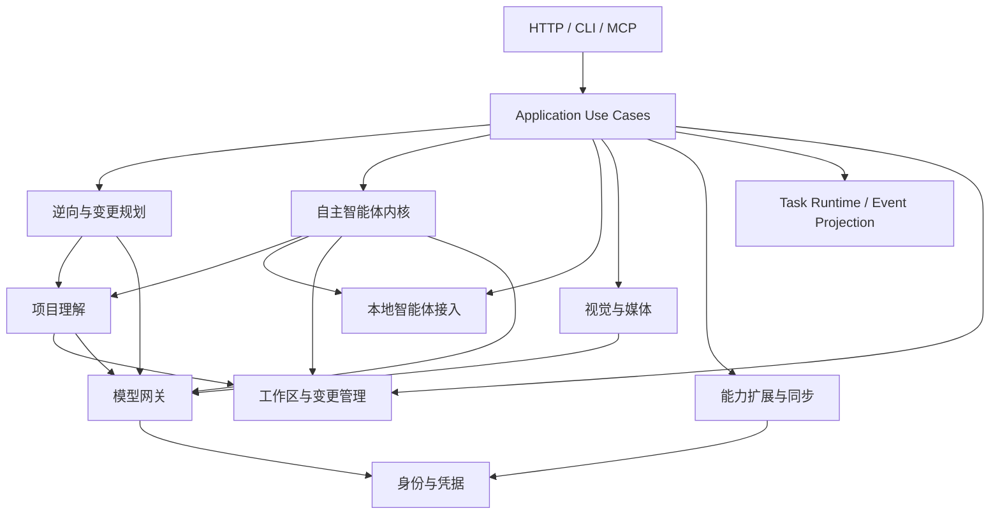

> 目标契约；当前实现与差距以根目录《系统架构设计.md》及本轮符合性审查为准。基线 1d267bf。

# 领域边界与迁移契约

具体目录、文件分组和迁移映射见 [项目目录结构与文件分组指南](项目目录结构与文件分组指南.md)。本文件定义业务权限与所有权，目录指南定义代码组织；二者均为目标契约，不表示全部实施完成。

## 1. 设计范围与领域职责

采用本地模块化单体，保留 `hub` 控制进程和 `superagent` 执行进程。以下九个模块是目标领域划分，不要求立即拆成九个 crate 或微服务。模块依据业务规则和状态所有权划分，不依据文件行数、持久化时间长短或 HTTP 路由前缀划分。HTTP、CLI、MCP 和 SSE 是接入协议，不是业务领域。

| 业务模块 | 包含的能力 | 应独立负责的规则 | 架构约束边界 |
|---|---|---|---|
| **模型网关** | 大模型接入、反向代理、协议转换、流式响应、模型路由 | 能力匹配、账户选择、有限重试、限流、健康状态和调用收据 | 拥有模型调用策略；不拥有任务规划、会话记忆和登录流程。通过身份接口获取凭据，所有 Hub 内部模型请求共用此入口。 |
| **视觉与媒体** | 截图、区域选择、OCR、翻译、录屏、音频处理 | 采集与编码生命周期、设备占用、Artifact、资源清理 | SDK 与进程细节留在 Adapter；内置 Adapter 不必改为动态插件。LLM 翻译消费模型网关；停止采集不等于文件已成功保存。 |
| **本地智能体接入** | Claude/Codex 等 CLI 检测、启动、恢复、交互 | 外部协议、子进程启动/终止/回收、事件归一化 | 不实现 Hub 的决策循环，不直接修改 Session 账本或 Task 状态文件；返回规范事件和执行收据。外部 CLI 自己的模型流量不默认受 Hub 网关控制。 |
| **自主智能体内核** | AgentLoop、规划、工具调用、上下文压缩、子智能体 | Run 决策预算、Session 恢复、工具事实、执行计划和完成判定 | 拥有运行上下文及其持久化账本；通过接口检索项目知识，不拥有项目索引。工具经注入 Registry 与执行网关调用；跨 Run 策略由内部 Evolution 子模块管理。 |
| **项目理解** | 索引、代码图谱、搜索、架构分析、领域提取、影响分析、知识语料 | 源码版本、索引一致性、文档版本、引用与证据 | 对被分析源文件只读，可写自身索引、语料和缓存；不规划或执行项目变更，不承接全部长期记忆。 |
| **逆向与变更规划** | 需求定位、差距识别、改造方案、验证计划 | 需求到证据的映射、计划版本、变更意图、验收条件 | 消费项目理解的版本化证据；输出计划，不直接启动进程或 Apply。静态变更计划与内核的运行中 Run Plan 分别归属，不共享可变状态。 |
| **能力扩展与同步** | Skill、MCP、插件发现、安装、配置同步 | 能力声明、安装版本、目标适配、冲突和逐目标恢复 | 拥有配置期生命周期；不拥有工具调用期状态，不直接读取或拼接原始 Token。配置同步与秘密值交付使用不同接口。 |
| **身份与凭据** | 登录、OAuth、Token 刷新、凭据保存、账户认证同步 | 登录事务、刷新互斥、凭据生命周期、授权范围 | 向获授权的 Adapter 提供受限凭据访问；不管理模型健康、路由或 Skill 安装。秘密值不得进入通用事件、日志和配置预览。 |
| **工作区与变更管理** | 工作区授权、隔离目录、Baseline、Diff、验证、Apply | 路径权限、基线版本、变更归属、验证有效性、应用冲突 | 统一项目文件授权与变更提交；不接管凭据、媒体和所有领域存储。不将 cwd 或路径校验等同于操作系统沙盒。 |

## 2. 状态、记忆和数据所有权

| 对象 | 唯一业务所有者 | 其他模块的访问方式 |
|---|---|---|
| Session、Run、Tool Call/Result、恢复账本 | 自主智能体内核 | 通过命令或只读快照访问；禁止直接写账本 |
| 当前 Run 工作上下文 | 自主智能体内核 | Run 结束后不直接传入下一 Run |
| Evolution 策略 | 内核的 Evolution 子模块 | 只读取 Promoted 策略，不修改工具权限 |
| 源码图谱、Knowledge Document/Chunk、分析缓存 | 项目理解 | 返回带版本与 Citation 的 Evidence |
| 需求方案、验收计划 | 逆向与变更规划 | 输出不可变计划版本供用例执行 |
| Workspace Capability、Baseline、Change Set、Apply Receipt | 工作区与变更管理 | 通过授权、比较、验证和应用接口访问 |
| Recording、媒体 Artifact、设备租约 | 视觉与媒体 | 返回不透明 ID 和状态，不共享 SDK 句柄 |
| CLI Child、协议会话 | 本地智能体接入 Adapter | 接收取消/交互命令，输出执行事件 |
| Account、LoginAttempt、Token | 身份与凭据 | 账户摘要与受限凭据访问分离 |
| Provider Route、Health、Capability Observation | 模型网关 | 规范查询/发现接口；不暴露秘密值 |
| Extension Manifest、SyncPlan、SyncReceipt | 能力扩展与同步 | 预览、提交、状态查询和恢复 |
| Task 状态及事件投影 | Application 层共享 Task Runtime | 消费领域事实并执行单一状态转换，不反向修改领域内部状态 |

Task 是对外执行句柄，Run 是一次智能体决策执行，Session 是可恢复会话；三者不能共用一个万能状态机。录屏、索引和同步可关联 Task，不必产生 Agent Run。Task Runtime 拥有任务投影和取消请求，领域 Runtime 拥有执行事实，Adapter 拥有操作系统资源；应用用例协调终态提交，禁止三处各自宣告成功。

长期保存不等于项目知识。用户偏好按用户配置隔离，Session 历史归执行账本，项目证据归项目理解；跨项目读取必须显式指定作用域。共享存储机制不改变数据所有权，也不允许模块直接读取另一模块的 JSON/SQLite 内部结构。

## 3. Application 编排与允许依赖

Application 层拥有跨领域用例、关联 ID、总体 deadline、取消传播和补偿步骤；它不是第十个万能领域。入口层只处理协议转换与调用者身份，用例不得长期滞留在 HTTP route 中。

图中箭头表示通过公开接口的允许调用，不表示共享数据库；未画出的新依赖需要补充本章或 ADR。工具对媒体、MCP 等能力的调用通过注入的 Adapter 连接，内核不反向依赖其具体实现。所有 Hub 内部模型请求，包括反向代理、Agent、翻译和项目分析，都消费模型网关；只有通过 Hub 代理的外部 CLI 请求才具备相同路由治理。

同层模块不得循环依赖；身份不回调模型网关，项目理解不调用逆向规划，工作区不调用 Agent 来完成 Apply。底层存储、网络、进程机制不依赖 HTTP/CLI 入口。依赖装配集中于 bootstrap，不把 AppState 作为全局服务定位器传入所有领域对象。

## 4. 跨模块执行与失败契约

| 用例 | 编排和一致性要求 | 失败与恢复责任 |
|---|---|---|
| 需求到变更 | 获取源码指纹 → 分析证据 → 版本化计划 → 授权及隔离 Workspace → Agent 执行 → Change Set → Verify → 用户选择 Apply | Application 记录阶段；准备失败终结 Task；执行失败保留隔离产物；Apply 失败由工作区恢复或明确报告部分应用 |
| 索引和知识导入 | 新索引/语料先在候选版本完成，验证后切换；分析结果携带 source fingerprint | 项目理解拥有旧版本保留和重建；源代码变化标记 stale，不能静默把旧证据当当前事实 |
| 模型调用 | 身份提供凭据 → 网关规划有限 Route → Adapter 调用 → 生成 Attempt Receipt | 凭据刷新由身份集中互斥；网关只做有限重试，避免两层无限重试；上下文错误交还内核压缩 |
| 录屏 | 创建 Recording → 获取设备 → 录制 → 停止采集 → 完成编码 → 校验 Artifact → 发布完成 | 媒体域回收设备和编码进程；失败不发布有效成品；恢复未完成录制时报告 interrupted/failed，不伪装 completed |
| Skill/MCP 配置同步 | 生成 SyncPlan → 展示差异 → 校验目标版本 → 按目标提交 → SyncReceipt | 扩展域拥有备份、逐目标状态和条件回滚；保留部分成功，不宣称跨文件/跨进程全局原子提交 |

同步默认由 Hub 的声明配置向目标生成；反向导入必须显式发起。应用前比较预览时目标指纹，目标已被用户修改则返回冲突，不按最后写入者直接覆盖。只管理约定字段，保留未知字段。重试依据 operation_id 和目标结果跳过已完成项；回滚仅在当前目标仍匹配本次写入版本时恢复备份，避免覆盖用户后续编辑。

认证同步只分发账户标识、能力或受限凭据引用；确需写入目标专用秘密存储时，由获授权的身份 Adapter 执行并返回脱敏结果。取消不等于回滚所有已提交目标，收据必须列明完成、失败、未执行和回滚结果。

## 5. 权限、生命周期与事务边界

- **项目文件权限**：文件、Git、QA、知识读取和 Agent cwd 消费 Workspace Capability；规范化路径、符号链接及写入时检查由该接口统一执行。应用数据、媒体 Artifact 和 Credential Store 使用各自受限根目录。目标是能力门控，不要求当前立即实现完整 VFS。
- **外部进程隔离**：cwd 只选择工作目录，不限制操作系统访问。没有 OS 级隔离时必须准确暴露能力限制；若需真正沙盒，在进程 Adapter 中另行实现并认证，不能靠提示词或路径参数宣称隔离。
- **终态与取消**：Task 终态单次提交；取消成功后迟到结果不得覆盖 cancelled。Adapter 必须回收进程；执行完成/取消的证据先持久化，再广播终态并关闭事件流。资源回收失败单独记录，不能冒充正常完成。
- **事件契约**：事件包含 task_id、operation_id、单调 sequence、schema_version 和受控 payload；Session/Run ID 按适用场景携带。回放和订阅原子建立，消费者去重；不假设跨进程天然 exactly-once。
- **登录事务**：先监听再打开授权页；校验 state 后消费回调；登录和 Token 请求有 deadline，取消回收端口及后台任务。日志不拼接 Token 响应正文。
- **Apply 原子边界**：Verification Receipt 绑定内容指纹、命令和环境；验证后文件变化使 Receipt 失效。应用前校验原 Workspace 冲突，生成逐文件恢复记录；多文件写入不能只凭最后一个成功标志声称整体原子。
- **跨领域一致性**：不引入跨 JSON、SQLite、子进程和远端 API 的隐式大事务。每个领域原子提交自己的记录；Application 持久化阶段和重试键，失败采用可审计重试或补偿。幂等键必须绑定输入指纹，不得复用同一键执行不同意图。

## 6. 通用代码的归属

| 层级 | 可以集中管理 | 不能集中到这里 |
|---|---|---|
| shared_kernel | 少量稳定 ID、新类型、事件信封、取消契约 | Account、Run、Recording 等完整可变实体和全部业务错误 |
| infrastructure | 原子写文件、文件锁、受限进程机制、HTTP 客户端、时钟、日志脱敏 | Provider 重试策略、MCP 合并规则、Apply 冲突策略 |
| 领域内公共子模块 | 网关 Limits/EvidencePolicy、录制资源管理、知识版本规则 | 仅因代码相似而跨领域合并的不同策略 |

“原子写文件”是通用机制，“怎样合并 MCP 配置”属于扩展域；“启动子进程”是机制，“取消录屏后如何处理未完成视频”属于媒体域。避免无限扩张的 common/utils。领域模块默认私有，显式导出最小 facade；禁止通配重导出把内部实现变成公共 API。

## 7. 每个模块的边界验收卡

每次提取模块都必须填写：负责的用例、不负责的事项、拥有的状态与存储、输入输出及版本、允许依赖、授权范围、超时/取消/幂等/恢复规则、兼容路径、对应契约测试。只有接口承担了完整规则且调用者不再理解内部细节，才能标记该边界完成。

优先验收：Agent 取消与进程回收、SSE 回放/live 交界、OAuth 错误 state/超时、配置同步冲突及部分失败、过期项目证据、验证后再修改、录制停止后编码失败。构建通过和文件变短不能替代这些行为验收。

---

## 8. 迁移计划

以下文件是候选入口，行数只是阅读成本信号。先明确接口与状态所有权，再移动代码；协议改动、存储迁移和目录调整分阶段提交。每阶段保留既有公共路径和数据契约，并比较测试清单及结果。

### 8.1 模型网关与代理层解耦 (对应“模型网关”模块)
**目标文件：**
- `src/routes/proxy/dispatch.rs`（mod/router 已拆分，执行用例仍待提取）
- `src/services/protocol_converter/streaming.rs`
- `src/services/protocol_converter/openai_responses/`
- `src/services/llm_provider/`

**重构行动项：**
- 从 `proxy/mod.rs` 提取模型调用用例，路由仅保留协议入口；健康检查消费网关的只读状态，不复制路由策略或隐式触发 Probe。
- 按“入口协议 ↔ Canonical ↔ 上游协议”组织请求、响应和流式 Adapter，避免增加厂商两两转换分支；不同入口共用账户路由、有限重试和 Receipt。
- 验收：保留现有 HTTP 契约，覆盖工具调用、分块 UTF-8、流中错误、有限 failover 和终态；不能通过删测试获得通过。

### 8.2 项目理解与记忆库分层 (对应“项目理解”模块)
**目标文件：**
- `src/services/brain/knowledge_corpus/`

**重构行动项：**
- `knowledge_corpus/runtime.rs` 当前依赖 `SupermemoryStore`；保留文档导入、版本替换和 Corpus Manifest 的一致性边界，按需要提取格式 Adapter 与检索接口。
- 图谱 SQLite/FTS 与知识语料存储分别由对应 Adapter 管理，不能把 Knowledge Corpus 误当作 SQLite Schema 管理模块；是否统一存储另作决策。
- 验收：相同哈希幂等、文档更新不暴露半版本、引用可追溯、源代码变化标记分析失效，查询不修改项目源码。

### 8.3 视觉流水线与原生交互 (对应“视觉与媒体”模块)
**目标文件：**
- `src/services/visual_pipeline/builtin/`
- `src/services/visual_pipeline/native_cropper.rs`

**重构行动项：**
- 复用已有 Screenshot/OCR/Translation Trait；检查具体 SDK、模型缓存和设备资源是否泄漏到调用者，再按 Adapter 移动实现。
- 单独定义 Recording 的采集、停止、编码、校验和失败回收状态；Artifact 只在输出验证后发布。
- 验收：默认与声明支持的 feature 组合可编译，设备失败/取消能清理资源，编码失败不返回成功视频，LLM 翻译使用统一网关。

### 8.4 先行收口与迁移门禁

1. 合并 Provider 重复常量，改为单一策略来源；显式导入导出，保留原 facade。
2. 为身份、同步、Agent 执行和媒体生命周期建立本地 mock/fake Adapter 契约测试。
3. 提取跨领域 Application 用例，再逐个迁移入口；不得同时重写全部领域。
4. 存储格式改变时采用版本化读取、备份和恢复测试；跨域流程用阶段记录及补偿，不承诺未实现的全局事务。
5. 架构验收分别记录源码兼容、默认/feature 构建、契约测试、真实 Adapter 认证；旧版本测试数量不得作为新实现完成证据。
