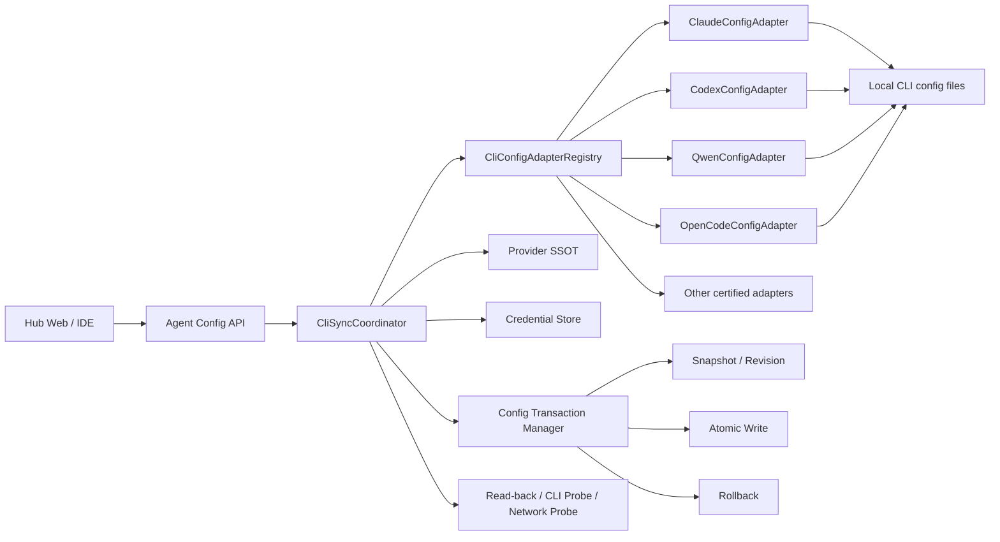
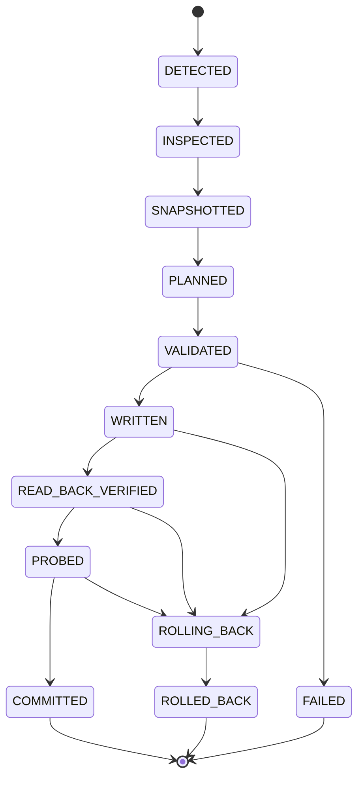

# Hub-RS 本地智能体 CLI 代理与模型同步规范

> 文档状态：目标规范（待实现）  
> 版本：1.0  
> 日期：2026-08-08  
> 适用范围：`super-agent/hub-rs` 对本地 Agent CLI 的代理端点、认证凭据、默认模型及模型映射同步  
> 不适用范围：单次执行的 `--model`/ACP `modelId` 覆盖、MCP/Skill 同步、云端账号同步

---

## 一、结论

Hub-RS 必须采用“统一同步事务 + 每个 CLI 独立配置适配器”的架构，禁止继续用一个 `sync_claude_like` 配置结构覆盖多种 CLI。

本规范吸收两类参考实现的优点：

- CC Switch：SQLite 作为 Provider 单一事实源，区分覆盖式和增量式应用，按应用写入真实配置，使用原子写、读回和回填机制；
- Antigravity Manager：按 CLI 管理多份配置文件，首次同步前备份，提供同步状态检测和恢复入口。

但不照搬其具体字段。参考项目也存在版本相关或语义不严谨的实现，例如仅用正则判断 Codex `base_url`、把 `model` 同时写入 Provider 表、用“文件存在且 URL 相同”代表整体同步成功。Hub-RS 必须以目标 CLI 当前版本的官方 Schema、帮助信息和实际探测结果为最终契约。

核心不变量：

1. 统一的是领域模型、事务状态和返回结果，不是落盘格式。
2. 同步成功必须代表“写入、读回、语义校验均成功”；只有文件写入成功不得返回 `APPLIED`。
3. Provider、模型、协议和认证是四个独立维度，不得压缩成三个字符串后盲写。
4. 代理协议与 CLI 协议不兼容时，必须经过 Hub 本地协议路由，禁止把不兼容的上游 URL 直接写入 CLI。
5. 修改用户配置前必须快照；多文件配置必须作为一个事务提交，失败自动回滚。
6. 不得覆盖与本次同步无关的权限、MCP、Skill、Prompt、OAuth 登录和用户偏好。
7. 未通过适配器认证测试的 CLI 只能标记为 `UNSUPPORTED` 或 `EXPERIMENTAL`，不得复用其他 CLI 格式并返回成功。

---

## 二、参考实现结论

### 2.1 CC Switch

CC Switch 的有效设计点：

- `cc-switch.db` 保存 Provider 等配置，作为 SSOT；活动 CLI 文件是投影，不是主数据；
- Claude、Codex、Gemini 等覆盖式应用使用当前 Provider 投影；OpenCode、OpenClaw、Hermes 等使用增量 Provider 注册；
- Claude 写入后重新读取 `settings.json`；Codex 在写入前解析 TOML，并把 `auth.json + config.toml` 作为关联配置处理；
- Codex Provider 切换尽量只修改 `config.toml`，避免破坏用户已有 ChatGPT OAuth 登录缓存；
- 配置写入使用原子文件替换；部分多文件写入失败时回滚先前文件；
- 支持从活动文件回填 Provider，避免用户手工修改被无声丢弃；
- 本地路由负责 Anthropic Messages、OpenAI Responses/Chat 等协议转换，真实密钥可以只保留在管理端并由路由注入。

### 2.2 Antigravity Manager

Antigravity Manager 的有效设计点：

- 一个 CLI 可以声明多个关联文件：Claude 为 `.claude.json + settings.json`，Codex 为 `auth.json + config.toml`，Gemini 为 `.env + settings.json + config.json`；
- 同步前为每个既有文件创建一次 `.antigravity.bak`；
- 采用“同目录临时文件 + rename”方式降低半写入风险；
- 提供 `installed/version/is_synced/has_backup/current_base_url/files` 状态；
- 提供显式 restore；没有备份时才尝试恢复官方默认端点。

### 2.3 Hub-RS 应改进之处

Hub-RS 不采用以下简化做法：

- 不用一个通用 JSON 模板适配所有 CLI；
- 不仅比较 Base URL，还必须比较 Provider、认证方式、模型和协议；
- 不把解析失败的既有文件直接当成空对象覆盖；
- 不用普通正则编辑 TOML/JSON5/YAML；必须使用对应语法解析器并保留未知字段；
- 不默认修改 `hasCompletedOnboarding` 等与代理模型无关的状态；如确有需求，应作为独立显式操作；
- 不在 Provider 表中写入 CLI Schema 未声明的字段；
- 不把真实 API Key 输出到同步响应、日志、预览或备份元数据。

---

## 三、领域模型

### 3.1 ProviderSpec

```json
{
  "providerId": "deepcloud-local",
  "displayName": "DeepCloud Local Gateway",
  "endpoint": "http://127.0.0.1:3001",
  "upstreamProtocol": "OPENAI_RESPONSES",
  "credentialRef": "keyring://deepcloud/providers/deepcloud-local",
  "modelsEndpoint": "/v1/models",
  "enabled": true
}
```

约束：

- `providerId` 是稳定标识，不使用显示名称作为配置键；
- `endpoint` 保存服务根地址，适配器负责补充 `/v1`、`/v1/messages` 或 `/v1/responses`；
- `credentialRef` 只引用凭据，不承载明文；
- `upstreamProtocol` 必须是显式枚举：`ANTHROPIC_MESSAGES | OPENAI_RESPONSES | OPENAI_CHAT | GEMINI | CUSTOM`。

### 3.2 ModelSelection

```json
{
  "defaultModel": "gpt-5.6",
  "reasoningEffort": "high",
  "roleMappings": {
    "default": "gpt-5.6",
    "fast": "gpt-5.6-mini",
    "strong": "gpt-5.6"
  },
  "source": "USER_SELECTED"
}
```

`roleMappings` 用于 Claude 的 Haiku/Sonnet/Opus 角色映射或其他 CLI 的快/强模型映射。目标 CLI 不支持角色映射时，适配器只投影 `defaultModel`，不能伪造字段。

### 3.3 CliTarget

```json
{
  "kind": "codex",
  "executable": "C:/path/to/codex.exe",
  "version": "1.2.3",
  "configRoot": "C:/Users/user/.codex",
  "managementMode": "EXCLUSIVE",
  "adapterRevision": "codex-v2"
}
```

管理模式：

| 模式 | 含义 | 典型 CLI |
|---|---|---|
| `EXCLUSIVE` | 活动配置只指向一个 Provider，切换会改变默认路由 | Claude、Codex、Gemini |
| `ADDITIVE` | 在 Provider 注册表增加/更新 Hub Provider，不删除其他 Provider | OpenCode、OpenClaw、Hermes |
| `RUNTIME_ONLY` | 没有经过认证的持久化格式，只允许单次启动参数或协议参数 | ACP 类或未知 CLI |

### 3.4 SyncRequest

```json
{
  "providerId": "deepcloud-local",
  "model": {
    "defaultModel": "gpt-5.6",
    "reasoningEffort": "high"
  },
  "persistDefault": true,
  "expectedRevision": "sha256:...",
  "validationLevel": "CLI_PROBE",
  "allowNetworkProbe": false
}
```

`persistDefault=false` 表示不修改本地文件，只用于单次执行参数；不得调用持久化同步事务。

---

## 四、目标架构



职责边界：

- `CliSyncCoordinator`：状态机、锁、事务、审计、响应，不理解具体文件字段；
- `CliConfigAdapter`：路径发现、版本能力、解析、语义合并、渲染、读回和探测；
- `ConfigTransactionManager`：快照、原子替换、多文件提交与回滚；
- `ProviderStore`：Provider、模型映射、适配器版本和最近一次有效结果；
- `CredentialStore`：密钥保存与临时解析；
- `LocalProtocolGateway`：仅在协议不兼容或需要密钥隔离、模型映射、故障转移时参与数据面。

---

## 五、适配器契约

```rust
#[async_trait]
pub trait CliConfigAdapter: Send + Sync {
    fn kind(&self) -> AgentKind;
    async fn detect(&self) -> Result<CliInstallation, SyncError>;
    async fn capabilities(&self, install: &CliInstallation)
        -> Result<CliConfigCapabilities, SyncError>;
    async fn inspect(&self, install: &CliInstallation)
        -> Result<EffectiveCliConfig, SyncError>;
    async fn plan(&self, request: &ResolvedSyncRequest)
        -> Result<ConfigMutationPlan, SyncError>;
    fn validate_rendered(&self, plan: &ConfigMutationPlan)
        -> Result<(), SyncError>;
    async fn probe(&self, expected: &EffectiveCliConfig)
        -> Result<ProbeResult, SyncError>;
}
```

适配器必须声明：

- 支持的 CLI 版本范围；
- 配置目录发现规则及环境变量覆盖；
- 关联文件集合、格式和权限；
- 配置优先级：系统、用户、项目、环境变量、命令行；
- 管理模式；
- 是否需要重启；
- 是否支持默认模型、Provider、角色映射、Reasoning Effort；
- 是否支持安全凭据引用，还是必须把密钥投影到 CLI 文件；
- 可用的离线探测和联网探测命令。

禁止为未认证版本返回空能力后继续写文件。

---

## 六、同步事务状态机



执行步骤：

1. 检测可执行文件、真实路径和版本；
2. 读取所有配置层，计算当前有效配置和 `revision`；
3. 校验 `expectedRevision`，不一致返回 `CONFIG_CONFLICT`；
4. 获取该 CLI 的跨进程文件锁；
5. 快照每个目标文件的“是否存在、原始字节、权限、哈希”；
6. 解析原文件并执行语义合并；解析失败必须停止，不得重建为空配置；
7. 在内存中完成 JSON/TOML/YAML/JSON5 Schema 和语义校验；
8. 写入同目录临时文件，设置原权限，然后原子替换；
9. 多文件按计划写入；任一步失败按逆序恢复全部快照；
10. 重新读取全部配置层，确认有效 Provider、Base URL、认证类型和模型；
11. 按请求执行 CLI 离线探测，可选执行最小联网探测；
12. 提交审计记录并返回有效配置；
13. 释放锁。

原子替换必须封装平台差异。Windows 不应假定 `rename` 能无条件覆盖已存在文件；实现应使用安全替换 API或“目标备份 + replace + 回滚”的平台策略。

---

## 七、代理协议选择规则

| CLI 入站协议 | 上游协议 | 写入目标 | 是否需要 Hub 路由 |
|---|---|---|---|
| Anthropic Messages | Anthropic Messages | 可直连上游或 Hub | 可选 |
| Anthropic Messages | OpenAI Responses | 必须写 Hub 本地 Anthropic 地址 | 必须 |
| Anthropic Messages | OpenAI Chat | 必须写 Hub 本地 Anthropic 地址 | 必须 |
| OpenAI Responses | OpenAI Responses | 可直连上游或 Hub | 可选 |
| OpenAI Responses | Anthropic Messages | 必须写 Hub 本地 Responses 地址 | 必须 |
| Gemini | 非 Gemini | 必须写 Hub 的 Gemini 兼容地址 | 必须 |

需要 Hub 路由时：

- CLI 配置中的 Base URL 指向 Hub 本机回环地址；
- CLI 文件只写代理占位凭据或 Hub 局部令牌；
- 真实上游凭据保存在 `CredentialStore`；
- Hub 根据当前 Provider 执行认证注入、模型映射、协议转换、重试和故障转移；
- Hub 必须防止本地其他进程无认证调用代理，至少使用随机本机令牌并限制监听 `127.0.0.1`。

这与 CC Switch 的 Claude→本地 Messages 路由→OpenAI Responses 上游模式一致。

---

## 八、首批 CLI 投影规范

### 8.1 Claude Code

目标文件：`~/.claude/settings.json`。

```json
{
  "model": "gpt-5.6",
  "env": {
    "ANTHROPIC_BASE_URL": "http://127.0.0.1:3001/anthropic",
    "ANTHROPIC_AUTH_TOKEN": "${DEEPCLOUD_CLI_TOKEN}"
  }
}
```

规则：

- 默认模型写根节点 `model`；
- Base URL 使用 `env.ANTHROPIC_BASE_URL`；
- 认证严格选择 `ANTHROPIC_API_KEY` 或 `ANTHROPIC_AUTH_TOKEN`，切换时清理适配器自己管理的冲突字段；
- 不修改 `permissions`、hooks、plugins、MCP 等未知字段；
- 不默认创建或改写 `~/.claude.json` 的 onboarding 状态；
- 单次运行的 `--model` 高于持久化默认模型，状态响应必须显示最终来源；
- CLI 探测必须使用当前版本支持的参数，不得使用未出现在 `--help` 的 `--cwd`、`--session`、`--system`。

### 8.2 Codex CLI

目标文件：`~/.codex/config.toml`；只有认证策略明确要求时才修改 `~/.codex/auth.json`。

```toml
model = "gpt-5.6"
model_provider = "deepcloud"
model_reasoning_effort = "high"

[model_providers.deepcloud]
name = "DeepCloud Local Gateway"
base_url = "http://127.0.0.1:3001/v1"
wire_api = "responses"
env_key = "DEEPCLOUD_CLI_TOKEN"
```

规则：

- `model` 和 `model_provider` 位于顶层；
- Provider 使用 `base_url`、`wire_api`、`env_key` 等当前 Schema 字段；
- 禁止写 `apiBase`；禁止把 `model` 写进 Provider 表，除非未来官方 Schema 明确支持；
- 第三方 Provider 切换默认保留已有 ChatGPT OAuth `auth.json`；
- 不得把 `custom.apiKey` 当成通用认证结构；
- 通过 `toml_edit` 或等价保留格式的编辑器修改，保留 MCP、features、profiles 和注释；
- 读回时根据顶层 `model_provider` 精确定位活动 Provider，不扫描任意第一个 `base_url`。

### 8.3 Qwen Code

目标文件和结构必须由 Qwen 专属适配器按已检测版本生成，至少覆盖：

- `model.name`；
- `modelProviders` 中的 Provider 定义和 `baseUrl`；
- `envKey` 对凭据的引用；
- `security.auth.selectedType`。

在该适配器完成 Schema fixture 和真实 CLI 探测前，Qwen 的持久化同步状态为 `EXPERIMENTAL`，禁止回退到 Claude 格式。

### 8.4 OpenCode、OpenClaw、Hermes

此类 CLI 优先采用 `ADDITIVE`：

- 只增加或更新 `deepcloud` Provider；
- 不覆盖内置 `openai/google/anthropic` Provider；
- 不删除用户自定义 Provider；
- 默认模型必须用 `provider/model` 形式时，由适配器生成；
- 清除同步只删除 Hub 所有且带管理标记的节点；
- JSON5/YAML 必须使用对应解析器，不能先转换成普通 JSON 后丢失语义。

### 8.5 其他 Agent CLI

Cursor Agent、CodeBuddy、Copilot、DevEco、Pi、Antigravity、Kimi、Kiro、Qoder、TraeCLI、Grok 等必须逐个满足以下准入条件后才允许持久化同步：

1. 有官方配置文档或从当前安装版本得到可验证 Schema；
2. 有独立 Adapter，不调用 Claude/Qwen/Codex Adapter；
3. 有至少一个版本 fixture；
4. 保留未知字段测试通过；
5. 写入、读回、回滚测试通过；
6. 真实 CLI 最小探测通过。

未满足时统一使用 `RUNTIME_ONLY`，仅允许本次执行的合法模型参数或协议 `modelId`。

---

## 九、配置优先级与有效值

同步状态不能只展示“文件里写了什么”，必须展示 CLI 最终会使用什么。

统一优先级模型：

```text
CLI argument
  > process environment
  > project/workspace config
  > user config
  > system defaults
  > CLI built-in default
```

具体顺序以适配器对应版本为准。返回值必须标记来源：

```json
{
  "requestedModel": "gpt-5.6",
  "persistedModel": "gpt-5.6",
  "effectiveModel": "gpt-5.6",
  "modelSource": "USER_CONFIG",
  "effectiveProvider": "deepcloud",
  "effectiveBaseUrl": "http://127.0.0.1:3001/v1"
}
```

若项目配置或环境变量覆盖用户配置，同步可以完成，但状态必须为 `APPLIED_WITH_OVERRIDE`，并返回覆盖来源；不得宣称模型已生效。

---

## 十、HTTP API 契约

### 10.1 预览同步

```http
POST /api/agents/{kind}/config/sync/plan
```

返回目标文件、字段级变更、是否需要路由、是否需要重启和警告。所有密钥必须脱敏。

### 10.2 执行同步

```http
POST /api/agents/{kind}/config/sync
```

成功响应：

```json
{
  "status": "APPLIED",
  "transactionId": "01J...",
  "cli": {
    "kind": "codex",
    "version": "1.2.3",
    "adapterRevision": "codex-v2"
  },
  "requestedModel": "gpt-5.6",
  "effectiveModel": "gpt-5.6",
  "modelSource": "USER_CONFIG",
  "effectiveProvider": "deepcloud",
  "effectiveBaseUrl": "http://127.0.0.1:3001/v1",
  "files": [
    {
      "path": "C:/Users/user/.codex/config.toml",
      "result": "UPDATED",
      "beforeRevision": "sha256:...",
      "afterRevision": "sha256:..."
    }
  ],
  "validation": {
    "syntax": "PASSED",
    "semantic": "PASSED",
    "readBack": "PASSED",
    "cliProbe": "PASSED",
    "networkProbe": "SKIPPED"
  },
  "restartRequired": true,
  "warnings": []
}
```

禁止继续返回仅有 `{ "success": true }` 的响应。

### 10.3 状态、历史和恢复

```http
GET  /api/agents/{kind}/config/status
GET  /api/agents/{kind}/config/sync/history
POST /api/agents/{kind}/config/restore
```

恢复必须指定 `transactionId` 或 `revision`。禁止“找不到备份就写官方默认配置”的隐式恢复；那是重置操作，应另设接口并二次确认。

---

## 十一、错误码

| 错误码 | 含义 |
|---|---|
| `CLI_NOT_INSTALLED` | 未检测到 CLI |
| `CLI_VERSION_UNSUPPORTED` | 当前版本无认证适配器 |
| `CONFIG_NOT_READABLE` | 配置不可读取 |
| `CONFIG_PARSE_FAILED` | 既有配置无法解析，未执行覆盖 |
| `CONFIG_CONFLICT` | `expectedRevision` 与当前文件不一致 |
| `CONFIG_LOCKED` | 其他进程正在修改配置 |
| `SCHEMA_VALIDATION_FAILED` | 渲染结果不符合目标 Schema |
| `PROTOCOL_INCOMPATIBLE` | 直连协议不兼容且本地路由不可用 |
| `CREDENTIAL_UNAVAILABLE` | 凭据引用无法解析 |
| `ATOMIC_WRITE_FAILED` | 原子写入失败 |
| `READ_BACK_MISMATCH` | 读回结果与计划不一致 |
| `CLI_PROBE_FAILED` | CLI 未接受配置 |
| `NETWORK_PROBE_FAILED` | 联网最小探测失败 |
| `ROLLBACK_FAILED` | 回滚失败，需要人工处理 |

所有错误响应必须携带 `transactionId`、安全的诊断信息和是否已回滚，不能包含 API Key。

---

## 十二、安全与审计

1. 密钥默认进入操作系统 Keychain/Credential Manager 或 Vault，不进入 Provider 普通 JSON。
2. CLI 必须明文读取密钥时，只向它规定的位置投影最少数据，并继承/收紧原文件权限。
3. 预览、日志、SSE、异常、备份清单和审计表统一使用 `SecretRedactor`。
4. Base URL 只允许 `https`；`http` 仅允许回环地址或显式信任的开发地址。
5. 防止符号链接和重解析点把目标文件引到配置根目录之外。
6. Adapter 生成 Provider ID、TOML section、JSON key 前必须进行字符白名单校验，防止配置注入。
7. 联网探测默认关闭；启用时只发送固定最小提示，不发送工作区内容。
8. 审计只保存字段路径和哈希，不保存密钥值及完整敏感文件。

---

## 十三、测试与准入矩阵

每个 Adapter 至少包含：

- 空配置创建；
- 已有未知字段保留；
- 已有 MCP/权限/OAuth 不丢失；
- 错误 JSON/TOML/YAML 拒绝覆盖；
- 模型、Provider、Base URL、协议字段精确投影；
- 冲突认证字段清理范围正确；
- 同步幂等；
- `expectedRevision` 冲突；
- 第二个文件写入失败后完整回滚；
- Windows/macOS/Linux 路径和原子替换；
- CLI 版本上下界；
- CLI `--help`/配置检查探测；
- 项目配置或环境变量覆盖检测；
- 日志和响应不泄露密钥。

成熟度等级：

| 等级 | 条件 | UI 行为 |
|---|---|---|
| `CERTIFIED` | Fixture、事务、真实 CLI 探测全部通过 | 允许默认同步 |
| `EXPERIMENTAL` | Schema/fixture 通过，缺真实版本矩阵 | 用户显式开启并展示警告 |
| `RUNTIME_ONLY` | 只验证了启动参数或协议 | 不展示持久化同步按钮 |
| `UNSUPPORTED` | 无可靠配置契约 | 禁止调用同步接口 |

首批验收应只认证当前机器可真实测试的 Claude Code 和 Codex CLI；其他 CLI 不因注册了 Backend 就自动获得同步能力。

---

## 十四、实施阶段

### M1：收口错误能力声明

- 删除 `sync_claude_like` 在非 Claude Backend 中的复用；
- 增加 `CliConfigCapability` 和成熟度；
- 旧同步接口对未认证 CLI 返回 `CLI_VERSION_UNSUPPORTED`；
- 把运行时模型覆盖与持久化同步拆成两个明确用例。

### M2：同步事务内核

- 实现 inspect、plan、revision、锁、快照、原子写、读回和回滚；
- 增加预览、状态、历史、恢复接口；
- 响应从布尔值升级为结构化结果。

### M3：Claude 与 Codex 认证适配器

- 按本规范修正字段；
- 使用本机已安装版本完成集成测试；
- 覆盖 OAuth 保留、环境覆盖和启动参数优先级。

### M4：本地协议路由闭环

- 根据协议矩阵决定直连或 Hub 路由；
- 代理令牌、真实凭据隔离；
- 模型映射和 `/v1/models` 有效模型校验；
- 最小网络探测和故障诊断。

### M5：逐个扩展其他 CLI

- 先 Qwen/OpenCode，再按实际业务需求增加；
- 一个 CLI 一个 Adapter、Schema fixture 和版本矩阵；
- 禁止以“字段看起来相似”为依据批量开放。

---

## 十五、参考资料

### 参考项目

- [CC Switch 仓库](https://github.com/farion1231/cc-switch)
- [CC Switch Provider Live 配置实现](https://github.com/farion1231/cc-switch/blob/main/src-tauri/src/services/provider/live.rs)
- [CC Switch Codex 配置与原子写实现](https://github.com/farion1231/cc-switch/blob/main/src-tauri/src/codex_config.rs)
- [CC Switch 配置文件与 SSOT 说明](https://github.com/farion1231/cc-switch/blob/main/docs/user-manual/en/5-faq/5.1-config-files.md)
- [CC Switch Claude/Codex 协议路由说明](https://github.com/farion1231/cc-switch/blob/main/docs/guides/claude-codex-routing-guide-en.md)
- [Antigravity Manager 仓库](https://github.com/lbjlaq/Antigravity-Manager)
- [Antigravity Manager 多 CLI 同步、状态和恢复实现](https://github.com/lbjlaq/Antigravity-Manager/blob/main/src-tauri/src/proxy/cli_sync.rs)

### CLI 官方契约

- [Claude Code 模型配置](https://code.claude.com/docs/en/model-config)
- [Claude Code 环境变量](https://code.claude.com/docs/en/env-vars)
- [Codex 配置 Schema](https://github.com/openai/codex/blob/main/codex-rs/core/config.schema.json)
- [Qwen Code Settings](https://github.com/QwenLM/qwen-code/blob/main/docs/users/configuration/settings.md)
- [Gemini CLI Configuration](https://github.com/google-gemini/gemini-cli/blob/main/docs/reference/configuration.md)

上述外部实现和文档会随版本变化。Adapter 必须记录验证时的 CLI 版本和 `adapterRevision`，不能把本文示例当成永不变化的硬编码事实。

---

DeepCloud rule initialized!
