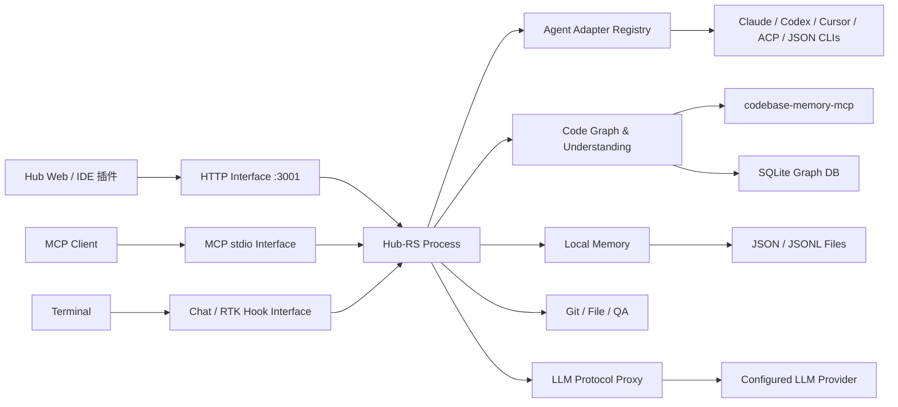
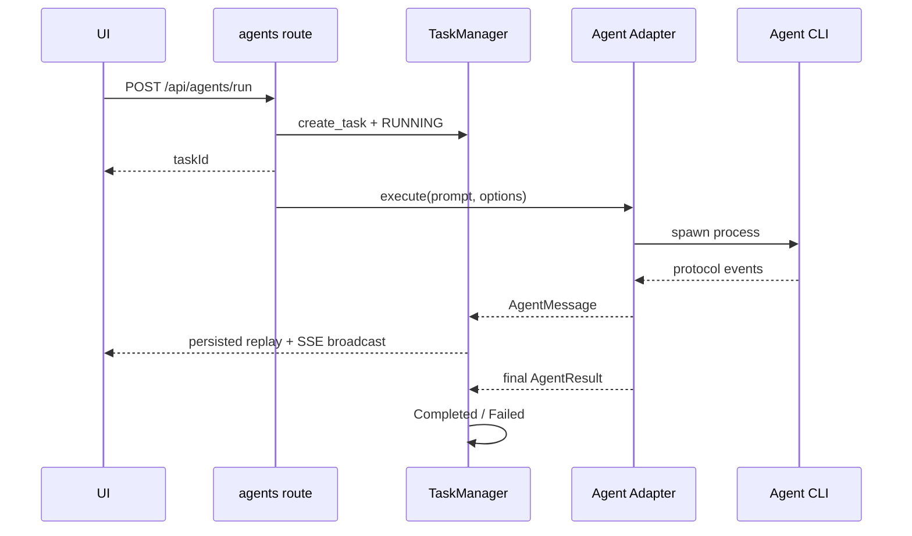
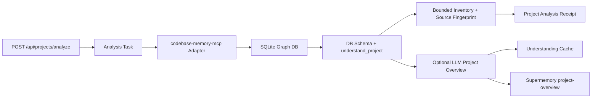

# Hub-RS 系统架构设计与代码逻辑审查

> 审查日期：2026-08-08  
> 审查范围：`super-agent/hub-rs` Rust 实现，不包含外层 `hub-web`、IDE 插件和安装器的完整实现。  
> 事实来源：当前源码、`Cargo.toml`、启动脚本与 `cargo test --all-targets`。  
> 结论口径：本文区分“已注册 Interface”“代码可编译”“逻辑闭合”“需要真实外部环境验证”，不把路由存在等同于功能可用。

---

## 一、结论摘要

Hub-RS 已形成一个可编译的本地代码智能与多 Agent Hub，核心骨架包括：

- 单二进制四种运行角色：HTTP、CLI Chat、MCP stdio、RTK Hook；
- 17 类本地 Agent CLI 的发现、统一启动 Interface、事件归一化和任务记录；
- Codebase Memory SQLite 图谱查询、项目理解、语义/混合检索；
- 本地 Supermemory、影子 Git、文件浏览、QA 工具；
- OpenAI、Anthropic、Gemini 入口形态的 LLM Proxy；
- 需求逆向、架构分析、领域流、影响分析和导读生成。

但是，**当前不能判定“全部功能正常可用”**。117 个 Rust 测试全部通过，只能证明已覆盖的 Module；以下问题仍会直接阻断或削弱真实使用：

1. `start-hub.ps1` 未传 `service`，程序会进入 RTK Hook 模式，HTTP Hub 无法按脚本启动。
2. Stream-JSON/JSON/App-Server/ACP Adapter 已统一取消令牌、进程终止与 cancelled/timeout/failed 终态；仍需补 fake/真实 CLI 的进程契约测试。
3. Agent SSE 已在 Task 终态前持久化并广播终态事件，随后关闭 event sender；本轮要求以 Task 内单调序号和原子“历史快照 + 实时订阅”关闭 backlog/live 交界窗口，断连端到端恢复继续作为验收项。
4. Gemini 与 OpenAI Responses Converter 仍为透传占位；跨上游 Provider 的请求体和认证也未完整转换。
5. MCP 的图谱路径硬编码为 `{project}/.deepcloud/graph.db`，与 HTTP Runtime 使用的缓存 DB 路径不一致；DB 缺失还会返回“成功”。
6. Rust HTTP 已限制为回环地址和 localhost Origin；IDE/Next 启动脚本同样必须限制为 loopback，分发产物禁止携带 Provider 凭据。文件、Git、QA、Agent cwd 必须从 Runtime 配置的项目根或显式 Workspace Capability 解析；调用方路径不是授权。审批写路由的自定义 Header 只是过渡保护，仍需统一启动期随机令牌/握手。

因此当前成熟度应定义为：**核心 Module 原型可编译，若干局部链路可用，系统级闭环尚未完成。**

---

## 二、系统定位

Hub-RS 是一个本地单进程控制面，把代码图谱、LLM、Agent CLI、Git、QA 和持久化工具聚合到统一 Interface。它不是 DeepCloud 微服务的一部分，也不依赖 Spring Cloud；主要部署形态是本机桌面程序或 IDE 附带进程。

---

## 三、运行角色与启动分派

入口为 `src/main.rs -> cli::dispatch()`：

| 命令 | 角色 | 实现 |
|---|---|---|
| `hub-rs service [PORT]` | Axum HTTP Hub | `server::serve`，默认 `127.0.0.1:3001` |
| `hub-rs chat` | 交互式 LLM Chat | `repl::run_chat` |
| `hub-rs mcp` | MCP JSON-RPC stdio | `mcp_server::run_mcp` |
| 其他命令或无参数 | RTK Hook/CLI | `rtk::cli::run` |

关键不变量：**启动 HTTP 必须显式传入 `service`**。当前 `start-hub.ps1` 直接启动 exe，没有参数，因此脚本与 CLI Interface 不匹配。

HTTP 进程的共享状态 `AppState` 保存以下核心 Module：

- `RuntimeConfig`：外部工具、项目、缓存和图谱路径；
- `AppPaths`：安装目录与可写数据目录；
- `TaskManager`：文件持久化任务及进程内事件总线；
- `reqwest::Client`：LLM 与 Proxy 共用 HTTP Adapter；
- `CertificationGatekeeper`：能力发现与认证状态；
- `ToolApprovalStore`：跨进程工具审批控制面；
- `EvolutionMemory`：跨 Run 的证据门控策略存储；
- `VisualPipelineRuntime`：Screenshot/OCR/Translation Provider Registry、Artifact Store 与流水线编排。

---

## 四、Module 划分

| Module | Interface | Implementation 与职责 | 状态 |
|---|---|---|---|
| Server Bootstrap | `service [port]`、Axum Router | 初始化配置、任务管理、CORS、Trace | 基本完成；缺少优雅停止与安全收口 |
| Agent Runtime | `/api/agents/*` | Agent 检测、Registry、17 个 Adapter、事件统一 | 取消与超时主链完成；HTTP 默认 30 分钟、调用方可在 1 秒至 24 小时内覆盖 |
| Task Runtime | `/api/tasks/*` | Task JSON、日志、事件 JSONL、broadcast、取消 watch | 状态转换串行化，终态不可覆盖；JSON 使用临时文件与备份恢复 |
| Tool Execution & Approval | `ToolExecutionGateway`、`/api/tool-approvals/*` | 工具策略、运行内循环保护、待审批记录、批准/拒绝、参数绑定的一次性消费 | 第一版完成；审批写路由要求 `X-Hub-Approval` 防跨站表单提交 |
| Cognitive Runtime | Run 级 `next_guidance`、`observe_tool`、`review_completion` | 任务分类、结构化 Run Plan、收据驱动推进、失败重规划、完成审查、模型轮次预算 | 自适应第二版完成；真实模型质量仍需评测集验证 |
| Evolution Memory | `observe`、`promoted_guidance`、`/api/evolution/strategies` | Run 结果选择、候选/晋升/拒绝状态、跨 Run 策略复用与只读审计 | 证据门控第一版完成；当前仅允许内置有界策略族 |
| Project Analysis | `/api/projects/analyze`、`/api/workspaces/analyze` | 共享 Task 生命周期，调用 codebase-memory-mcp 建图，校验 DB，生成确定性清单/源码指纹与可选 LLM 概览 | Project Analysis Receipt 第一版完成；已用随包 CBM 0.8.1 做 HTTP 冒烟 |
| Workspace Intelligence | `/api/workspaces/*` | 显式 Open 登记 Workspace Capability，聚合 Readiness、分析 Receipt、图谱、Knowledge Corpus、Git 与 Agent Task | UI 唯一项目工作台；切换工作区自动恢复状态 |
| Change Set Runtime | `/api/agents/tasks/*/{diff,verify,apply}` | 从隔离运行目录生成结构化 Change Set，执行有限自动验证，只应用用户确认文件并处理删除 | Apply 默认受 Verification Receipt 门禁；强制绕过必须留痕 |
| Visual Pipeline | `/api/vision/*` | 稳定 Provider Interface、xcap 截图、PaddleOCR-rs ONNX、LLM/DeepL/Google 翻译、外部命令插件、Artifact 与 Receipt | 首个纵切完成；scap 通过插件适配器接入，不绑定前端 |
| Code Understanding | `/api/context/*`、`/api/understand/*` | SQLite 图查询、FTS/向量混合检索、LLM 解释、缓存 | 主要逻辑存在；真实 DB 兼容需验证 |
| Analysis | `/api/analyze/*` | 架构、领域、影响面、导读 | 部分闭合；领域与影响算法较浅 |
| Reverse Engineering | `/api/reverse*` | 规则引擎、需求分析、执行计划生成 | 部分闭合；影响图推演明确 TODO |
| Memory | `/api/memory/*` | 项目级 JSON 记忆、关键词检索、聊天增强 | 可用原型；并发写和检索质量有限 |
| Git/File/QA | `/api/git*`、`/api/files*`、`/api/qa/*` | libgit2、影子快照、文件读取、Patch、质量工具 | 文件路由已接入 Workspace Guard；Git/QA 必须统一消费同一 Workspace Capability，并覆盖受管目录外路径拒绝测试 |
| QA | `/api/qa/*` | Playwright、codegen、k6 子进程 | 直接执行；无任务化、超时和取消 |
| LLM Proxy | `/proxy/*` | 请求/响应协议转换、SSE 转换 | OpenAI→Anthropic SSE 较完整；其他方向不完整 |
| MCP | `mcp` stdio | 4 个工具：需求分析、快照、历史、回滚 | 原型；配置/路径与 HTTP Runtime 分叉 |
| RTK | 默认命令角色 | 命令输出压缩和 Hook | 作为本地 crate 链接；测试有较多 warning |

### 4.1 Visual Pipeline Adapter 边界

`VisualPipelineRuntime` 持有三个独立 Trait Registry：`ScreenshotProvider`、`OcrProvider`、`TranslationProvider`。路由只调用 Runtime，用 UUID 引用 Artifact；内置 SDK、环境密钥和外部进程协议均停留在 Adapter 层。设置写入 `app_data_root/vision/settings.json`，插件 Manifest 位于 `app_data_root/vision/plugins/`，截图位于 `app_data_root/vision/artifacts/`，最多保留 64 个并在 24 小时后过期。

- Windows xcap Adapter 优先使用 WGC；系统未提供 WGC 服务时尝试 GDI 屏幕 DC，并把双重失败作为可观察错误返回，不生成伪截图。
- PaddleOCR-rs 只在模型路径与字典文件均存在时 Ready；模型按路径、大小和修改时间缓存 OcrEngine。仓库固定了 0.2.7 的最小 vendor 修复，仅修正上游 `crate-type` 与未启用 Execution Provider 的编译门控，推理算法保持原实现。
- LLM Translation Adapter 复用 Hub Canonical Model Gateway；DeepL 和 Google Adapter 只从环境读取密钥。外部插件通过有界 JSON stdin/stdout 接入，Manifest 重载只发现插件、不执行插件。

---

## 五、HTTP Interface 清单

### 5.1 Agent 与任务

- Agent：发现、运行、SSE 事件、配置同步、Skill 安装/更新/卸载、MCP 列表、Model 列表。
- Task：任务列表、详情、文本日志、可恢复 SSE 事件、交互/纠偏、取消。
- Workspace Intelligence：Open/Readiness、分析、聚合快照、Knowledge Document 导入/检索/重建/删除、影子快照/回滚。

### 5.2 代码理解

- 文件树、文件内容、单文件分析、项目图谱；
- 关键词、语义、混合上下文检索；
- 文件理解、项目理解；
- 架构、领域流、影响面和阅读导览。

### 5.3 工具与自动化

- Git 状态、Diff、恢复、历史、影子快照/回滚、Patch、Clone；
- Playwright 用例发现/执行/录制，k6 执行；
- 代码压缩、需求逆向、执行计划。
- 工具审批：列表/详情，以及批准、拒绝；状态写入只接受带 `X-Hub-Approval: approve|deny` 的本地控制面请求。
- 视觉流水线：Provider/Monitor 发现、设置、插件重载、截图 Artifact、OCR、翻译和组合执行；所有执行均为显式控制面请求。

### 5.4 LLM 与记忆

- LLM 设置、Claude 设置与运行；
- 本地 Memory 查询/写入、Supermemory Chat/日志；
- Anthropic/OpenAI/Gemini 兼容入口。
- Evolution：只读查看 Candidate、Promoted、Rejected 策略及累计成功/失败证据。

完整路由由 `src/server.rs` 聚合，实际定义位于 `src/routes/`。

---

## 六、核心执行链

### 6.1 Agent 异步执行

统一事件模型包括 Text、Thinking、ToolUse、ToolResult、Status、Error 和 Log。Adapter 分为：

- Stream JSON：Claude、Cursor、Qwen、CodeBuddy；
- JSON/JSONL：Copilot、OpenCode、DevEco、OpenClaw、Pi、Antigravity；
- ACP：Hermes、Kimi、Kiro、Qoder、TraeCLI、Grok；
- Codex App Server：JSON-RPC stdio。

当前 Seam 统一 AgentMessage、AgentResult 与取消 watch。TaskManager 不直接持有每种 CLI 的 `Child`；Adapter 作为进程生命周期 Adapter 持有并终止子进程。必须满足：取消提交成功后 Task 终态固定为 Cancelled，Adapter 结果不得覆盖；timeout、cancelled、failed 不得互相折叠；HTTP Agent Run 默认具有有限超时并允许调用方覆盖。

### 6.2 项目索引与理解

两个分析入口必须复用 `AppState` 中的同一个 TaskManager，保证 `/api/tasks/*` 的状态、取消和事件订阅指向同一运行实例。Task 只有在外部索引成功、SQLite `nodes/edges` Schema 可读、结构化分析与 Project Analysis Receipt 持久化后才完成；LLM 概览是可降级增强。后续 Context、Understand 和 Analyze Module 都直接读取相同 SQLite 表，包括 `nodes`、`edges`、向量及 FTS 数据。DB 已进行最低 Schema 校验，完整版本协商仍待补充。

### 6.3 混合检索、Knowledge Corpus 与聊天

用户问题同时进入本地 Memory 关键词检索和图数据库 Hybrid Search；两类结果拼入 system prompt，再通过 `LlmProvider` 请求配置的模型。LLM 未配置时返回降级说明，不会尝试远程调用。

长文档不再由工具调用点逐条写入随机 UUID Memory。deep `KnowledgeCorpusRuntime` 通过一个窄 Interface 统一 Workspace Guard、格式识别、大小限制、内容哈希、幂等版本、结构化分块、批量向量化、原子替换、删除/重建和带分数检索。文本/Markdown、DOCX 与 PDF 是三个提取 Adapter；它们在文档提取 Seam 后统一产出 Knowledge Chunk。Corpus Manifest 与底层 Memory Record 保存在同一 Supermemory 检查点中，因此来源更新不会暴露半个版本。检索结果必须携带总分、关键词分、可用时的向量分，以及行、段落或页码 Citation；注入 Run Prelude 时仍按 Evidence 数据处理。

### 6.4 LLM Proxy

入口协议先由 `ProtocolConverter` 转成内部 OpenAI Chat 形态，然后请求配置的上游，最后由“入口 Converter”转换响应。该实现只在“上游也是 OpenAI-compatible”时基本成立；当上游配置为原生 Anthropic 或 Gemini 时，还缺少从内部标准格式到上游协议的第二个 Adapter。

### 6.5 Run 级认知控制

`CognitiveRuntime` 在每个 Run 开始时根据目标分类为 Conversational、Investigative 或 Execution，并创建结构化 `RunPlan`。Execution 计划为 Inspect → Act → Verify → Respond；Investigative 计划为 Evidence → Synthesize → Respond。每轮模型请求前投影当前步骤、失败次数和紧凑策略。工具执行后，它只通过规范化收据状态与风险推进步骤，不复制大型结果或敏感参数，模型文字也不能伪造步骤完成。连续两次执行失败产生一次 Replan 指令，要求改变假设、工具或证据来源，同时保留已完成步骤；若先修改后检查，则显式记录顺序违例，要求补做现状检查与验证并在最终结果中披露缺失的变更前证据。

模型产生文本草稿时，Runtime 先检查 Run Plan 是否闭合，再结合取证情况、全失败状态和草稿完整度决定接受或要求一次复核。关键不变量：复核每个 Run 最多一次；默认最多 40 个模型轮次；`fast` 模式不增加复核轮次；任何动态策略都不能覆盖 Tool Receipt 中的事实。

### 6.6 证据门控进化

每个 Run 结束时，`CognitiveRuntime` 输出不含用户原文的规范化报告：任务类型、是否完成、Run Plan 是否闭合、Replan 次数。`EvolutionMemory` 将报告映射到内置策略族并执行选择：策略先进入 Candidate；至少 3 次成功且失败率不高于 25% 才晋升为 Promoted；零成功且累计 3 次失败则 Rejected。只有 Promoted 策略会投影进后续同类 Run。

该 Module 吸收“变异—选择—保留”的进化思想，但明确限制变异空间：第一版只评估内置策略族，不保存原始目标，不从模型文本生成可执行规则，不修改源码、权限或审批状态。`request_reload` 仍是独立的进程控制工具，继续受 Tool Policy 和人工审批约束。

### 6.7 Workspace Intelligence 与安全 Apply

UI 只消费一个深的 Workspace Intelligence Interface。`Open` 将原生目录选择转成进程内 Workspace Capability 并返回 Workspace Readiness；随后分析、知识语料、Agent cwd 与变更应用复用同一规范路径。Task 的历史快照与实时 SSE 在 TaskManager 的 Sequenced Task Event Seam 汇合，页面断开或刷新后从最后事件序号恢复，不重新启动任务。

Agent 在隔离运行目录结束后，Change Set Runtime 计算逐文件 `added | modified | deleted` Receipt。用户可选择文件，验证 Module 在隔离目录运行有限的自动质量命令并写入 Verification Receipt；Apply 再次校验任务终态、相对路径和选择集合，只复制新增/修改文件并显式删除已确认的删除项。默认只有验证通过才能 Apply；显式强制绕过也必须写入 Task、Apply Receipt、影子 Git 和 Supermemory。

---

## 七、持久化设计

默认可写根目录为 `%USERPROFILE%/.aindex-hub`；Bundle 模式可由 `HUB_APP_DATA_ROOT` 覆盖。

| 数据 | 默认位置/规则 | 格式 |
|---|---|---|
| LLM/Claude 设置 | `app_data_root/settings/` | JSON |
| Task | `app_data_root/tasks/{id}.json` | JSON |
| Task 日志 | `app_data_root/tasks/{id}.log` | 文本 |
| Agent 会话账本 | `app_data_root/agent-sessions/{session-id}.events.jsonl` | JSONL；正常事件追加，压缩/重排时检查点重写；`HUB_AGENT_SESSION_ID` 选择会话 |
| 大型工具结果 | `app_data_root/tool-results/{xxh3}.json` | 完整 JSON；通过 `tool-result://{xxh3}` 引用分片读取；默认最多 512 项/256 MiB，按旧到新裁剪 |
| 工具审批 | `app_data_root/tool-approvals/{pending|approved|denied|consumed|expired}/{id}.json` | 不保存完整参数，仅保存规范化参数哈希；目录间原子移动决定状态，批准凭证单次消费 |
| 进化策略 | `app_data_root/evolution/strategies.json` | 有界策略及成功/失败计数；检查点替换带 `.json.bak` 崩溃恢复 |
| Understanding Cache | `app_data_root/cache/understanding/{db}.json` | JSON，最多 500 项 |
| Code Graph | `codebase_memory_cache_root/{project-key}.db` | SQLite |
| 项目 Memory / Corpus Manifest | `{project}/.supermemory/supermemory.json` | JSON；Corpus Manifest 与对应 Knowledge Chunk 原子提交，写入采用跨进程 advisory lock 与同目录临时文件替换 |
| Shadow Git | `{project}/.shadow-git` 或配置目录 | Git 仓库 |

多数旧 JSON 持久化仍采用读全量→修改→覆盖写，没有文件锁或跨进程并发控制。Task/Session 事件采用 append；Tool Approval 以同卷目录间 rename 作为跨进程状态转换和单次消费的不变量。

---

## 八、配置与外部依赖

主要环境变量：

- `HUB_BUNDLE_ROOT`、`HUB_APP_DATA_ROOT`、`HUB_WORKSPACE_ROOT`；
- `HUB_PROJECT_ROOT`、`HUB_PROJECTS_ROOT`；
- `HUB_CODEBASE_MEMORY_BIN`、`HUB_CODEBASE_MEMORY_DB_PATH`、`HUB_CODEBASE_MEMORY_CACHE_ROOT`；
- `HUB_UNDERSTAND_ANYTHING_ROOT`、`HUB_KNOWLEDGE_GRAPH_PATH`；
- `HUB_SHADOW_GIT_ROOT`、`HUB_RTK_BIN`。
- `HUB_TOOL_POLICY_MODE`：`audit`（兼容默认）、`read-only`（只允许只读工具）、`approval`（非只读工具必须经本地控制面逐次批准）。
- `HUB_REASONING_MODE`：`adaptive`（默认，按任务和证据决定复核）、`fast`（最低额外延迟）、`deliberate`（复杂/简单任务均执行一次完成审查）。
- `HUB_CAPABILITY_CATALOG_TTL_HOURS`：Catalog 能力证据有效期，默认 24 小时；`HUB_CAPABILITY_PROBE_TTL_HOURS`：真实 Probe 能力证据有效期，默认 168 小时；两者均被限制在 1～2160 小时。

运行依赖包括 Agent CLI、codebase-memory-mcp、Git、Node/npx、Playwright、k6 和配置的 LLM Provider。健康状态目前主要检查路径和设置，不验证所有外部命令是否可实际执行。

---

## 九、代码逻辑成熟度

| 能力 | 判断 | 依据 |
|---|---|---|
| Rust 编译与纯逻辑测试 | 🟢 | `cargo test`：117 passed |
| HTTP Router 组合 | 🟢 | 所有 routes 成功合并，编译通过 |
| HTTP 启动脚本 | 🔴 | 未传 `service`，进入 Hook 模式 |
| Agent CLI 检测 | 🟡 | 逻辑完整，依赖实际 PATH 与版本输出 |
| Agent 执行与事件归一化 | 🟡 | 四类 Adapter 已实现，缺真实 CLI 契约测试 |
| Agent 取消 | 🟢/🟡 | watch 已穿透共享 Adapter并 kill 子进程；状态竞态与终态词汇已统一，待 fake CLI 进程契约测试 |
| Agent SSE 完成语义 | 🟢/🟡 | Task 终态会先持久化/广播终态事件，再移除 sender 并结束 live stream；待端到端断连测试 |
| Skill/MCP 配置同步 | 🟡 | 多种本地配置写入，未覆盖所有 Agent 真实版本 |
| Code Graph 查询 | 🟡 | SQL 实现完整，缺真实 DB Schema 集成测试 |
| 架构/领域/影响分析 | 🟡 | 可生成报告，但算法存在单跳、ID 输入和 TODO |
| Local Memory | 🟡 | 关键词查询可用，并发一致性不足 |
| OpenAI-compatible Proxy | 🟡 | 非流式及部分流式可用 |
| Anthropic SSE 输出 | 🟢/🟡 | 转换测试充分；端到端上游兼容未验证 |
| Gemini Proxy | 🔴 | Converter 明确为 stub |
| OpenAI Responses Proxy | 🔴 | Converter 明确为 passthrough |
| MCP Tool | 🔴/🟡 | Git 工具可调用；图谱路径与 Runtime 不一致 |
| Git/File/QA | 🟡 | 实现存在，但安全、超时、取消和外部工具需补齐 |

---

## 十、已确认问题与优先级

### P0：启动和状态真实性

1. 修正 `start-hub.ps1` 为 `hub-rs.exe service 3001`，并增加进程退出检测。
2. 已完成 Task Runtime 串行化状态转换、取消令牌穿透及 Adapter 子进程终止；下一步增加 fake CLI 契约测试。
3. 已禁止后台结果覆盖 Cancelled，统一 cancelled/timeout/failed，并在关闭 SSE 前发送独立的持久化终态 AgentMessage。

### P1：协议与安全

1. 将 Proxy 拆成“入口协议→Canonical”“Canonical→上游协议”“上游协议→Canonical”“Canonical→入口协议”四段 Adapter；补 Anthropic/Gemini 认证头。
2. Gemini 和 OpenAI Responses 不应在未实现时声明完整可用。
3. 对 `project` 建立允许根目录；所有文件路径 canonicalize 后校验仍位于根目录。
4. 收紧 CORS，增加本地随机令牌或 IDE 握手，防止浏览器跨站访问本机写接口。
5. MCP 与 HTTP 共用 `RuntimeConfig`，DB 缺失必须返回错误而非成功。

### P2：分析深度与持久化

1. RequirementAnalyzer 解析 LLM 入口文件并真正运行图谱影响推演。
2. DomainAnalyzer 给 LLM 传符号名称和路径，不传裸 node ID。
3. ImpactAnalyzer 支持多跳、关系类型、置信度和深度上限。
4. JSON Store 使用文件锁、临时文件 + rename，实现原子写。
5. 为 SQLite Schema 增加版本检查，避免上游索引器升级后静默失配。

---

## 十一、测试现状与验收建议

现有 117 个测试主要覆盖：

- CLI 分派；
- Agent 参数过滤、Registry、JSON/Stream JSON 事件；
- SSE 分块、UTF-8、Tool Call 和 Usage 转换；
- Token Filter。

缺少的关键测试：

1. Axum Router 端到端测试；
2. fake Agent 子进程的启动、事件、退出、超时、取消；
3. SSE backlog/live 去重与终止；
4. 临时 SQLite fixture 覆盖 Context/Understand/Analyze；
5. LLM Proxy 四协议请求、响应、工具调用和流式矩阵；
6. 路径穿越、任意项目路径、恶意 Patch/Clone URL；
7. Task/Memory 并发写和进程重启恢复；
8. MCP initialize/list/call 契约测试；
9. `start-hub.ps1` + `/api/health` 启动冒烟测试。

系统可用的最低验收线应为：启动脚本冒烟通过、fake Agent 完整执行/取消通过、SSE 正常结束、真实 codebase-memory DB 查询通过、OpenAI-compatible Proxy 端到端通过，再逐个声明其他 Provider 和 Agent Adapter 可用。

---

## 十二、目标架构演进

```mermaid
flowchart TB
    ENTRY["HTTP / MCP / CLI Interfaces"] --> CORE["Deep Hub Runtime Module"]
    CORE --> TASK["Durable Task & Cancellation Module"]
    CORE --> AGENT["Canonical Agent Runtime"]
    CORE --> CODE["Canonical Code Intelligence"]
    CORE --> LLM["Canonical LLM Gateway"]
    CORE --> CTX["Context Budget & Compaction Module"]
    CORE --> COG["Cognitive Runtime"]
    COG --> EVO["Evolution Memory"]
    CORE --> TOOL["Tool Execution Gateway"]
    TOOL --> APPROVAL["Tool Approval Store"]
    CORE --> LEDGER["Session Ledger"]
    CORE --> SAFE["Workspace Capability Guard"]

    AGENT --> A1["Stream JSON Adapter"]
    AGENT --> A2["JSONL Adapter"]
    AGENT --> A3["ACP Adapter"]
    AGENT --> A4["App Server Adapter"]

    CODE --> C1["Codebase Memory Adapter"]
    CODE --> C2["SQLite Read Adapter"]
    CODE --> C3["Memory Adapter"]

    LLM --> L1["OpenAI Adapter"]
    LLM --> L2["Anthropic Adapter"]
    LLM --> L3["Gemini Adapter"]

    CTX --> B1["Token Estimator"]
    CTX --> B2["Request Budget Planner"]
    CTX --> B3["Compaction Policy"]

    TOOL --> T1["Local Tool Adapter"]
    TOOL --> T2["Dynamic Tool Adapter"]
    TOOL --> T3["MCP Tool Adapter"]
    TOOL --> T4["Tool Result Store"]
    TOOL --> T5["Tool Risk Policy"]

    LEDGER --> S1["JSONL Append Adapter"]
    LEDGER --> S2["Checkpoint / Recovery"]
    LEDGER --> S3["Legacy Event Migration"]
    LEDGER --> S4["Session Lifecycle"]
    LEDGER --> S5["Tool Pair Recovery"]
    LEDGER --> S6["Run Terminal Receipt"]

    TASK -.cancel.-> AGENT
    SAFE -.authorize.-> CODE
    SAFE -.authorize.-> AGENT
```

目标是形成六个 deep Module：

- Durable Task & Cancellation：一个 Interface 统一状态、事件、取消和恢复，增加调用方 Leverage；
- Canonical LLM Gateway：协议知识集中在一个 Seam，提高 Locality；
- Context Budget & Compaction：统一 token 估算、安全余量、输出配额和溢出判定；LLM 请求必须先通过该 Interface，执行循环不得各自维护字符阈值；
- Fusion Runtime 第一阶段：`CompactionRuntime` 以 ContextBudget 为唯一触发依据，在请求前生成确定性 Compaction Checkpoint；Implementation 必须保持当前 Run 和 Tool Call/Tool Result 配对，禁止使用会再次超限的递归 LLM 摘要作为唯一恢复路径；
- Fusion Runtime 第二阶段：`SteeringQueue` 以 Session 为隔离域持久化运行中输入，采用 lease/ack/release Interface；Session Ledger 的 `SteeringInjected` 事件是交付事实，重启时用于恢复未确认租约；
- Fusion Runtime 第三阶段：`SubagentRuntime` 是子执行生命周期唯一所有者；Hermes 风格 Handle/Correlation、Harness 风格深度/配额与进程 Adapter Seam、OpenClaw 风格父 Session 结果交付统一收敛于该 Module；模型只接触四个窄 Interface：启动、查询、纠偏、取消；
- Fusion Runtime 第四阶段：`ModelAttemptRouter` 集中错误分类、尝试上限和退避节奏；Context overflow 交还 `CompactionRuntime`，鉴权错误交还凭据恢复，只有 transient/rate-limit 可重试，从而让 Provider Adapter 保持浅而可替换；
- Autonomous Run Prelude：每个 Run 在首次模型请求前由 deep `RunPreludeRuntime` 根据 Objective 选择 Capability Route，并从 SuperMemory 与代码图谱装配有 provenance 的有界 Knowledge Evidence；该上下文只属于当前 Run，不写回 Session transcript，也不把检索内容视为指令；
- User Interaction Runtime：`InteractionRuntime` 是 pending Interaction Request 的唯一所有者；IPC 与 Console 作为两个 Adapter，共享 request-id 关联、单请求准入、超时和迟到响应拒绝不变量，工具不得直接争用 stdin；
- Knowledge Corpus Runtime：`KnowledgeCorpusRuntime` 是 Knowledge Document 生命周期和 Knowledge Chunk 检索的唯一所有者；文本、DOCX、PDF Adapter 只负责提取，文档哈希幂等、结构化分块、Corpus Manifest、原子版本替换、删除/重建、分数与 Citation 集中在该 Module，工具和 Run Prelude 不再各自理解存储细节；
- Canonical LLM Gateway：Agent 只提交 Canonical Model Request；`ModelRouteRuntime` 根据模型别名、Routing Tags、优先级、权重与 active fallback 生成有限 Provider Route，OpenAI-compatible、Anthropic、Gemini Internal 与 Copilot Adapter 分别完成出站协议和回包归一化。Rate-limit、网络/5xx 与账户级鉴权错误才允许沿 Route failover，Attempt Receipt 不保存凭据或正文；
- Provider Resilience Runtime：deep `ProviderHealthRuntime` 在 Canonical LLM Gateway 内集中 `closed/open/half-open` Circuit、单 Probe 准入、连续失败阈值和延迟均值；`ModelRequirements` 在 Route 生成时约束 tools/vision/streaming/context，调用方只提交请求事实，不理解健康算法或 Provider 能力字段；
- Gateway Eval Runtime：只读 Module 通过与真实 Route 相同的 Interface 评测 default/tools/vision/streaming/context profiles，区分 Eligible、Verified 和 Unknown，结合 Provider Health Snapshot 形成确定性报告；健康入口只消费报告，不复制路由规则，也不发起外部请求；
- Provider Capability Runtime：deep Module 以一个显式发现 Interface 隐藏模型目录 Adapter、固定 Capability Probe、证据合并、Capability Freshness、Recertification Plan、资源上限和原子配置提交；OpenAI-compatible、Anthropic 与 Gemini 目录形成真实 Adapter Seam。Probe 与 Catalog 使用不同有界 TTL，Expired/Invalid 统一回退 Unknown；路由与 Gateway Eval 只消费规范判定，不解析时间字段。调用方只提交既有 Account ID、有限 Model/Profile 和网络确认，不接触 URL、凭据或 Probe 正文，从而同时获得能力发现的 Leverage 与时间/安全规则的 Locality；
- Cognitive Runtime：把任务分类、结构化 Run Plan、收据驱动的状态推进、失败 Replan、完成审查和模型轮次预算集中在 Run 级 deep Module；AgentLoop 只在认知 Seam 请求 guidance、提交 Tool Receipt、提交完成草稿，从而提升决策 Locality 与策略替换的 Leverage；
- Evolution Memory：把跨 Run 的候选生成、证据计数、晋升/拒绝和只读审计收敛在独立 Seam；Cognitive Runtime 只读取 Promoted 策略，获得经验复用的 Leverage，同时保持权限与源码安全的 Locality；
- Tool Execution Gateway：统一工具风险分类、策略判定、查找、执行、panic 隔离、失败分类、结果大小约束、完整结果外置存储和执行收据；Gateway 与 AgentLoop 同生命周期，不再为每次调用临时创建，因此策略状态具有运行内 Locality；大型结果通过不可穿越的 `tool-result://` 引用和 `read_tool_result` 分片读取；`HUB_TOOL_POLICY_MODE=audit` 为兼容默认值，`read-only` 在工具从 Registry 取出前拒绝写入、网络、进程、破坏性和未分类工具；`approval` 让非只读工具先产生请求，Hub 本地 HTTP 控制面批准后，Gateway 按“工具名 + 规范化参数哈希”原子消费一次，过期、拒绝、参数变化或重复使用均不执行；模型不能通过工具参数声明自批；`ToolLoopGuard` 在每个 run 开始时重置，连续 4 次或 12 次窗口内第 6 次完全相同的调用会在取出工具前返回 `repetition_blocked`；
- Session Ledger：按会话隔离事件，普通路径只追加；历史压缩或重排通过带备份的检查点提交，启动时恢复备份并忽略崩溃产生的尾部半行；旧 `.brain_events.json` 只迁移、不删除；当前 Interface 的不变量是同一 session-id 单写者；会话状态遵循 `created → running → needs-input → completed | failed | cancelled`，工具调用在执行前持久化，恢复时为缺失结果补充 `interrupted` 收据并移除孤儿结果；每个 run 具有唯一 ID 和恰好一个终态收据，重启时未完成 run 自动收敛为 `interrupted`；
- Workspace Capability Guard：所有文件、Git、QA 和 Agent cwd 共享授权规则，避免安全逻辑泄漏到各 route；调用方提交的绝对路径不能构造新 Guard，Native Brain 与外部 Adapter 必须接收 Run 绑定的 Workspace。
- Sequenced Task Event：TaskManager 在同一同步边界内建立持久化历史快照与实时订阅，Task 内单调序号同时写入 SSE `id`；客户端断线或 lag 时按最后序号补读。
- Verification Receipt：Execution Run 只有消费明确的 format/lint/type-check/test/build 或验收 Adapter 收据才能完成 Verify；普通 ProcessControl 只证明命令被执行。
- Project Analysis Receipt：把外部索引退出、DB Schema/规模、源码指纹、项目清单、构建/测试/文档入口、分析告警和 LLM 增强状态集中为一个 Task 结果；UI 与 Agent 不再从文本日志猜测项目是否分析完整。

---

## 十三、关键源码索引

- 启动与 Router：`src/main.rs`、`src/cli.rs`、`src/server.rs`
- 配置：`src/config/app_paths.rs`、`src/config/runtime.rs`
- Canonical LLM Gateway：`src/services/brain/model_route_runtime.rs`、`src/services/brain/provider_health_runtime.rs`、`src/services/brain/gateway_eval_runtime.rs`、`src/services/brain/provider_capability_runtime.rs`、`src/services/llm_provider.rs`、`src/services/protocol_converter/upstream.rs`、`src/services/protocol_converter/anthropic_upstream.rs`、`src/services/protocol_converter/openai_responses.rs`
- Agent：`src/routes/agents.rs`、`src/services/agent/`
- Agent 工具执行：`src/services/brain/tool_execution_gateway.rs`、`src/services/brain/tools/registry.rs`
- Agent 会话账本：`src/services/brain/session_ledger.rs`、`src/services/brain/session_lifecycle.rs`、`src/services/brain/tool_pairing.rs`、`src/services/brain/terminal_receipt.rs`、`src/services/brain/events.rs`
- Task：`src/services/task_manager.rs`、`src/routes/tasks.rs`
- 图谱与理解：`src/services/graph_service.rs`、`vector_service.rs`、`understand_service.rs`
- 分析：`architecture_analyzer.rs`、`domain_analyzer.rs`、`impact_analyzer.rs`
- LLM：`llm_provider.rs`、`routes/proxy/`、`services/protocol_converter/`
- 记忆与知识语料：`supermemory_store.rs`、`brain/knowledge_corpus.rs`、`brain/contextual_chunker.rs`、`routes/memory.rs`
- Git/文件/QA：`git_service.rs`、`file_service.rs`、`routes/qa.rs`
- MCP/CLI：`src/mcp_server.rs`、`src/repl.rs`

---

DeepCloud rule initialized!
