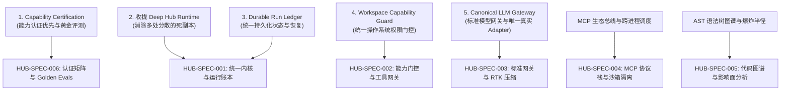

# SuperAgent (hub-rs) OpenSpec 开放规范体系

> **定位宗旨**：从“能力堆叠”全面迈向“可信本地运行时”。
> 本规范集是 `super-agent` (hub-rs) Rust 内核架构演进的唯一事实源（SSOT），所有模块重构、功能新增与测试评估必须严格遵循本规范。

---

## 一、架构宣言五大红线对齐 (Manifesto Alignment)

本规范集直接承接根目录《[architecture_manifesto.md](../architecture_manifesto.md)》的 5 大核心演化战略：



---

## 二、规范目录组织架构

```text
super-agent/openspec/
├── README.md                          # 本文件：SuperAgent 规范总览与架构宣言映射
├── templates/
│   └── spec-template.md               # 专属规范模板
├── runtime/
│   └── durable-run-ledger.spec.md     # HUB-SPEC-001: Deep Hub Runtime 统一内核与持久化运行账本规范
├── security/
│   └── capability-guard.spec.md       # HUB-SPEC-002: Workspace Capability Guard 统一权限门控与工具网关规范
├── gateway/
│   └── canonical-llm-gateway.spec.md  # HUB-SPEC-003: Canonical LLM Gateway 与 RTK 动态压缩协议规范
├── mcp/
│   └── mcp-protocol-stack.spec.md     # HUB-SPEC-004: MCP Protocol 协议栈、双向 JSON-RPC 与工具沙箱隔离规范
├── intelligence/
│   └── code-graph-blast-radius.spec.md# HUB-SPEC-005: AST 语义解析、代码库知识图谱与爆炸半径分析规范
└── evals/
    └── capability-certification.spec.md# HUB-SPEC-006: 能力认证矩阵 (Capability Matrix) 与 Golden Evals 评测规范
```

---

## 三、四阶段闭环工作流 (Rust Spec-Driven Loop)

1. **Design（规范先行）**：
   - 任何新功能、工具（Tool）或 Provider 引入前，先更新或创建对应的 `openspec/**/*.spec.md`；
   - 明确所有权矩阵（Owner / Allowed / Forbidden）与状态流转；
2. **Develop（受控开发）**：
   - 遵循四大反模式禁令，杜绝在 HTTP Agent、Supervisor、SuperAgent 之间出现逻辑副本；
   - 所有触达 OS（读写、Shell、Git）必须通过 `WorkspaceCapabilityGuard`；
3. **Verify（契约验证）**：
   - 执行单元测试：`cargo test`；
   - 执行基准评测：`node scripts/run_evals.cjs`；
   - 执行端侧自检脚本确保无 panic 与类型错误；
4. **Feedback（自愈反哺）**：
   - 排查出的边界异常沉淀至《契约问题台账.md》，同步更新对应 Spec 的验收测试矩阵。
