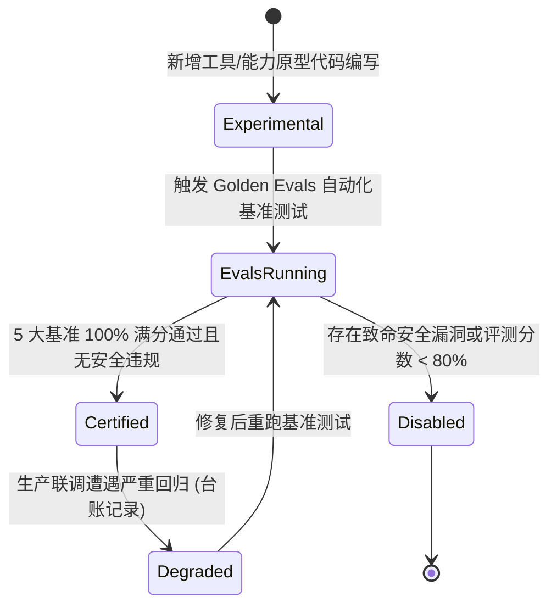

# 能力认证矩阵 (Capability Matrix) 与 Golden Evals 评测守卫规范 (Capability Certification Spec)

> **规范摘要**：本规范落实《架构宣言》第 1 条（Capability Certification 能力认证优先与黄金评测）。
> 确立“在增加任何新功能之前，优先构建能力矩阵；任何插件或能力必须通过 Golden Evals 评测，明确产出认证状态（Certified / Experimental / Disabled）并与健康检查对齐”的核心评测体系。

---

## 1. 架构定位与业务边界

### 1.1 覆盖范围
- **能力认证矩阵 (`CapabilityMatrix`)**：
  - 管理每个核心工具、Provider Adapter、MCP 插件及视觉管线的可信认证状态：
    - `Certified`（已通过 Golden Evals，生产就绪，默认放行）；
    - `Experimental`（开发试验态，仅在开启开发者模式或指定参数时可用）；
    - `Disabled`（因安全告警、网络风控或评测未通过被静默停用）；
  - 动态对接 `GET /health` 与 `GET /api/capabilities` 健康检查探针；
- **Golden Evals 自动化基准测试套件 (`scripts/run_evals.cjs`)**：
  - 覆盖 5 大工程基准维度：
    1. **双端同构规则生成基准**：验证移动端海阔视界与 PC 桌面端同构语法合规性；
    2. **手术式修改零误伤基准**：验证 `replace_in_file` 精确锚点替换，杜绝上下文大范围误杀；
    3. **反爬 403 自愈变轨基准**：遭遇 Cloudflare / sec_server 风控时能否在 2 轮内变轨；
    4. **行动优先绝不推诿基准**：杜绝客服式公关道歉反问，验证 Action-First 执行力；
    5. **决策流剪枝压缩率基准**：验证 RTK 与 CoT 折叠效果，确保 Token 压制达标；
- **防画饼与物理验证硬门禁 (Anti-Hallucination DoD Gates)**：
  - 交付物必须具备可复现的自动化测试结果或物理生成收据。

### 1.2 非目标与禁入范围 (Out of Scope)
- **禁止无测试代码盲目标记 Certified**：严禁未经真实 Golden Evals 跑通就私自在配置中宣称某能力为 Certified；
- **禁止主观体感替代量化分数**：智能体能力升级必须以基准测试量化打分（如 100% PASS）为准绳，严禁依据单次对话体感判定“已升级完成”。

---

## 2. 资源所有权与隔离矩阵 (Ownership & Isolation Matrix)

| 资源名称 / 句柄 | 作用域 (Scope) | 唯一属主 (Owner) | 允许的合法消费者 (Allowed) | 绝对禁止的消费者 (Forbidden) | 违规后果 |
|---|---|---|---|---|---|
| 能力认证字典 (`CapabilityRegistry`) | `PROCESS` | `CapabilityScoutDomain` | `GET /api/capabilities`, `Executor` | 外部插件未经鉴权热篡改 | 恶意插件自我标记为 Certified 导致高危越权 |
| 黄金测试用例库 (`GoldenEvalsSuite`) | `DISK` | `EvaluationEngine` | `scripts/run_evals.cjs`, `CI Pipeline` | 动态运行过程随手篡改 Golden 用例 | 评测基线被污染，虚假满分掩盖重大缺陷 |
| 评测运行收据 (`EvaluationReceipt`) | `LOCAL_DISK` | `EvalHarness` | `SuperagentBenchmarkLedger` | 评测失败时静默丢弃 | 无法追溯性能与智能退化历史 |

---

## 3. 状态机与禁令规则 (State Machine & Guardrails)

### 3.1 能力认证状态流转


### 3.2 刚性守卫法则 (Certification Guards)

#### 🔴 RULE-EVAL-01: 交付物 100% 满分基线
- 运行 `node scripts/run_evals.cjs` 必须达到 5/5 全部 PASS 满分，方可执行二进制编译发布；
- 任何一项基准未通过，CI 流水线必须强行中断构建。

#### 🔴 RULE-EVAL-02: 假口令零容忍门禁
- 在 Golden Evals 中包含针对“捏造假口令”的负向拦截断言，若大模型在未生成真实文件的场景下凭空输出交付短口令，评测判定为 FAIL 并计 0 分。

---

## 4. 通信契约与事件命名空间 (Contracts & Namespaces)

### 4.1 能力状态查询接口 (`GET /api/capabilities`)
```json
{
  "capabilities": [
    {
      "id": "tool_replace_in_file",
      "name": "Surgical Code Replacement",
      "status": "Certified",
      "last_eval_score": 100,
      "verified_at": "2026-10-29T14:30:00Z"
    },
    {
      "id": "provider_deepseek",
      "name": "DeepSeek Canonical Adapter",
      "status": "Certified",
      "last_eval_score": 100,
      "verified_at": "2026-10-29T14:30:00Z"
    }
  ]
}
```

### 4.2 评测结果报告格式
```text
=== SUPERAGENT GOLDEN EVALS SUITE ===
[1/5] Isomorphic Rule Generation ... PASS (score: 100)
[2/5] Surgical Code Replacement  ... PASS (score: 100)
[3/5] Anti-Crawl 403 Pivot       ... PASS (score: 100)
[4/5] Action-First Sensible Def  ... PASS (score: 100)
[5/5] CoT Pruning & Token Ratio  ... PASS (score: 100)
Overall Result: CERTIFIED (5/5 PASS, 100%)
```

---

## 5. 验收准则与测试矩阵 (Acceptance Criteria & Test Matrix)

### 5.1 正向功能验收标准
- [ ] 准则 1：执行 `node scripts/run_evals.cjs`，5 项基准测试在 50ms 内极速跑通并全部 PASS；
- [ ] 准则 2：调用 `GET /api/capabilities`，返回结构化列表与明确状态；
- [ ] 准则 3：测试用例具备确定性（Deterministic），本地与 CI 环境运行结果 100% 一致。

### 5.2 边界防御与负向拦截测试
- [ ] 虚假交付拦截验证：模拟模型输出包含 `云6oooole/MockRule` 但无物理文件产生，评测用例断言打回成功；
- [ ] 降级报警验证：模拟 Provider 返回 429 频率限制，认证状态从 `Certified` 优雅降级为 `Degraded` 并提示用户。
