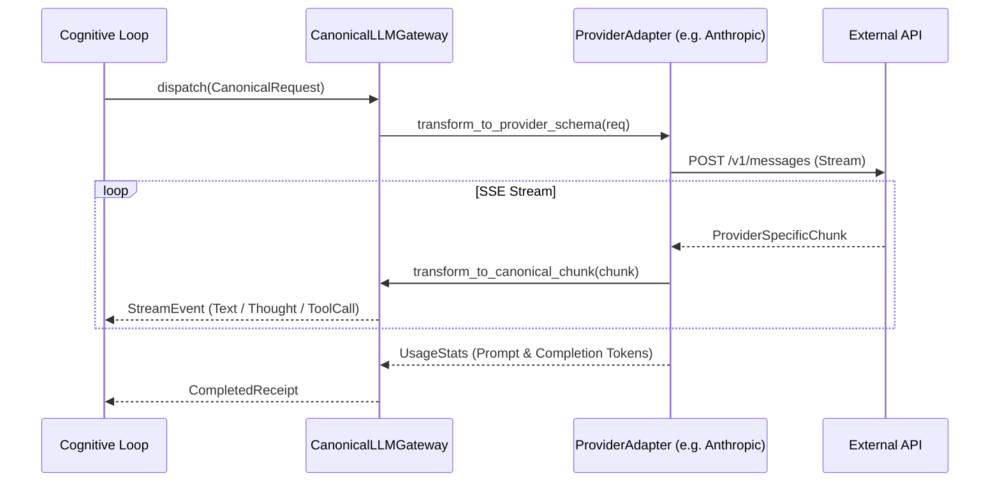

# Canonical LLM Gateway 与 RTK 动态压缩协议规范

> **规范摘要**：本规范落实《架构宣言》第 5 条（Canonical LLM Gateway 标准 LLM 网关）。
> 确立“内部全量统一为 Canonical 格式、每家提供商（OpenAI, Anthropic, Gemini）仅允许存在唯一真实 Adapter、RTK 源码级压缩无损降噪”的技术架构标准。

---

## 1. 架构定位与业务边界

### 1.1 覆盖范围
- **Canonical LLM Gateway (`domains/model_gateway`)**：
  - 内部统一采用 `CanonicalRequest` 与 `CanonicalResponse` 数据结构；
  - 维护三家唯一的生产级 Adapter：
    - `OpenAiAdapter`：兼容 OpenAI 官方、DeepSeek、Qwen、Ollama 等兼容接口；
    - `AnthropicAdapter`：处理 Claude 3.5/3.7 原生 Messages 与 Thinking 块协议；
    - `GeminiAdapter`：对接 Google Gemini 2.5/3.8 Flash 与 Pro 系列 API；
- **RTK (Rust Token Killer) 压缩引擎**：
  - 通过 Rust FFI 直接链接 `rtk` 核心库，对代码和长文档执行去噪压缩；
  - 消除冗余 License 头、超量换行、纯展示性注释；
- **动态 Token 预算守卫 (`ContextBudget`)**：
  - 监控并维持滑动窗口在模型的安全上下文限制之内（8k/32k/128k/1M）。

### 1.2 非目标与禁入范围 (Out of Scope)
- **禁止维护多余的死适配器**：严禁在 Controller、Agent 与 Brain 中各自编写 HTTP 请求代码；
- **禁止篡改大模型原始输出语义**：除合规格式转换与流式聚合外，Gateway 严禁随意对 LLM 的生成结果进行破坏性正则修改。

---

## 2. 资源所有权与隔离矩阵 (Ownership & Isolation Matrix)

| 资源名称 / 句柄 | 作用域 (Scope) | 唯一属主 (Owner) | 允许的合法消费者 (Allowed) | 绝对禁止的消费者 (Forbidden) | 违规后果 |
|---|---|---|---|---|---|
| HTTP 连接池 (`reqwest::Client`) | `PROCESS` | `CanonicalLLMGateway` | 注册的 Provider Adapters | 每次请求重新 `Client::new()` | 频繁创建 TCP 连接耗尽系统文件描述符 (Socket Exhaustion) |
| API 密钥凭据库 | `PROCESS` | `CredentialStore` | `ProviderAdapter` | 前端接口返回、日志输出 | 凭据明文外泄 |
| RTK 压缩规则字典 | `PROCESS` | `RtkEngine` | `ContextBudgetManager` | 运行时热覆盖非法正则 | 导致压制模块崩溃，源码破坏 |

---

## 3. 状态机与禁令规则 (State Machine & Guardrails)

### 3.1 网关请求转换与流式路由


### 3.2 刚性网关法则 (Rigid Gateway Rules)

#### 🔴 RULE-GW-01: Canonical 统一转换单一事实源
- 网关外部模块只能感知 `CanonicalMessage`（枚举：`System`, `User`, `Assistant`, `Tool`）；
- 任何提供商私有特性（如 Anthropic 的 `thinking` 块、OpenAI 的 `tool_calls`）必须在 Adapter 内部完成进出转换。

#### 🔴 RULE-GW-02: 流式打字机逐字保真
- 流式传输中禁止使用会引入显著延迟的全局大块缓冲，必须保证单 chunk 到达后 5ms 内转发给客户端。

---

## 4. 通信契约与事件命名空间 (Contracts & Namespaces)

### 4.1 Canonical 数据契约 (`Rust`)
```rust
#[derive(Debug, Clone, Serialize, Deserialize)]
pub struct CanonicalRequest {
    pub model: String,
    pub system_prompt: String,
    pub messages: Vec<CanonicalMessage>,
    pub tools: Vec<ToolDefinition>,
    pub temperature: Option<f32>,
    pub thinking_budget_tokens: Option<u32>,
}

#[derive(Debug, Clone, Serialize, Deserialize)]
pub enum CanonicalMessage {
    User { content: String, images: Vec<String> },
    Assistant { text: String, thought: Option<String>, tool_calls: Vec<ToolCall> },
    ToolResult { tool_call_id: String, content: String, is_error: bool },
}
```

---

## 5. 验收准则与测试矩阵 (Acceptance Criteria & Test Matrix)

### 5.1 正向功能验收标准
- [ ] 准则 1：在任意支持的 Provider 之间无缝切换，上层认知逻辑与前端 UI 无感无缝运作；
- [ ] 准则 2：RTK 压缩对 5000 行大文件压缩耗时 < 10ms，有效节约 40% 以上上下文空间。

### 5.2 边界防御与负向拦截测试
- [ ] 协议合规断言：OpenAI 协议流中绝不注入中间非法 `system` 消息；
- [ ] 异常熔断重试：遭遇网络 502 / 503 时，Adapter 支持指数退避重试（最多 3 次），并在失败时返回可诊断的错误报文。
