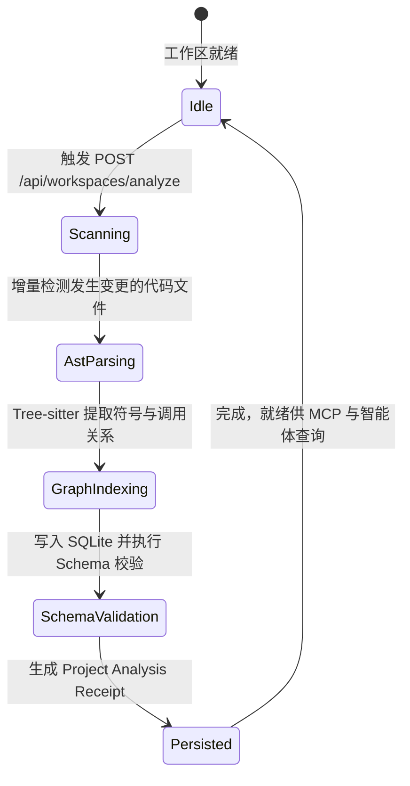

# AST 语义解析、代码库知识图谱与爆炸半径分析规范 (Code Intelligence Spec)

> **规范摘要**：本规范界定 SuperAgent 在工作区代码解析、语法树提取（Tree-sitter）、图数据库构建（SQLite / Rusqlite）、影响面评估（Blast Radius）与架构合规巡检（Architectural Linter）的标准体系。
> 确立“毫秒级增量 AST 解析、XXH3 稀疏向量索引、修改前自动测算系统爆炸半径与架构红线硬门禁阻断”的代码智能基准。

---

## 1. 架构定位与业务边界

### 1.1 覆盖范围
- **代码智能解析内核 (`code_analysis` / Tree-sitter)**：
  - 支持 Rust、TypeScript、JavaScript、Python、Java 等主流语言的语法树解析；
  - 提取文件、类、函数、路由、接口及调用关系（Call Graph & Type Hierarchy）；
- **工作区知识图谱 (`knowledge_graph`)**：
  - 基于 Rusqlite 建立本地图数据库（`.codegraph/graph.db`），支持有向图遍历（`search_graph`, `trace_path`, `query_graph`）；
- **爆炸半径与影响面分析 (`impact_analyzer.rs`)**：
  - 在改动某个核心函数/单例前，基于图谱反向计算被调用方与波及的微服务/模块，输出 `Blast Radius Receipt`；
- **架构合规巡检器 (`architectural_linter.rs` / `code_review`)**：
  - 扫描代码中是否存在破坏 OpenSpec 所有权（如常驻组件持有局部单例）、违规使用 JPA、未经门控执行命令的反模式。

### 1.2 非目标与禁入范围 (Out of Scope)
- **禁止全量无条件全库重扫**：索引必须采用基于 Git 状态与文件 mtime 的增量扫描，禁止每次请求都重新解析整个 `node_modules` 或 `target`；
- **禁止图数据库阻断主进程启动**：知识图谱构建必须在独立的后台低优先级工作线程异步执行，不可阻塞桌面端的首屏渲染；
- **禁止基于幻觉猜测调用链**：爆炸半径分析必须基于 AST 真实有向边推导，严禁使用大模型进行无事实依据的脑补臆测。

---

## 2. 资源所有权与隔离矩阵 (Ownership & Isolation Matrix)

| 资源名称 / 句柄 | 作用域 (Scope) | 唯一属主 (Owner) | 允许的合法消费者 (Allowed) | 绝对禁止的消费者 (Forbidden) | 违规后果 |
|---|---|---|---|---|---|
| 图数据库句柄 (`.codegraph/graph.db`) | `WORKSPACE_DISK` | `KnowledgeGraphManager` (Rusqlite) | `ImpactAnalyzer`, `McpServer` | 多进程无锁写入 | SQLite 数据库死锁（`database is locked`）损坏 |
| Tree-sitter 解析器实例池 | `PROCESS` | `CodeIntelligenceDomain` | `WorkspaceOrchestrator` | 跨线程无锁直接共享单一解析器 | Tree-sitter C FFI 状态错乱触发内存段错误 (SIGSEGV) |
| 爆炸半径分析报告 (`BlastRadiusReceipt`) | `TASK_RUN` | `ImpactAnalyzer` | `CognitiveRuntime`, `CodeReviewView` | 被静默丢弃不通知大模型 | 模型无视高危影响面，导致大范围破坏性重构 |
| 项目 Wiki 知识链 (`project-wiki-latest`) | `SUPERMEMORY` | `KnowledgeCorpusService` | `ArbitrationConsoleModal`, `WikiPreview` | 外部直接修改无校验 JSON | 知识沉淀失效，项目历史记忆丢失 |

---

## 3. 状态机与禁令规则 (State Machine & Guardrails)

### 3.1 代码分析与图谱构建状态机


### 3.2 刚性守卫法则 (Intelligence Guards)

#### 🔴 RULE-GRAPH-01: 极度危险影响面预警 (Blast Radius Threshold)
- 当 `ImpactAnalyzer` 计算出的影响节点数超过阈值（如：影响面包含超过 5 个核心模块或涉及 `RootLayout` / `GlobalAudioEngine` 等系统级常驻单例时）；
- 系统必须在 Observation 中显式插入：
  `"【高危影响面告警】当前修改的爆炸半径评级为 CRITICAL (波及 12 个系统组件)。必须编写回归测试并优先采用差量适配，禁止全量颠覆重构！"`。

#### 🔴 RULE-GRAPH-02: 目录遍历黑名单刚性隔离
- 无论代码分析还是全库搜索，必须刚性排除以下目录：
  `.git/`, `node_modules/`, `target/`, `dist/`, `.next/`, `temp_cache/`, `sidecar_data/`。

---

## 4. 通信契约与事件命名空间 (Contracts & Namespaces)

### 4.1 知识图谱查询接口契约 (`POST /api/analyze/wiki`)
- **请求格式 (Request)**：
  ```json
  {
    "project": "D:/deepcloud",
    "lang": "zh-CN"
  }
  ```
- **响应格式 (Response)**：
  ```json
  {
    "success": true,
    "project": "D:/deepcloud",
    "indexed": true,
    "wiki": "# DeepCloud System Architecture...",
    "trace": {
      "overview": { "languages": { "Rust": 87, "TypeScript": 150 } },
      "symbols_count": 4520,
      "graph_edges_count": 18230
    },
    "generatedAt": "2026-10-29T14:30:00Z"
  }
  ```

---

## 5. 验收准则与测试矩阵 (Acceptance Criteria & Test Matrix)

### 5.1 正向功能验收标准
- [ ] 准则 1：增量代码变更解析耗时 < 300ms，准确提取符号更新并写入 SQLite；
- [ ] 准则 2：爆炸半径测算能清晰展示直接调用方、间接依赖链及波及文件清单。

### 5.2 边界防御与负向拦截测试
- [ ] 损坏源码测试：面对语法错误的源文件，解析器优雅记录 warning，不 panic，不破坏其余正常文件索引；
- [ ] 超大文件保护：超过 10MB 的单文件自动跳过 AST 全文解析，采用流式行切片索引。
