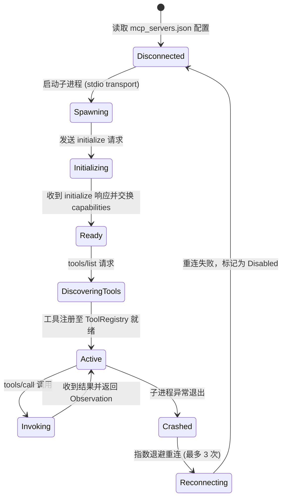

# MCP Protocol 协议栈、双向 JSON-RPC 与工具沙箱隔离规范 (MCP Protocol Stack Spec)

> **规范摘要**：本规范界定 SuperAgent 实现 Model Context Protocol (MCP) 跨进程通信、双向 JSON-RPC 2.0 调度、外部工具动态挂载与沙箱隔离的标准。
> 确立“标准 stdio/SSE 双传输协议、工具元数据动态注册与类型校验、外部插件进程沙箱安全隔离与崩溃容错降级”的工程基准。

---

## 1. 架构定位与业务边界

### 1.1 覆盖范围
- **MCP 服务端角色 (SuperAgent as MCP Server)**：
  - 启动子命令 `hub-rs mcp-server`，向外部 AI IDE（Antigravity, Cursor, Claude Desktop）暴露本项目的代码图谱、知识链与分析工具；
- **MCP 客户端角色 (SuperAgent as MCP Host)**：
  - 动态连接外部三方 MCP 服务器（如 GitHub MCP, Memory MCP, PostgreSQL MCP）；
  - 解析外部工具的 JSON Schema 并安全合并入智能体工具池；
- **进程隔离与生命周期管理 (`McpProcessManager`)**：
  - 监控外部 MCP 子进程的心跳、内存与 IO 通道；
  - 提供单命令超时阻断机制（默认 30s）。

### 1.2 非目标与禁入范围 (Out of Scope)
- **禁止未受控的动态代码执行**：外部 MCP 服务器必须以独立进程运行，禁止以动态链接库（`dlopen`）形式注入主进程内存；
- **禁止无 Schema 校验调用**：所有入参与返回值必须经过 JSON Schema 强类型校验。

---

## 2. 资源所有权与隔离矩阵 (Ownership & Isolation Matrix)

| 资源名称 / 句柄 | 作用域 (Scope) | 唯一属主 (Owner) | 允许的合法消费者 (Allowed) | 绝对禁止的消费者 (Forbidden) | 违规后果 |
|---|---|---|---|---|---|
| MCP 子进程 `stdin / stdout` | `OS_PIPE` | `McpProcessManager` | `JsonRpcChannel` | 外部线程直接读写裸句柄 | JSON-RPC 报文错位、消息帧交错损坏 |
| MCP 工具注册表 (`ToolRegistry`) | `PROCESS` | `McpEcosystemDomain` | `ToolExecutionGateway` | 动态插件单方面覆写核心原生工具 | 原生 `view_file` 等核心工程工具被恶意替换 |
| 外部 MCP 凭据配置文件 | `LOCAL_DISK` | `McpConfigManager` | `McpProcessManager` (作为环境变量注入) | 前端未鉴权读取 | 外部第三方服务的 Access Token 泄露 |

---

## 3. 状态机与禁令规则 (State Machine & Guardrails)

### 3.1 MCP 客户端连接与工具调度状态机


### 3.2 刚性守卫法则 (MCP Guards)

#### 🔴 RULE-MCP-01: 原生核心工具名称保护
- 严禁任何外部 MCP 插件注册与 10 大核心原生工程工具同名的工具；
- 若发生重名，系统必须自动增加插件前缀（如 `mcp_github_view_file`），绝不覆盖原生核心工具。

#### 🔴 RULE-MCP-02: 调用超时断路保护
- 外部 MCP 工具调用若超过配置的超时阈值（默认 30 秒无响应），网关必须强行向子进程发送终止信号并向 LLM 返回超时错误，绝不允许卡死认知主线程。

---

## 4. 通信契约与事件命名空间 (Contracts & Namespaces)

### 4.1 JSON-RPC 2.0 报文标准
- **工具调用请求 (`tools/call`)**：
  ```json
  {
    "jsonrpc": "2.0",
    "id": 101,
    "method": "tools/call",
    "params": {
      "name": "search_code",
      "arguments": {
        "query": "WASAPI",
        "max_results": 10
      }
    }
  }
  ```
- **工具调用响应**：
  ```json
  {
    "jsonrpc": "2.0",
    "id": 101,
    "result": {
      "content": [
        {
          "type": "text",
          "text": "Found 3 occurrences in src/media/player.rs"
        }
      ],
      "isError": false
    }
  }
  ```

---

## 5. 验收准则与测试矩阵 (Acceptance Criteria & Test Matrix)

### 5.1 正向功能验收标准
- [ ] 准则 1：启动 `hub-rs mcp-server`，符合官方 MCP 协议标准规范，能被外部客户端正常发现并调用；
- [ ] 准则 2：外部 MCP 插件挂载后，工具 Schema 正确映射，参数验证错误时返回标准 JSON-RPC `-32602`。

### 5.2 边界防御与负向拦截测试
- [ ] 异常崩溃恢复测试：强行 kill 外部 MCP 插件子进程，主进程感知并记录告警，下一次调用时平滑重连；
- [ ] 超时熔断测试：模拟假死的 MCP 工具，30s 后自动触发熔断并返回优雅降级说明。
