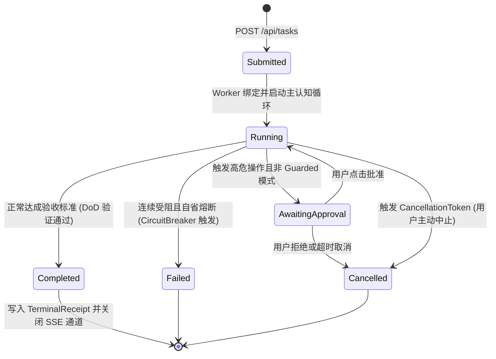

# Deep Hub Runtime 统一内核与 Durable Run Ledger 规范

> **规范摘要**：本规范落实《架构宣言》第 2 条（收拢 Deep Hub Runtime 消除死副本）与第 3 条（Durable Run Ledger 持久化运行账本）。
> 确立 Rust 端 Task、Worker 进程句柄、认知状态机、SSE 事件流与断点恢复由唯一的 `SessionLedger` / `RunLedger` 统一管理的架构标准。

---

## 1. 架构定位与业务边界

### 1.1 覆盖范围
- **Deep Hub Runtime 核心统一层 (`services/brain/cognitive_runtime.rs`)**：
  - 彻底收拢此前散落在 HTTP Agent、Supervisor 与 SuperAgent Worker 中的执行逻辑；
  - 维护单一的全局异步执行中枢，统一处理请求进入、会话生命周期与取消信号（`tokio_util::sync::CancellationToken`）；
- **Durable Run Ledger (`services/agent/run_ledger.rs` & `services/brain/session_ledger.rs`)**：
  - 作为全系统唯一的运行事实源（SSOT），维护：
    1. 任务元数据（ID、创建时间、工作区、模型配置、ThinkingLevel）；
    2. 执行状态（`Submitted` -> `Running` -> `AwaitingApproval` -> `Completed` / `Failed` / `Cancelled`）；
    3. 事件时钟序列与快照路径索引；
    4. 检查点（Session Checkpoint）与持久化恢复；
  - 负责落盘 `.superagent/traces/{session_id}/turn_{N}.json` 无损决策镜像。

### 1.2 非目标与禁入范围 (Out of Scope)
- **严禁多重状态副本 (No Duplicate State Copies)**：禁止在 Controller 或内存全局静态哈希表中另外维护平行的 Task 状态；
- **禁止不可取消的后台孤儿子任务**：所有派生出来的 `tokio::spawn` 协程必须绑定关联任务的 `CancellationToken`，主任务取消时必须级联中断。

---

## 2. 资源所有权与隔离矩阵 (Ownership & Isolation Matrix)

| 资源名称 / 句柄 | 作用域 (Scope) | 唯一属主 (Owner) | 允许的合法消费者 (Allowed) | 绝对禁止的消费者 (Forbidden) | 违规后果 |
|---|---|---|---|---|---|
| `SessionLedger` 实例 | `PROCESS` | `DeepHubRuntime` | `SuperagentWorker`, `TasksRoute` | 外部线程无锁绕行写入 | 状态机竞争，数据竞态引发逻辑死锁 |
| `CancellationToken` | `TASK` | `SessionLedger` | `CognitiveWorker`, `ToolGateway` | 被丢弃在局部作用域未注册 | 用户在前端点击“停止”时后台继续死循环执行 |
| 决策追踪文件 (`turn_{N}.json`) | `LOCAL_DISK` | `TracePersistenceEngine` | `GET /api/tasks/{id}/traces` | 外部未落盘前过早向客户端返回完成 | 前端追踪抽屉 404 找不到快照 |

---

## 3. 状态机与禁令规则 (State Machine & Guardrails)

### 3.1 任务全生命周期状态流转


### 3.2 操作守卫法则 (Runtime Guards)

#### 🔴 GUARD-RUN-01: 取消信号级联传播
- 任何长时间运行的 IO 操作（如大模型流式调用、Shell 编译、大型项目扫描）在每次迭代前必须检查：
  ```rust
  if cancellation_token.is_cancelled() {
      ledger.mark_cancelled(task_id).await;
      return Err(RuntimeError::TaskCancelled);
  }
  ```

#### 🔴 GUARD-RUN-02: 终态原子落盘保障
- 在向 SSE 发送 `completed` 事件前，必须确保当前轮次的 `turn_{N}.json` 已完成本地磁盘的 `flush()` 写入。

---

## 4. 通信契约与事件命名空间 (Contracts & Namespaces)

### 4.1 核心数据结构定义 (`Rust`)
```rust
#[derive(Debug, Clone, Serialize, Deserialize)]
pub struct TaskRecord {
    pub task_id: String,
    pub session_id: String,
    pub status: TaskStatus,
    pub workspace_path: PathBuf,
    pub thinking_level: ThinkingLevel,
    pub current_turn: usize,
    pub total_prompt_tokens: usize,
    pub total_completion_tokens: usize,
    pub trace_snapshots: Vec<PathBuf>,
    pub created_at: DateTime<Utc>,
    pub updated_at: DateTime<Utc>,
}
```

---

## 5. 验收准则与测试矩阵 (Acceptance Criteria & Test Matrix)

### 5.1 正向功能验收标准
- [ ] 准则 1：任务启动、流转、完成过程状态变迁严格单调递增，无偶发状态回退；
- [ ] 准则 2：每个轮次均生成合法的 JSON 快照，通过 `GET /api/tasks/{id}/traces` 能准确查验；
- [ ] 准则 3：前端触发取消指令时，Worker 在 200ms 内平滑退出，释放所有底层子进程。

### 5.2 边界防御与负向拦截测试
- [ ] 并发任务互斥测试：同时下发 5 个任务，各任务的 `SessionLedger` 数据互不穿透、时钟严格独立；
- [ ] 崩溃恢复测试：模拟运行时断电或 panic，重启后从账本最后一条合法 Checkpoint 平滑恢复。
