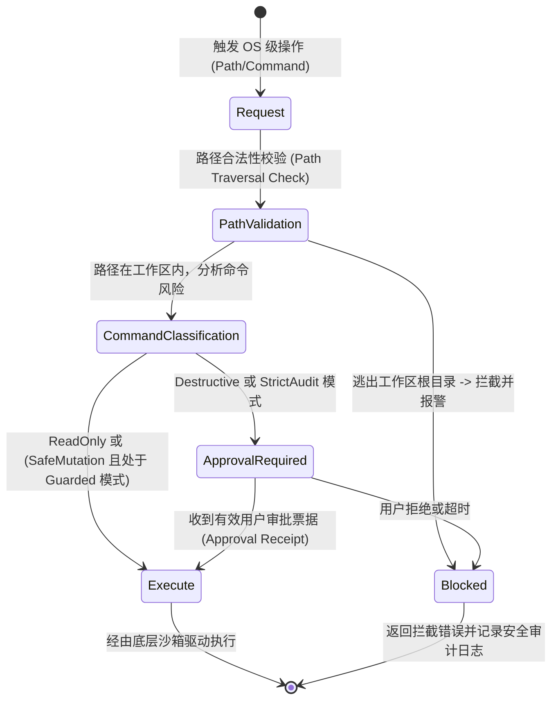

# Workspace Capability Guard 统一权限门控与工具执行网关规范

> **规范摘要**：本规范落实《架构宣言》第 4 条（Workspace Capability Guard 工作区能力门控）。
> 确立“安全绝不依赖提示词约束，所有触达操作系统的动作（读写文件、Git 变更、Shell 进程）必须统一穿过底层权限门控模块进行硬拦截”的核心架构标准。

---

## 1. 架构定位与业务边界

### 1.1 覆盖范围
- **权限门控中枢 (`WorkspaceCapabilityGuard`)**：
  - 作为触达操作系统层（OS API / `tokio::process` / `std::fs`）的唯一必经枢纽；
  - 路径白名单校验：确保所有文件操作严格收敛在注册的工作区目录内，彻底防御目录穿越（Path Traversal）；
  - 命令安全分类：严格判定 `ReadOnly`、`SafeMutation`、`ProcessControl` 与 `Destructive` 四大级别；
- **工具执行网关适配器 (`ToolExecutionGateway`)**：
  - 透明别名归一化（12 组通用别名）；
  - 10 大核心工程工具置顶保护；
  - 错误诊断洞察（Observation Diagnostic Insight）自动提炼注入；
- **Shadow Git 快照与物理工作记忆**：
  - 批量危险改动前自动生成临时 Git Snapshot；
  - 项目根目录自动维护 `.superagent_todo.md`。

### 1.2 非目标与禁入范围 (Out of Scope)
- **严禁旁路文件与系统调用 (No Bypass)**：除 Guard 自身外，任何代码分析、模型推理模块禁止直接使用 `std::fs::write` 或 `std::process::Command`；
- **禁止弱安全提示词替代硬防御**：禁止仅靠向大模型灌输“请不要删除系统文件”等 Prompt 规则替代代码层强制校验。

---

## 2. 资源所有权与隔离矩阵 (Ownership & Isolation Matrix)

| 资源名称 / 句柄 | 作用域 (Scope) | 唯一属主 (Owner) | 允许的合法消费者 (Allowed) | 绝对禁止的消费者 (Forbidden) | 违规后果 |
|---|---|---|---|---|---|
| OS 进程执行句柄 (`Command`) | `OS_KERNEL` | `WorkspaceCapabilityGuard` | `ToolExecutionGateway` | 外部插件或业务模块直接调用 | 恶意代码绕过安全审计，格式化主机磁盘 |
| 工作区写权限锁 (`WorkspaceWriteLock`) | `WORKSPACE` | `WorkspaceCapabilityGuard` | `write_to_file`, `replace_in_file` | 并发任务未经协调写入 | 文件写入交叠竞争，源码损坏 |
| Shadow Git 临时分支 | `GIT_REPO` | `ShadowGitEngine` | `WorkspaceCapabilityGuard` | 用户或外部脚本推送到 remote | 污染生产主分支提交历史 |

---

## 3. 状态机与禁令规则 (State Machine & Guardrails)

### 3.1 权限裁决与拦截状态机


### 3.2 刚性安全法则 (Rigid Security Rules)

#### 🔴 RULE-SEC-01: 绝对路径穿越硬拦截
- 所有接收的文件路径参数必须执行标准规范化处理：
  ```rust
  let canonical_target = match fs::canonicalize(&target_path) {
      Ok(p) => p,
      Err(_) => return Err(SecurityViolation::InvalidPath),
  };
  if !canonical_target.starts_with(&registered_workspace_root) {
      return Err(SecurityViolation::PathTraversalAttempted);
  }
  ```

#### 🔴 RULE-SEC-02: 高危命令刚性黑名单
- 包含以下特征的指令严禁自动放行：
  `rm -rf /`, `mkfs`, `format`, `dd if=`, `chmod -R 777 /`, `DROP DATABASE`, `truncate table`；
- 一旦匹配，必须挂起并进入人工审批模式。

---

## 4. 通信契约与事件命名空间 (Contracts & Namespaces)

### 4.1 审批请求与票据载荷 (`ApprovalRequest`)
```json
{
  "approval_id": "appr_7c81a2",
  "task_id": "task_20261029_001",
  "tool_name": "run_command",
  "risk_level": "Destructive",
  "command": "git reset --hard HEAD~1",
  "target_path": "d:/deepcloud",
  "justification": "Reverting broken commit as requested"
}
```

---

## 5. 验收准则与测试矩阵 (Acceptance Criteria & Test Matrix)

### 5.1 正向功能验收标准
- [ ] 准则 1：在工作区内的合法文件读写与常规构建测试命令（`cargo check`、`npm test`）零延迟秒级放行；
- [ ] 准则 2：修改操作执行前，Shadow Git 快照成功生成，支持一键安全还原。

### 5.2 边界防御与负向拦截测试
- [ ] 路径逃逸注入测试：传入 `../../../../Windows/System32/drivers/etc/hosts`，门禁必须 100% 阻断；
- [ ] 破坏性命令拦截测试：模拟调用 `rm -rf *`，门禁进入挂起审批状态，无人值守时严禁自动放行。
