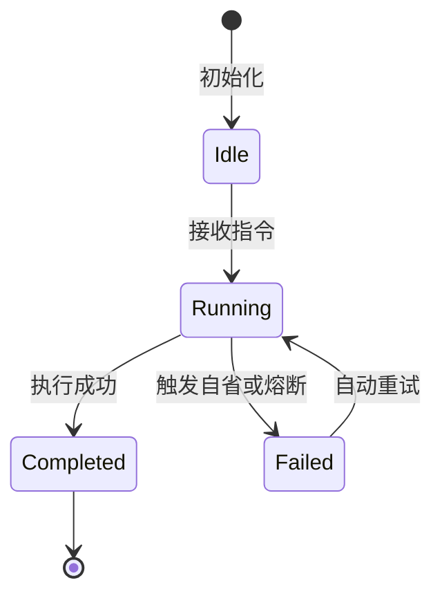

# {模块/特性规范标题} 规范

> **规范摘要**：简要说明本规范在 Rust Hub-RS / SuperAgent 内核中的架构定位、核心目标与防范风险。

---

## 1. 架构定位与业务边界

### 1.1 覆盖范围
- 本模块负责的核心职责；
- 与 Deep Hub Runtime 核心、Rust 异步任务 (`tokio`) 的交互边界。

### 1.2 非目标与禁入范围 (Out of Scope)
- 明确本模块绝对不应处理的职责，避免代码碎片化与“死副本 (Dead Copies)”。

---

## 2. 资源所有权与隔离矩阵 (Ownership & Isolation Matrix)

| 资源名称 / 句柄 | 作用域 (Scope) | 唯一属主 (Owner) | 允许的合法消费者 (Allowed) | 绝对禁止的消费者 (Forbidden) | 违规后果 |
|---|---|---|---|---|---|
| 例: `Arc<SessionLedger>` | `PROCESS` | `DeepHubRuntime` | `SuperagentWorker` | 外部未加锁并发写线程 | 状态机竞争，事件时钟倒流 |

---

## 3. 状态机与禁令规则 (State Machine & Guardrails)

### 3.1 状态流转图


### 3.2 操作守卫 (Action Guards)
- 明确调用前置条件与身份鉴权；

### 3.3 绝对禁止的反模式 (Prohibited Patterns)
> [!CAUTION]
> 列出在 Rust 代码实现与审查中严禁出现的致命反模式。

---

## 4. 通信契约与事件命名空间 (Contracts & Namespaces)

### 4.1 接口 / Channel 契约
- REST / SSE / MCP JSON-RPC 格式定义；

### 4.2 数据结构 (Rust Struct Definition)
```rust
// 核心数据结构
```

---

## 5. 验收准则与测试矩阵 (Acceptance Criteria & Test Matrix)

### 5.1 正向功能验收标准 (DoD)
- [ ] 准则 1：通过 Rust 单元测试 (`cargo test`)；

### 5.2 边界防御与 Golden Evals 负向拦截测试
- [ ] 守卫测试：异常输入或违规调用时优雅拦截，不发生 panic。
