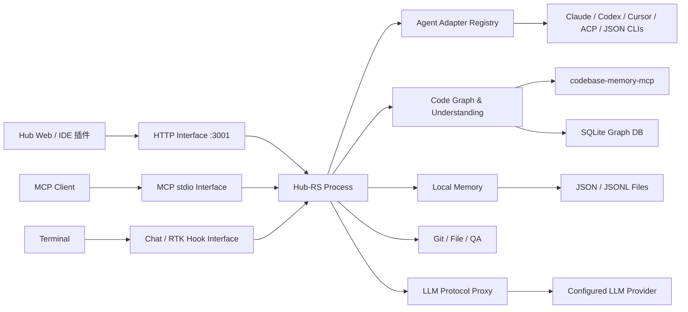
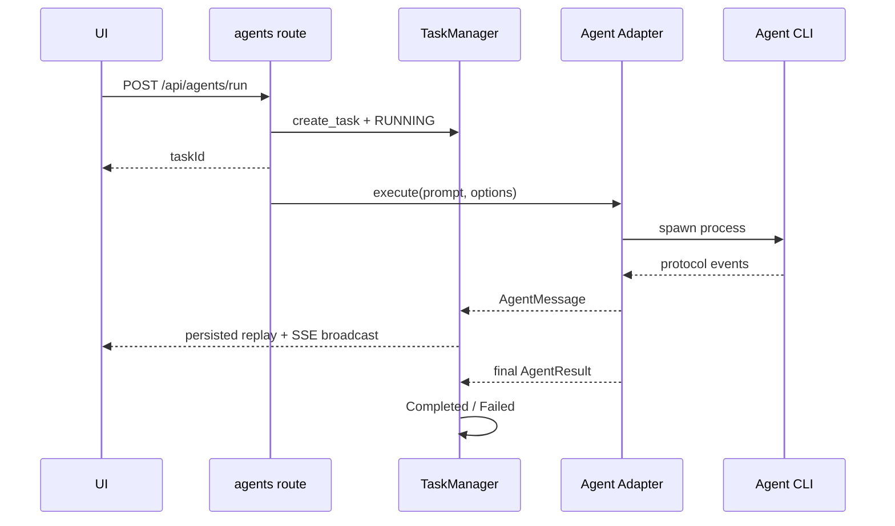
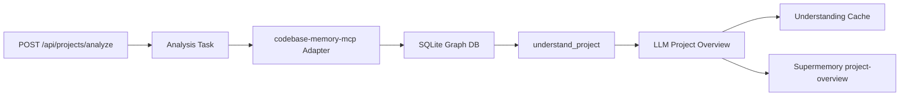
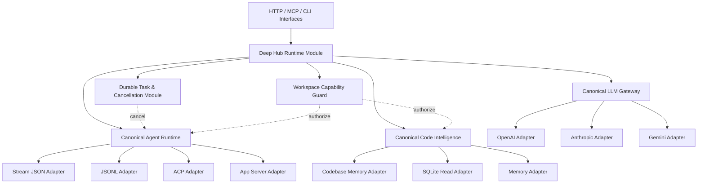

# Hub-RS 系统架构设计与代码逻辑审查

> 审查日期：2026-08-08  
> 审查范围：`super-agent/hub-rs` Rust 实现，不包含外层 `hub-web`、IDE 插件和安装器的完整实现。  
> 事实来源：当前源码、`Cargo.toml`、启动脚本与 `cargo test --all-targets`。  
> 结论口径：本文区分“已注册 Interface”“代码可编译”“逻辑闭合”“需要真实外部环境验证”，不把路由存在等同于功能可用。

---

## 一、结论摘要

Hub-RS 已形成一个可编译的本地代码智能与多 Agent Hub，核心骨架包括：

- 单二进制四种运行角色：HTTP、CLI Chat、MCP stdio、RTK Hook；
- 17 类本地 Agent CLI 的发现、统一启动 Interface、事件归一化和任务记录；
- Codebase Memory SQLite 图谱查询、项目理解、语义/混合检索；
- 本地 Supermemory、影子 Git、文件浏览、QA 工具；
- OpenAI、Anthropic、Gemini 入口形态的 LLM Proxy；
- 需求逆向、架构分析、领域流、影响分析和导读生成。

但是，**当前不能判定“全部功能正常可用”**。48 个 Rust 测试全部通过，只能证明部分纯逻辑 Module；以下问题会直接阻断或削弱真实使用：

1. `start-hub.ps1` 未传 `service`，程序会进入 RTK Hook 模式，HTTP Hub 无法按脚本启动。
2. 任务取消只更新 JSON 状态，不终止 Agent 子进程；子进程结束后还可能覆盖为 Completed/Failed。
3. Agent SSE 没有可靠终止条件，任务结束后连接可能持续等待。
4. Gemini 与 OpenAI Responses Converter 仍为透传占位；跨上游 Provider 的请求体和认证也未完整转换。
5. MCP 的图谱路径硬编码为 `{project}/.deepcloud/graph.db`，与 HTTP Runtime 使用的缓存 DB 路径不一致；DB 缺失还会返回“成功”。
6. HTTP Interface 接受任意本地项目路径，文件读取存在 `..` 穿越，且 CORS 为 `Any`；本地恶意网页可能利用浏览器访问本机 Hub。

因此当前成熟度应定义为：**核心 Module 原型可编译，若干局部链路可用，系统级闭环尚未完成。**

---

## 二、系统定位

Hub-RS 是一个本地单进程控制面，把代码图谱、LLM、Agent CLI、Git、QA 和持久化工具聚合到统一 Interface。它不是 DeepCloud 微服务的一部分，也不依赖 Spring Cloud；主要部署形态是本机桌面程序或 IDE 附带进程。

---

## 三、运行角色与启动分派

入口为 `src/main.rs -> cli::dispatch()`：

| 命令 | 角色 | 实现 |
|---|---|---|
| `hub-rs service [PORT]` | Axum HTTP Hub | `server::serve`，默认 `127.0.0.1:3001` |
| `hub-rs chat` | 交互式 LLM Chat | `repl::run_chat` |
| `hub-rs mcp` | MCP JSON-RPC stdio | `mcp_server::run_mcp` |
| 其他命令或无参数 | RTK Hook/CLI | `rtk::cli::run` |

关键不变量：**启动 HTTP 必须显式传入 `service`**。当前 `start-hub.ps1` 直接启动 exe，没有参数，因此脚本与 CLI Interface 不匹配。

HTTP 进程的共享状态 `AppState` 只保存四项：

- `RuntimeConfig`：外部工具、项目、缓存和图谱路径；
- `AppPaths`：安装目录与可写数据目录；
- `TaskManager`：文件持久化任务及进程内事件总线；
- `reqwest::Client`：LLM 与 Proxy 共用 HTTP Adapter。

---

## 四、Module 划分

| Module | Interface | Implementation 与职责 | 状态 |
|---|---|---|---|
| Server Bootstrap | `service [port]`、Axum Router | 初始化配置、任务管理、CORS、Trace | 基本完成；缺少优雅停止与安全收口 |
| Agent Runtime | `/api/agents/*` | Agent 检测、Registry、17 个 Adapter、事件统一 | 主链存在；取消与 SSE 终止未闭合 |
| Task Runtime | `/api/tasks/*` | Task JSON、日志、事件 JSONL、broadcast | 可持久化；缺少进程句柄和并发写保护 |
| Project Analysis | `/api/projects/analyze` | 调用 codebase-memory-mcp 建图并生成项目概览 | 逻辑存在；依赖外部二进制和 DB Schema |
| Code Understanding | `/api/context/*`、`/api/understand/*` | SQLite 图查询、FTS/向量混合检索、LLM 解释、缓存 | 主要逻辑存在；真实 DB 兼容需验证 |
| Analysis | `/api/analyze/*` | 架构、领域、影响面、导读 | 部分闭合；领域与影响算法较浅 |
| Reverse Engineering | `/api/reverse*` | 规则引擎、需求分析、执行计划生成 | 部分闭合；影响图推演明确 TODO |
| Memory | `/api/memory/*` | 项目级 JSON 记忆、关键词检索、聊天增强 | 可用原型；并发写和检索质量有限 |
| Git/File | `/api/git*`、`/api/files*` | libgit2、影子快照、文件读取、Patch | 能力强；路径授权与穿越风险高 |
| QA | `/api/qa/*` | Playwright、codegen、k6 子进程 | 直接执行；无任务化、超时和取消 |
| LLM Proxy | `/proxy/*` | 请求/响应协议转换、SSE 转换 | OpenAI→Anthropic SSE 较完整；其他方向不完整 |
| MCP | `mcp` stdio | 4 个工具：需求分析、快照、历史、回滚 | 原型；配置/路径与 HTTP Runtime 分叉 |
| RTK | 默认命令角色 | 命令输出压缩和 Hook | 作为本地 crate 链接；测试有较多 warning |

---

## 五、HTTP Interface 清单

### 5.1 Agent 与任务

- Agent：发现、运行、SSE 事件、配置同步、Skill 安装/更新/卸载、MCP 列表、Model 列表。
- Task：任务列表、详情、文本日志、取消。

### 5.2 代码理解

- 文件树、文件内容、单文件分析、项目图谱；
- 关键词、语义、混合上下文检索；
- 文件理解、项目理解；
- 架构、领域流、影响面和阅读导览。

### 5.3 工具与自动化

- Git 状态、Diff、恢复、历史、影子快照/回滚、Patch、Clone；
- Playwright 用例发现/执行/录制，k6 执行；
- 代码压缩、需求逆向、执行计划。

### 5.4 LLM 与记忆

- LLM 设置、Claude 设置与运行；
- 本地 Memory 查询/写入、Supermemory Chat/日志；
- Anthropic/OpenAI/Gemini 兼容入口。

完整路由由 `src/server.rs` 聚合，实际定义位于 `src/routes/`。

---

## 六、核心执行链

### 6.1 Agent 异步执行

统一事件模型包括 Text、Thinking、ToolUse、ToolResult、Status、Error 和 Log。Adapter 分为：

- Stream JSON：Claude、Cursor、Qwen、CodeBuddy；
- JSON/JSONL：Copilot、OpenCode、DevEco、OpenClaw、Pi、Antigravity；
- ACP：Hermes、Kimi、Kiro、Qoder、TraeCLI、Grok；
- Codex App Server：JSON-RPC stdio。

当前 Seam 的价值是统一 AgentMessage 和 AgentResult；但 `TaskManager` 不持有 `Child` 或取消令牌，导致取消无法穿过 Seam 到达 Adapter。

### 6.2 项目索引与理解

后续 Context、Understand 和 Analyze Module 都直接读取相同 SQLite 表，包括 `nodes`、`edges`、向量及 FTS 数据。这个 DB Schema 是系统最关键的外部契约，目前没有版本协商或启动期 Schema 校验。

### 6.3 混合检索与聊天

用户问题同时进入本地 Memory 关键词检索和图数据库 Hybrid Search；两类结果拼入 system prompt，再通过 `LlmProvider` 请求配置的模型。LLM 未配置时返回降级说明，不会尝试远程调用。

### 6.4 LLM Proxy

入口协议先由 `ProtocolConverter` 转成内部 OpenAI Chat 形态，然后请求配置的上游，最后由“入口 Converter”转换响应。该实现只在“上游也是 OpenAI-compatible”时基本成立；当上游配置为原生 Anthropic 或 Gemini 时，还缺少从内部标准格式到上游协议的第二个 Adapter。

---

## 七、持久化设计

默认可写根目录为 `%USERPROFILE%/.aindex-hub`；Bundle 模式可由 `HUB_APP_DATA_ROOT` 覆盖。

| 数据 | 默认位置/规则 | 格式 |
|---|---|---|
| LLM/Claude 设置 | `app_data_root/settings/` | JSON |
| Task | `app_data_root/tasks/{id}.json` | JSON |
| Task 日志 | `app_data_root/tasks/{id}.log` | 文本 |
| Agent 事件 | `app_data_root/tasks/{id}.events.jsonl` | JSONL |
| Understanding Cache | `app_data_root/cache/understanding/{db}.json` | JSON，最多 500 项 |
| Code Graph | `codebase_memory_cache_root/{project-key}.db` | SQLite |
| 项目 Memory | `{project}/.supermemory/supermemory.json` | JSON |
| Shadow Git | `{project}/.shadow-git` 或配置目录 | Git 仓库 |

当前 JSON 持久化均采用读全量→修改→覆盖写，没有文件锁、原子替换或跨进程并发控制。Task 事件采用 append，比其他 JSON 路径更稳健。

---

## 八、配置与外部依赖

主要环境变量：

- `HUB_BUNDLE_ROOT`、`HUB_APP_DATA_ROOT`、`HUB_WORKSPACE_ROOT`；
- `HUB_PROJECT_ROOT`、`HUB_PROJECTS_ROOT`；
- `HUB_CODEBASE_MEMORY_BIN`、`HUB_CODEBASE_MEMORY_DB_PATH`、`HUB_CODEBASE_MEMORY_CACHE_ROOT`；
- `HUB_UNDERSTAND_ANYTHING_ROOT`、`HUB_KNOWLEDGE_GRAPH_PATH`；
- `HUB_SHADOW_GIT_ROOT`、`HUB_RTK_BIN`。

运行依赖包括 Agent CLI、codebase-memory-mcp、Git、Node/npx、Playwright、k6 和配置的 LLM Provider。健康状态目前主要检查路径和设置，不验证所有外部命令是否可实际执行。

---

## 九、代码逻辑成熟度

| 能力 | 判断 | 依据 |
|---|---|---|
| Rust 编译与纯逻辑测试 | 🟢 | `cargo test --all-targets`：48 passed |
| HTTP Router 组合 | 🟢 | 所有 routes 成功合并，编译通过 |
| HTTP 启动脚本 | 🔴 | 未传 `service`，进入 Hook 模式 |
| Agent CLI 检测 | 🟡 | 逻辑完整，依赖实际 PATH 与版本输出 |
| Agent 执行与事件归一化 | 🟡 | 四类 Adapter 已实现，缺真实 CLI 契约测试 |
| Agent 取消 | 🔴 | 只改 TaskStatus，不 kill 子进程 |
| Agent SSE 完成语义 | 🔴 | 没有终态事件/关闭 channel 的可靠机制 |
| Skill/MCP 配置同步 | 🟡 | 多种本地配置写入，未覆盖所有 Agent 真实版本 |
| Code Graph 查询 | 🟡 | SQL 实现完整，缺真实 DB Schema 集成测试 |
| 架构/领域/影响分析 | 🟡 | 可生成报告，但算法存在单跳、ID 输入和 TODO |
| Local Memory | 🟡 | 关键词查询可用，并发一致性不足 |
| OpenAI-compatible Proxy | 🟡 | 非流式及部分流式可用 |
| Anthropic SSE 输出 | 🟢/🟡 | 转换测试充分；端到端上游兼容未验证 |
| Gemini Proxy | 🔴 | Converter 明确为 stub |
| OpenAI Responses Proxy | 🔴 | Converter 明确为 passthrough |
| MCP Tool | 🔴/🟡 | Git 工具可调用；图谱路径与 Runtime 不一致 |
| Git/File/QA | 🟡 | 实现存在，但安全、超时、取消和外部工具需补齐 |

---

## 十、已确认问题与优先级

### P0：启动和状态真实性

1. 修正 `start-hub.ps1` 为 `hub-rs.exe service 3001`，并增加进程退出检测。
2. Task Runtime 持有取消令牌和子进程控制句柄；取消必须到达 Agent Adapter。
3. 发送持久化终态 AgentMessage，完成后关闭 SSE；禁止后台结果覆盖 Cancelled。

### P1：协议与安全

1. 将 Proxy 拆成“入口协议→Canonical”“Canonical→上游协议”“上游协议→Canonical”“Canonical→入口协议”四段 Adapter；补 Anthropic/Gemini 认证头。
2. Gemini 和 OpenAI Responses 不应在未实现时声明完整可用。
3. 对 `project` 建立允许根目录；所有文件路径 canonicalize 后校验仍位于根目录。
4. 收紧 CORS，增加本地随机令牌或 IDE 握手，防止浏览器跨站访问本机写接口。
5. MCP 与 HTTP 共用 `RuntimeConfig`，DB 缺失必须返回错误而非成功。

### P2：分析深度与持久化

1. RequirementAnalyzer 解析 LLM 入口文件并真正运行图谱影响推演。
2. DomainAnalyzer 给 LLM 传符号名称和路径，不传裸 node ID。
3. ImpactAnalyzer 支持多跳、关系类型、置信度和深度上限。
4. JSON Store 使用文件锁、临时文件 + rename，实现原子写。
5. 为 SQLite Schema 增加版本检查，避免上游索引器升级后静默失配。

---

## 十一、测试现状与验收建议

现有 48 个测试主要覆盖：

- CLI 分派；
- Agent 参数过滤、Registry、JSON/Stream JSON 事件；
- SSE 分块、UTF-8、Tool Call 和 Usage 转换；
- Token Filter。

缺少的关键测试：

1. Axum Router 端到端测试；
2. fake Agent 子进程的启动、事件、退出、超时、取消；
3. SSE backlog/live 去重与终止；
4. 临时 SQLite fixture 覆盖 Context/Understand/Analyze；
5. LLM Proxy 四协议请求、响应、工具调用和流式矩阵；
6. 路径穿越、任意项目路径、恶意 Patch/Clone URL；
7. Task/Memory 并发写和进程重启恢复；
8. MCP initialize/list/call 契约测试；
9. `start-hub.ps1` + `/api/health` 启动冒烟测试。

系统可用的最低验收线应为：启动脚本冒烟通过、fake Agent 完整执行/取消通过、SSE 正常结束、真实 codebase-memory DB 查询通过、OpenAI-compatible Proxy 端到端通过，再逐个声明其他 Provider 和 Agent Adapter 可用。

---

## 十二、目标架构演进

目标是形成三个 deep Module：

- Durable Task & Cancellation：一个 Interface 统一状态、事件、取消和恢复，增加调用方 Leverage；
- Canonical LLM Gateway：协议知识集中在一个 Seam，提高 Locality；
- Workspace Capability Guard：所有文件、Git、QA 和 Agent cwd 共享授权规则，避免安全逻辑泄漏到各 route。

---

## 十三、关键源码索引

- 启动与 Router：`src/main.rs`、`src/cli.rs`、`src/server.rs`
- 配置：`src/config/app_paths.rs`、`src/config/runtime.rs`
- Agent：`src/routes/agents.rs`、`src/services/agent/`
- Task：`src/services/task_manager.rs`、`src/routes/tasks.rs`
- 图谱与理解：`src/services/graph_service.rs`、`vector_service.rs`、`understand_service.rs`
- 分析：`architecture_analyzer.rs`、`domain_analyzer.rs`、`impact_analyzer.rs`
- LLM：`llm_provider.rs`、`routes/proxy/`、`services/protocol_converter/`
- 记忆：`supermemory_store.rs`、`routes/memory.rs`
- Git/文件/QA：`git_service.rs`、`file_service.rs`、`routes/qa.rs`
- MCP/CLI：`src/mcp_server.rs`、`src/repl.rs`

---

DeepCloud rule initialized!
