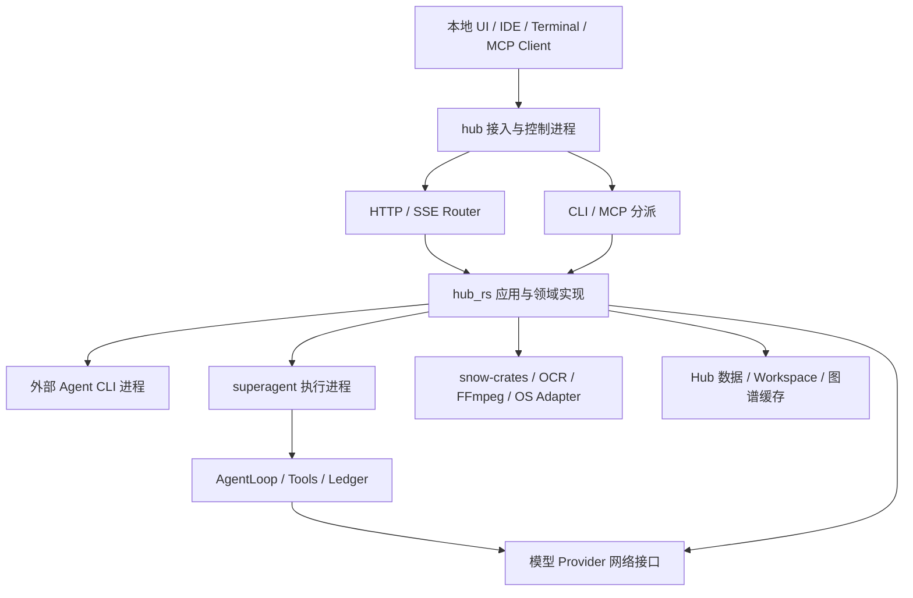
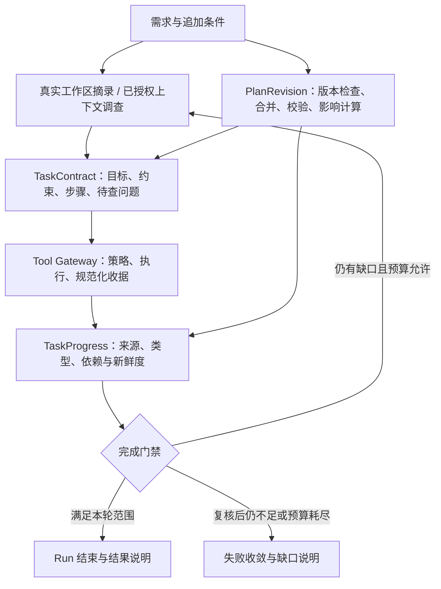

# SuperAgent / Hub-RS 系统架构设计

> 更新：2026-10-30。状态：持续演进的主架构设计，包含已实现机制与待实施契约。
> 详细架构核对基线：2026-10-29 的 `e91ae25` 与当时的需求理解、证据闭环和增量修订工作区；这些本地改动现已提交为 `c46d1e0`，贴图窗口独立提交为 `dd37ead`。2026-10-30 同步远程 `main` 至 `d917efc`，合并说明见第 9.3 节。2026-09-07 的 `1d267bf` 审查仅作历史证据。
> 定位：本地模块化单体，包含 `hub` 控制入口、`superagent` 执行入口及本地原生媒体依赖。
> 当前判断：**领域机制部分形成，整体尚未符合目标 DDD 边界**。目录拆分不代表职责收口，编译通过不代表所有能力可用。

## 1. 文档导航与事实口径

| 文档 | 职责 |
|---|---|
| 本文 | 全项目架构总览、当前模块落点、目标结构和演进顺序；作为架构入口 |
| [项目目录结构与文件分组指南](docs/architecture/项目目录结构与文件分组指南.md) | 各层及九个领域的子目录、现有代码迁移映射、Rust 可见性、测试与迁移注意事项 |
| [领域边界与迁移契约](docs/architecture/领域边界与迁移契约.md) | 各领域负责/不负责什么、状态归属、允许依赖、失败恢复和验收规则 |
| [2026-09-07 历史符合性审查](docs/reviews/2026-09-07-当前架构符合性审查.md) | 当时的符合情况、源码证据、问题优先级和验证结果 |
| [历史源码清单与指纹](docs/reviews/2026-09-07-current-architecture-evidence.json) | 当时 274 个 src Rust 文件、行数、SHA-256 和通配导出位置；不是当前清单或完整调用图 |
| [领域词汇](CONTEXT.md) | Session、Run、Task、Evidence 等稳定概念及不变量 |
| [需求理解与执行闭环](docs/architecture/superagent-intelligence-evolution.md) | 第一阶段实现与开源机制对照；其中早期预算以第三阶段为准 |
| [子目标证据与模型评测](docs/architecture/superagent-task-evidence-and-evals.md) | 第二阶段证据绑定、合成任务评测及其局限 |
| [增量计划修订](docs/architecture/superagent-incremental-planning.md) | 第三阶段版本协议、失效传播、当前预算与定向实测 |
| [API 契约](API_CONTRACTS.md) | 外部请求与响应兼容要求，实际行为以相应版本的契约测试为证据 |
| [CLI 同步规范](本地智能体CLI代理模型同步规范.md) | 本地智能体配置同步的专门规则；与新边界不一致处必须显式记录和迁移 |
| [历史架构原文](docs/architecture/history/系统架构设计-整理前-1d267bf.md) | 原文完整存档，仅作历史追溯，不作为当前实现或目标约束入口 |

当前事实、目标契约和认证结果分开记录。历史版本的 117/226 个测试、旧路径或启动问题不代表本版本状态。本文不对不在本仓库的 Web/IDE 产品实现作认证；snow-crates 与 vendor 只审查依赖归属，未逐一完成其平台实现认证。

### 1.1 问题、目标与范围

当前首要问题是复杂需求的目标、约束和未知项不能仅靠对话记忆维护：初始理解可能缺项，追加条件可能覆盖原要求，工具调用成功也可能被误认为任务完成。架构需要把“理解假设—调查事实—计划版本—执行证据—最终验收”连成可检查的链路，同时保留工作区、凭据与变更提交的独立边界。

本设计要求：

1. 复杂任务形成可修订的目标、约束、子目标依赖和待查问题；简单任务保持直接执行。
2. 可从项目中确认的问题先调查，用户选择与授权缺口明确交互；上下文始终带来源和预算。
3. 追加需求保留未受影响的进度，使受影响步骤重新取证；完成必须通过真实收据和有效验证。
4. HTTP、CLI、MCP、原生内核与外部 Agent 保持明确的状态所有权、权限传递和失败收敛规则。
5. 通过确定性回归与真实任务评测分别验证机制正确性和任务效果；证据不足的能力保持 Experimental。

本轮文档完善不引入微服务拆分、额外自主模型调用、后台收费探测、全盘文件接管或自动 Apply。操作系统沙盒、跨进程规划恢复和业务语义覆盖属于尚待实现并验收的能力，不能由目录迁移或计划格式校验替代。

### 1.2 设计组织与解释顺序

参考 [OpenSpec 设计模板](https://github.com/Fission-AI/OpenSpec/blob/main/schemas/spec-driven/templates/design.md)，本文说明背景、技术选择、取舍和迁移；第 12 节单列可观察行为与验收场景，第 10 节给出交付门禁。具体变更应将动机、行为、实现方案和工作清单分别维护，避免一份长文同时充当所有事实来源。

状态标记统一为：**已实现**表示当前代码存在相应机制；**部分实现**表示存在尚未闭合的边界；**目标**表示实施契约；**待复核**表示仅有历史审查、此次没有重新认证。行为约束以 [CONTEXT.md](CONTEXT.md) 和 [API_CONTRACTS.md](API_CONTRACTS.md) 为约束来源；本文补充技术理由。出现冲突必须显式修订相关契约，不能按文件日期静默覆盖。阶段文档保留当时实验条件，不作为最新统一预算或全系统认证。

## 2. 部署与进程架构

`Cargo.toml` 定义 `hub`、`superagent` 两个二进制，共享 `hub_rs` 库：

- `src/bin/hub.rs` 调用 `cli::dispatch()`，承载 HTTP、MCP、交互终端及 RTK 分派。
- `src/bin/superagent.rs` 装配自主 AgentLoop；Supervisor/Worker/IPC 实现位于 `services/brain/`。
- `src/server.rs` 装配 AppState、HTTP Router、回环监听和停机信号。
- `start-hub.ps1` 以 `hub.exe service 3001` 启动服务；启动状态不等于所有外部能力 Ready。
- `snow-crates/` 是独立 workspace，声明采集、OCR、拼图、UI selector、录制等库；根项目仅通过 Cargo 中实际列出的 path dependency 使用其中部分库。存在的 crate 不等于 Hub 已接入的功能。
- `vendor/paddleocr_rs_onnx` 是本地原生适配依赖；RTK 为 Git 依赖。它们属于基础设施/Adapter，不拥有 Hub 的 Task、Account 或 Workspace 业务状态。



此图描述部署角色，不表示进程间已经具有统一持久化协调。当前服务停机调用 TaskManager 的取消与有界等待机制，但不能据此宣称所有后台 Adapter、录制资源及子进程均已回收。

## 3. 当前代码结构与目标归属

| 层级或领域 | 当前主要路径 | 目标归属和现状 |
|---|---|---|
| 接入、装配 | `src/bin/`、`src/cli.rs`、`src/mcp_server.rs`、`src/server.rs`、`src/routes/` | 接入协议与 bootstrap；部分 route 仍承担复杂用例 |
| 模型网关 | `src/domains/model_gateway/` 下的 `providers/`、`protocols/`、`capabilities/{eval,discovery,probe}.rs`、`gateway.rs`、`model_attempt_router.rs`；`src/routes/proxy/` | 已有 Canonical、路由、健康与能力机制；代理/Agent 完全收敛到单一调用用例仍需逐入口验收 |
| 视觉与媒体 | `src/services/visual_pipeline/`、`snow-crates/`、`vendor/` | 三阶段 Provider 与显式 RecordingPhase 已存在；录制会话及最近 Artifact 仍保存在进程全局状态 |
| 本地智能体接入 | `src/services/agent/` 下的 `backend.rs`、`backends/`、`acp/`、`app_server.rs`、`stream_json.rs`、`json_lines.rs`、`proc.rs` | 保留 AgentBackend 协议与进程生命周期；将配置期代码从执行期概念中分离 |
| 自主智能体内核 | `src/domains/agent_cognitive/{executor,intent}.rs`、`src/services/brain/` 下的 `cognitive_runtime.rs`、`task_understanding.rs`、`task_progress.rs`、`task_plan_revision.rs`、`session_*`、`tool_*` | 已有当前 Run 的需求契约、证据绑定和增量修订；会话账本与规划内存状态恢复能力不同 |
| 项目理解 | `src/domains/code_analysis/`、`src/domains/knowledge_graph/`、`src/services/analysis_service.rs`、`src/services/brain/knowledge_corpus/`、`src/services/supermemory_store.rs` | 有版本化分析与语料机制；图谱/语料接口及跨模块状态访问仍需收口 |
| 逆向与变更规划 | `src/domains/code_analysis/requirement_analyzer.rs`、`src/routes/reverse.rs` | 需求期方案与执行期计划分离；历史审查发现的图 DB 直接依赖和影响分析缺口需定向复核 |
| 能力扩展与同步 | `src/services/agent/` 下的 `config_sync/`、`skills.rs`、`skills_sync.rs`、`mcp.rs`、`installer.rs`；`src/routes/skills.rs` | 已有锁内 expected revision 复核与回滚内容比较；严格 ReadBack 和完整并发恢复仍需验收 |
| 身份与凭据 | `src/services/cli_auth/`、`src/services/{keyring_auth,auth_validator,subscription}.rs`、`src/config/llm_settings.rs`、`src/routes/settings/` | 登录与凭据域；刷新互斥与调用方一致性需逐入口验收 |
| 工作区与变更 | `src/services/{workspace_capability,workspace_guard,destructive_ops,file_service}.rs`、`src/domains/version_control/{change_set,git_service}.rs`、`src/domains/sandbox/`、`src/routes/agents/diff.rs` | 已有登记授权、路径保护及 Baseline/Verify/Apply；全入口授权一致性与应用竞态仍需逐项验收 |
| 共享 Task 和用例 | `src/domains/project_management/task_manager.rs`、`src/services/{progress,analysis_service}.rs`、`src/application/usecases/`、部分 routes | Task Runtime 属于应用编排能力；已有 usecase 骨架仍有占位成功返回，不能视为流程迁移完成 |
| 配置与观测 | `src/config/`、`src/models/`、`src/services/{usage_tracker,cost_calculator,i18n}.rs`、`src/domains/token_compression/` | 技术机制按需共用，领域策略保留本域；models 目录不意味着全部类型应共享 |

未以 `src/` 开头的简写按其所在模块理解。目录是代码落点，不是最终授权边界；2026-10-29 快照中 `src/domains/` 的十二个目录与下节九个业务领域并非一一对应，10-30 同步又引入 `swarm_intelligence/` 等机制，不能按目录数量认定领域迁移完成。2026-09-07 文件指纹只覆盖当时快照；跨层引用与动态执行未由该清单自动证明。

## 4. 九个领域的目标边界

| 领域 | 拥有 | 不拥有 | 公开交互 |
|---|---|---|---|
| 模型网关 | Route、Attempt、Health、能力证据、协议适配 | 登录事务、用户任务计划、Session | 规范模型请求、流、脱敏 Attempt Receipt |
| 视觉与媒体 | Recording、设备租约、编码、Artifact | 项目修改、账户路由、Agent 决策 | Capture/OCR/Translate、Recording 操作与收据 |
| 本地智能体接入 | CLI 协议会话、Child 与回收 | Hub Run 决策、配置同步事务 | ExecOptions、事件、最终执行收据 |
| 自主智能体内核 | TaskContract、TaskProgress、RunPlan、Session Ledger、工具配对、预算、子执行、Evolution | 需求期方案、项目图谱 Schema、厂商协议 | Start/Steer/Cancel/Resume 与运行快照；规划工具属于当前 Run |
| 项目理解 | 源码指纹、索引、文档/分块、证据 | 项目源码修改、需求执行计划 | Index/Ingest/Query 与带版本 Citation |
| 逆向与变更规划 | 需求方案、计划版本、验收条件 | 执行进程、Apply、图数据库内部结构 | 版本化变更意图与验证计划 |
| 扩展与同步 | Manifest、版本、SyncPlan/Receipt、逐目标恢复 | 原始秘密值、运行中 Tool 状态 | Discover/Preview/ApplySync/Recover |
| 身份与凭据 | Account、LoginAttempt、刷新互斥、Credential | Provider Health、Skill 安装 | 账户摘要、登录控制、受限凭据访问 |
| 工作区与变更 | Workspace Capability、Baseline、Change Set、Verification/Apply Receipt | 全系统磁盘、媒体设备、模型决策 | Authorize/Prepare/Inspect/Verify/Apply |

这些名称定义目标契约，不表示同名 Rust API 已存在。各模块默认私有，明确导出 facade；禁止通配重导出扩大实现依赖。只在真实替换点定义 Trait，避免为每个函数制造接口。

## 5. 应用用例与依赖方向

接入 → Application 用例 → 领域接口 → 领域内部 Adapter。Application 拥有阶段、operation_id、总体 deadline、取消传播和补偿，不拥有领域内部可变对象。各入口不得相互调用。

允许的主要业务依赖：

- 逆向规划 → 项目理解、模型网关；不得打开图 DB 或直接 Apply。
- 内核 → 项目证据、模型网关、工作区、注入工具和 Agent Adapter；不得复制它们的策略。
- 项目理解 → 已授权文件读取、模型网关、自己的存储 Adapter。
- 媒体 → 模型网关（LLM 翻译）、自身 SDK/网络 Adapter；普通非 LLM 翻译不经过模型协议层。
- 模型网关 → 身份的凭据接口；身份不得回调网关形成循环。
- 扩展同步 → 身份的受限交付接口、目标配置 Adapter；不传递原始 Token 到通用日志/预览。
- 工作区 → Git/文件/质量执行 Adapter；不依赖 Agent 来完成 Apply。

入口兼容层可以保留当前路径，但不能继续复制业务流程。新依赖必须同步更新边界契约或 ADR，并说明如何避免循环。

## 6. 核心流程与一致性

### 6.1 需求到安全变更

用户需求 → 带源码指纹的证据 → 版本化方案 → 授权 Workspace → Baseline 与隔离副本 → Agent 执行 → Change Set → Verify → 用户选择 Apply。

Application 关联各阶段。内核 Run Plan 是执行期计划，逆向方案是需求期计划，两者以版本传递，不能共享可变状态。当前 `routes/agents/run.rs` 和 `diff.rs` 仍承担大量编排；目标是提取用例并保留 API 外形。

Verification Receipt 必须绑定待应用内容指纹；当前 Apply 已比较指纹，应保留。默认要求成功且对应当前内容的验证；无可用验证或验证失败时，只能由用户显式 `force`，并记录绕过事实。Agent 的结束文字不构成 Apply 授权。后续还需覆盖验证期间修改、检查到应用间竞态、多文件部分提交与恢复。

### 6.2 模型请求

入口协议 → Canonical Request → 能力与 Route → 身份凭据 → Provider Adapter → Canonical Response/Stream → 入口响应。

当前 `LlmProvider` 与 proxy dispatch 各自执行尝试循环和认证处理；目标为同一个调用用例，HTTP/SSE 只做格式转换。普通调用不自动触发收费能力 Probe；上下文错误由内核恢复，有限 failover 不得叠加成无界重试。

### 6.3 录屏

当前 `RecordingPhase` 已定义 Idle、Capturing、Paused、Stopping、Encoding、Validating、Published、Failed、Reclaimed，成功导出主链为 Capturing → Stopping → Encoding → Validating → Published。暂停与恢复单独转换，不能靠 engine 是否为空隐含全部业务语义。中断恢复与持久化终态是后续契约，不能把 Published 直接等同于外部 Task 的 completed。

设备与 FFmpeg Child 归媒体域。停止采集、编码器退出和有效 Artifact 发布是不同事实。当前 `record_manager.rs` 使用 ACTIVE_SESSION / LAST_ARTIFACT 全局状态，在输出元数据可读且非零后发布 Artifact；这仍不是媒体可播放性的完整认证。录制状态持久化、崩溃恢复和 Task 统一投影尚需设计与专项验收。

### 6.4 配置同步与认证

Inspect → SyncPlan → 用户或已授权用例确认 → Lock → 再检查 revision → Snapshot → Commit → ReadBack → Receipt。跨多个目标记录逐项结果，不承诺全局原子。

默认 Hub 声明配置向目标生成；反向导入显式发起。回滚前比较本次写入后的内容，禁止覆盖用户后续改动。认证秘密值由身份 Adapter 交付，配置预览只含引用或脱敏摘要。当前 Coordinator 已在锁内再次 inspect 并检查调用方提供的 expected revision；Transaction 回滚已比较拟写内容与现内容。这些机制已超出历史审查基线，但未提供 expected revision 时如何防止过期计划、严格 ReadBack、一致性竞争和崩溃后锁恢复仍需补验，不能宣称跨目标事务完成。

### 6.5 Task、事件与停机

Task 是外部句柄，Run 是一次智能体执行，Session 是长期会话；录屏、索引和同步可以有 Task 而没有 Run。领域产生执行事实，Task Runtime 维护投影，Adapter 拥有资源，Application 协调单次终态。

事件需要单调序号、版本和关联 ID；历史快照与订阅原子建立，lag 补读并去重。取消请求不等于资源已回收。当前 `server.rs` 调用 `drain_active_tasks`，设置停机标志、取消活跃 Task，并以 10 秒期限等待已注册的运行句柄。目标还需证明所有入口停止准入、Adapter/录制/子任务均被覆盖，且超时后未回收资源可定位；等待部分句柄不能代表全流程 drain 完成。

### 6.6 需求理解、上下文和执行证据

以下链路已接入共享原生 AgentLoop；外部 CLI 的内部规划不因经过 Hub Adapter 就自动具备同等门禁。



初始上下文只读取当前 Run Workspace 中实际存在的规则、说明和构建清单，附路径、行范围与截断标记。Prelude 每 Run 一次、有界投影；不能从目录名推断框架版本。更多文件与外部资料由现有授权工具按需调查，检索内容是证据数据，不能提升为系统指令。将未知项标为 `workspace`、`external` 或 `user` 只表达调查来源，不代表已有答案或获得联网权限。

原生规划接口与业务含义：

| 接口 / 对象 | 输入与输出 | 当前边界 |
|---|---|---|
| `plan_task` / TaskContract | 目标解释、成功条件、约束、步骤 DAG、待查问题 → 合法计划及版本 | 纯元数据；初次建立或完整替换。替换清除进度绑定并作废旧验证，已观察事实缓存可供重新绑定 |
| `revise_task_plan` / PlanRevision | 基准版本、追加条款、局部步骤修改 → 新版本、保留/失效步骤 | 只允许增量；省略字段和旧依赖保留，不能删除原要求或弱化既有证据种类 |
| `update_task_progress` / TaskProgress | 步骤 ID / 问题索引、当前 Run 收据 ID → 绑定或拒绝原因 | 检查成功状态、来源、证据类型、前置依赖和新鲜度；状态查询不产生证据 |
| CognitiveRuntime / RunPlan | 工具事实与进度 → Inspect / Act / Verify、完成门禁 | RunPlan 是阶段控制；TaskContract 是模型编写的需求解释，二者不能相互冒充 |

每 Run 独享一个共享 TaskProgress，规划工具与认知运行时消费同一状态。修订在副本上合并，检查版本、总预算、未知依赖和循环，稳定拓扑排序后一次提交；失败保持版本与所有绑定不变，重复相同增量不升版本。变更步骤及后续依赖需要修订后新收据，新增要求使旧 Verify 失效；未受影响的调查证据保留。完整缩减范围需要显式审阅后的完整替换，不能借格式修复静默删除要求；目前这项语义审阅依赖模型遵循指令，尚非自动授权证明。

当前预算由 `TaskContract::schema()` 与运行时共用：最多 12 个步骤、12 条成功条件、16 条约束、8 个待查问题，规范化 JSON 总计 12,000 字符。局部字段上限、Schema 与示例见[增量修订设计](docs/architecture/superagent-incremental-planning.md)。超限明确报错，禁止静默截断；成功收据元数据缓存上限 256，每次绑定最多 8 个收据。长任务通过分阶段交付和保留需求引用演进，不能靠放弃原约束适配预算。

普通工具成功、规划、Todo、后台启动和模型文字均不能作为验证。前台质量检查必须成功退出；后续写操作或失败进程检查使已有验证失效。无证据的子目标或未解决调查问题阻断执行型 Run 完成，最多再复核一次，Fast 模式同样受限。明确的“只做规划”范围可以交付提案，其未来实施步骤无需本轮执行；涉及当前仓库的判断仍需调查证据，结果必须说明尚未实施。

**已实现机制的限度**：上述门禁证明收据、时序和结构满足规则，不能证明模型没有漏解用户需求，也不能证明某次修改符合自然语言验收。当前没有完整的“用户要求 ID → 子目标 → 业务断言 → 收据”覆盖关系；第 10 节 I1 将补足该设计。`agent.task-understanding` 保持 Experimental。

### 6.7 状态提交与失败契约

下表给出所有者与恢复边界；标为目标的协议不得被当前客户端视为已经可用。

| 情形 | 唯一状态所有者 | 应有结果 / 恢复 | 状态 |
|---|---|---|---|
| 计划版本冲突、依赖循环、超预算 | 当前 Run 的 TaskProgress | 原子拒绝；返回错误，读取现版本后修订，不能留下半个更新 | 已实现 |
| 新约束到达或步骤修改 | TaskProgress + 认知阶段控制 | 提交新版本；传播失效，重开验证；旧收据不能为受影响步骤重新充当新证据 | 已实现 |
| 工具失败、超时或后续写操作 | Tool Gateway 产生事实；内核判定进度 | 失败收据不可算完成；旧验证失效；有界修复，预算耗尽失败结束 | 已实现门禁；不能据此证明所有 Adapter 已回收 |
| 用户响应迟到、取消与完成竞争 | Interaction / Task Runtime，应用用例协调 | 按关联 ID 接收；单次终态；迟到结果不得覆盖已取消状态 | 契约已定义，跨 Adapter 完整验收仍需补齐 |
| 进程中断 | 内核 Session Ledger | 配对工具调用、记录中断；当前 TaskProgress 不自动恢复 | 账本机制与规划恢复分开；后者未实现 |
| Apply 冲突或多文件部分失败 | 工作区域 | 拒绝过期验证；报告已写/未写路径，条件补偿，禁止覆盖用户新改动 | 指纹检查已实现；完整事务恢复为目标 |
| 配置同步部分成功 | 扩展域 | 逐目标收据、锁内复核与条件回滚，不承诺跨进程全局原子 | expected revision 锁内检查和内容比较已实现；完整竞争/恢复验收待补 |

面向后续新增的跨域命令，关联信息至少包含 operation ID、可用的 Task/Run/Session ID、Workspace 引用和版本；事件还需序号与 schema version。它们是目标信封，不是已新增的 HTTP 字段。拒绝、超时、取消、部分失败和中断应保持不同结果，错误消息不得回传凭据或无界正文。重试、幂等键与恢复动作由拥有该事务的用例定义，不能对所有工具默认自动重试。

## 7. 存储与权限

| 数据 | 归属与位置类别 | 一致性要求 |
|---|---|---|
| Account / Token | 身份域配置和 Credential Store | 刷新集中互斥、脱敏、失败保留旧配置 |
| Session / Tool receipts | 内核账本，Hub app data | 先记录调用、结果配对、检查点与中断恢复 |
| TaskContract / PlanRevision / TaskProgress | 内核，当前 Run 内存 | 版本化提交、绑定失效和预算；工具调用结果有账本记录，但没有自动重建规划状态的恢复协议 |
| Task / events | Task Runtime，Hub app data | 单次终态、序号、投影恢复 |
| 图谱 | 项目理解，RuntimeConfig 图缓存路径 | Schema 验证、源码指纹、过期标识 |
| Knowledge Corpus | 项目理解，SupermemoryStore | Manifest 与 Chunk 同一提交、哈希幂等 |
| Baseline / Change Set | 工作区域，隔离运行目录 | 版本绑定、冲突检测、Apply 恢复记录 |
| 截图/录屏 | 媒体 Artifact Store / 导出目标 | 设备与文件生命周期、输出验证、清理配额 |
| Skill/MCP 配置 | 扩展域，目标 CLI 专用配置 | 受管字段、锁内版本检查、条件回滚 |

默认数据根由 AppPaths/RuntimeConfig 解析；环境变量与持久化路径不应由每个调用者重新推断。图谱与 Corpus 当前是不同存储，不能因都支持检索而假定同一个 SQLite Schema。

WorkspaceCapabilityRegistry 负责“可使用哪些项目”，WorkspaceGuard 负责“目标路径是否在已授权根内”。Guard 不应接受任意调用者路径构造授权。当前 HTTP 和 MCP 准入策略不同，后续明确传递同一个授权上下文；不用全局单例跨进程共享可变对象。

当前具备应用层路径门控；cwd 不是 OS 沙盒。项目文件、应用数据、凭据、媒体导出分别授权，不引入接管所有磁盘的万能 VFS。DestructiveOps 当前从绑定 Guard 取得项目根与安全路径，不再接受额外 project 参数；仍需验证所有调用方取得 Guard 的授权来源及 Patch 内路径语义，不能只看方法签名判定全入口安全。

## 8. 通用机制与代码组织

目标目录是迁移方向，不是当前已完成结构。当前已有 application、interfaces、infrastructure 等目录，但部分 usecase 仍仅返回占位结果；文件夹存在不能证明用例已经收口：

```text
src/
  interfaces/       # HTTP / SSE / CLI / MCP
  application/      # 用例、Task 投影、取消和阶段恢复
  domains/
    model_gateway/  media/  agent_connectors/  agent_runtime/
    project_intelligence/  reverse_engineering/  extensions/
    identity/  workspace/
  shared_kernel/    # 少量 ID、事件信封和取消契约
  infrastructure/   # 文件锁、原子写、时钟、进程和网络机制
  bootstrap/        # 配置及依赖装配
```

先通过 facade 和测试建立边界，再按需迁目录/crate。原子写是通用机制，MCP 合并是扩展规则；进程执行是机制，录制失败保留片段是媒体规则；HTTP Client 是机制，Provider 重试是网关规则。不要将全部 DTO、错误类型和业务策略放进 common。

2026-09-07 指纹清单曾统计 37 处通配重导出，不能当成当前数量。显式导出和 Provider 策略去重应按当前依赖重新核对，不能以重命名文件代替治理。

## 9. 当前符合性与验证

### 9.1 证据分层与当前记录

确定性测试证明结构与状态规则；真实模型评测检验给定任务配置下的行为；外部账户、平台和产品链路认证另行进行。三个层级不能互相替代。下表引用 2026-10-29 文档修改前已完成的阶段记录；该次文档整理未重跑 Rust 回归或收费模型评测，10-30 合并后的新回归见第 9.3 节。

| 范围 / 来源 | 已有结果 | 解释边界 |
|---|---|---|
| [2026-09-07 审查](docs/reviews/2026-09-07-当前架构符合性审查.md) | 当时构建检查通过；测试目标因 E0252/E0599 编译失败 | 历史快照，已被后续测试执行记录取代，不能继续称为当前构建阻断 |
| [第三阶段回归记录](docs/architecture/superagent-incremental-planning.md) | `cargo test --lib --quiet -- --skip domains::code_review::tests::test_review_current_project_workspace`：384 通过、0 失败、2 忽略、1 排除 | 排除慢速全项目审查；不是所有 feature / 平台 / 外部服务通过，结果对应当时未提交工作区 |
| 同阶段入口检查 | `cargo check --bins --example task_understanding_eval` 通过；评测 example 构建通过 | 证明所检查入口可构建，不证明外部适配运行成功 |
| [v3 定向模型报告](outputs/task-understanding-eval-v3-steering.json) | 同一实际模型 `anthropic:claude-sonnet-4-6`；一对追加条件样例均 3 轮提交合法计划；增强组成功增量修订 1 次 | 合成提案任务，不能证明真实编码成功率；两组工具与上下文配置不同，不是单变量实验 |

v3 增强组保留原条款文字，但总 Token 未降低；完整重写组重新措辞也可能满足语义。固定术语检查不能代替语义覆盖，单个样例不能形成开源智能体性能排名。原始报告、配置、夹具指纹和实际模型身份必须随结论一起保存。

### 9.2 当前能力与待验收边界

已核对的原生内核机制包括真实工作区上下文、TaskContract 校验、当前 Run 收据绑定、增量修订原子性、验证失效和完成门禁。其他已有机制包括 AgentBackend、Canonical 协议适配、三阶段视觉接口、Task 事件回放、配置同步 Coordinator、Workspace 登记及 Apply 指纹比较；存在机制不等于全部调用入口已接入。

本轮额外核对发现，历史缺口中已有机制更新：DestructiveOps 从 Guard 绑定路径，配置同步有 expected revision 锁内复核及内容比较回滚，停机具备 Task 取消与句柄有界等待，录制具备显式阶段与发布检查。上述是源码核对结果，本轮未重新执行其专项测试。

仍需专项验收的架构问题：单一模型调用用例、统一身份刷新、全入口 Workspace 准入、Patch 内路径约束、无 expected revision 时的同步竞争、严格 ReadBack、全流程停机回收、图谱查询接口、录制状态持久化和显式封装。历史问题关闭必须附当前源码与回归证据，不能仅凭本文更新改为已完成。

尚无需求语义完整性证明、跨进程规划自动恢复或真实编码成功率稳定提升的结论。本次阶段记录不覆盖真实账户登录、所有 Provider/外部 CLI、桌面采集、snow-crates 全 workspace、所有 feature 或其他操作系统。默认原生配置面向 Windows，认证应注明构建目标、运行环境与 Adapter。

### 9.3 2026-10-30 远程同步与合并边界

功能分支在本地修改提交后合入远程 `main` 的六个新提交，基线推进到 `d917efc`。远程增加了补充验证门禁、卡死检测、蜂群角色路由、会话检查点接口等机制；本次同步不将其全部视为已完成架构认证，也不据会话检查点接口推断 TaskProgress 已实现跨进程恢复。

重叠修改的合并原则是保留双方机制：执行器仍消费完整规范收据，再交给补充门禁和卡死检测；固定配置评测入口与蜂群角色路由同时保留。完成判定先检查 RunPlan 与子目标证据，补充验证门禁也受同一次复核预算约束；重试耗尽不能降级为成功。工具执行详情不重复累计工具调用次数，只有明确的验证事实才能同步成功验证状态。

合并后的 `cargo test --lib --locked --quiet -- --skip domains::code_review::tests::test_review_current_project_workspace`：455 通过、0 失败、2 忽略、1 排除。排除项为未受此次改动影响的慢速全项目审查；新增回归验证工具详情不重复累计调用，以及补充门禁不能扩展复核预算或在重试耗尽后放行。第 9.1 节仍是前一阶段的历史结果，本轮没有重新执行收费模型评测。

`cargo check --locked --bins --example task_understanding_eval` 通过，覆盖两个可执行入口与评测示例的构建检查；相对远程基线的 `git diff --check origin/main` 通过。

## 10. 迁移优先级和完成标准

先补“需求理解”的语义闭环，再扩展效果评测；授权与提交安全作为持续发布门禁。以下均为待交付增量，已有阶段机制见第 9 节，不能将写完设计等同于完成实现。

| 工作项 / 所有者 | 依赖与交付内容 | 完成门禁 |
|---|---|---|
| I1 需求覆盖 / 内核 | 复用现有计划与证据；建立稳定要求 ID、用户来源、假设状态，关联子目标与业务断言 | 漏掉约束、错误绑定无关断言、追加要求、显式缩减范围均有反例；明确“结构覆盖”与“业务通过”分别判定 |
| I2 上下文增量投影 / 内核 + 项目理解 | 保留来源、预算与版本；减少重复完整投影，支持按需扩展截断资料 | 固定任务重放中无来源丢失和过期事实冒充；记录输入/输出/总 Token 与重读次数 |
| I3 真实任务基准 / 评测入口 | 基于 I1 输出可审阅验收；固定模型、独立任务、重复次数与预算 | 包含跨文件实现、追加约束、资料可查和失败恢复；任务效果与费用均公布，失败/超时也入分母 |
| B1 授权与提交 / Workspace + 扩展 | 复核已有 Guard/锁内检查，补 QA 全入口、Patch 路径、Apply 与同步竞争、严格 ReadBack | 越权路径、参数错配、用户并发修改、部分失败与条件回滚有契约回归 |
| B2 模型与身份 / 网关 + 身份 | 提取统一调用与凭据 facade；保留协议兼容层 | Proxy/Agent/翻译/分析逐入口证明同策略，有限尝试、脱敏和能力过期规则可回归 |
| B3 用例与资源 / Application + Adapter | 编排移出 route；明确 deadline、取消和有界 join | 迟到完成不覆写取消，子进程与设备可回收，超时资源可定位 |
| B4 项目证据与媒体 / 各所属领域 | 图谱/语料版本接口、Recording 状态与 Artifact 发布分别实施 | 过期图谱、Schema 错误、导入恢复以及采集/编码/导出失败分别验证 |
| B5 恢复与封装 / 内核 + Application | 先定义规划检查点版本及账本恢复协议，再整理目录与显式导出 | 中断后不会沿用未验证进度；旧账本仍可读，公共路径兼容，依赖边界可检查 |

### 10.1 交付清单

- [ ] I1：先提交需求来源、覆盖关系、冲突/缩减范围协议的设计与失败场景，再实现及回归；未覆盖项在结果中明确报告。
- [ ] I2：在固定输入重放下比较现有与增量上下文；验证来源、新鲜度、截断说明和总 Token，不只比较输出 Token。
- [ ] I3：在运行前冻结任务集、预算、重复次数与通过规则；保存模型身份、轨迹、失败样本和独立业务验收结果。
- [ ] B1：列全路径型入口与写入入口，逐项给出授权上下文及拒绝/冲突测试；历史缺口有证据后关闭。
- [ ] B2：逐调用入口迁移到 facade，每批保持协议契约和构建检查通过，收据中无秘密值。
- [ ] B3：为用例补齐状态转换、deadline 和回收责任，取消竞争与超时测试通过后再移除旧编排。
- [ ] B4：项目证据与录制分别交付恢复测试；不得以一个 Task 成功状态掩盖下游 Artifact 失败。
- [ ] B5：提交可兼容旧账本的规划恢复协议并验证崩溃重放，再按域迁移文件；不以移动目录作为完成门禁。

### 10.2 兼容、启用与回退

每个变更只迁移一个可验收的用例或边界，先定义行为与失败场景，再接 facade、回归和文档。现有 HTTP 请求/响应保持兼容；增加规划快照或版本字段时先更新 API 契约，持久化变更带 schema version 与旧数据读取策略。当前 `plan_task`、`revise_task_plan`、`update_task_progress` 是原生工具，不是本文新增的 HTTP API。

新增语义覆盖、上下文压缩和恢复能力应提供可回退的启用路径；回退保留原始需求、账本和拒绝记录，不得关闭现有授权或完成门禁。未知版本检查点不能继续执行或套用旧进度，应保留数据并明确报告不可恢复原因。变更 Apply、配置同步等外部写入的回退必须比较当前指纹，不能把回退部署解释为自动覆盖用户后续修改。

每个边界交付需写清负责/不负责、唯一状态所有者、输入输出、依赖、权限、deadline、取消、幂等、失败恢复和测试。代码、行为契约、设计理由和验证记录一起更新。

## 11. 关键技术决策与取舍

| 决策 | 选择与原因 | 考虑过的替代方案 / 代价 |
|---|---|---|
| D1 本地模块化单体 | 保留共享库与两个进程角色，先收口状态和接口 | 立即按领域拆微服务增加部署、分布式事务与恢复成本；当前边界尚不稳定 |
| D2 模型解释 + 确定性运行时 | 模型处理需求语义，Rust 检查结构、版本、收据与预算 | 只靠提示词难以阻止伪完成；只靠规则无法理解开放需求。当前仍需补语义覆盖 |
| D3 需求期与执行期分离 | 静态方案输出不可变版本；内核独占 Run 内契约和进度 | 共享一个可变计划会混淆未来建议与本轮已完成事实，并扩大恢复耦合 |
| D4 增量优先、完整替换显式 | 追加条件保留原要求，按依赖传播失效；版本冲突原子拒绝 | 每轮重写容易丢条款和进度；增量也会累积上下文，真正缩减范围仍需完整替换与审阅 |
| D5 以收据和版本判完成 | 证据属于当前 Run，验证随写入和需求修订失效 | 工具 `Ok`、模型自评和单一成功标志无法证明实现。收据种类匹配仍不能代替业务断言 |
| D6 权限与能力独立 | 工具策略、Workspace 和凭据边界在规划之外执行 | 在计划里声明“允许”不能授予操作权；外部 CLI 的能力也不能自动视作 Hub 已验证能力 |
| D7 分层评测、保守晋级 | 结构回归、合成模型评测、真实任务验收分层记录 | 单样例或固定词匹配易产生假提升；真实任务更昂贵，需显式预算与多次运行 |

## 12. 行为要求、验收场景与追踪

本节是主设计中的行为验收附录，采用 OpenSpec 风格的 Requirement / Scenario 组织，**未初始化为 OpenSpec 项目或执行其 CLI 校验**。状态说明和追踪表限定当前实现程度；出现“必须”代表契约，不能据此认定已通过所有场景。

### Requirement: R1 上下文具有来源并受授权约束

系统 MUST 从已授权范围获取上下文，保留来源、版本或读取位置及截断事实；可调查的项目事实应先调查，不能由目录名称推断框架规则。

#### Scenario: 项目资料足以回答未知项

- **WHEN** 用户要求修改现有项目，而规则文件和实现已说明约束
- **THEN** 系统先调查并引用来源；只询问资料无法决定的行为选择或授权缺口。

#### Scenario: 摘录被截断

- **WHEN** 初始资料超过投影预算
- **THEN** 系统标明截断，需要时按授权补读，不能把摘录未出现的内容当作不存在。

### Requirement: R2 完成与本轮范围和有效证据一致

系统 MUST 在执行型任务缺少声明子目标的有效证据或必要验证时阻止成功结束；规划型交付必须明确其提案性质。

#### Scenario: 测试后再次修改文件

- **WHEN** 成功验证之后又发生写操作，或后续进程检查失败
- **THEN** 旧验证失效；未复验不得以原成功收据通过完成门禁。

#### Scenario: 只交付方案

- **WHEN** 用户明确要求本轮只做规划
- **THEN** 可在具备必要调查证据后交付方案，未来实施步骤不得被描述成已经执行。

### Requirement: R3 追加需求保留原约束并传播失效

系统 MUST 原子处理计划修订，保留未受影响的要求与进度，为受影响步骤及其后续依赖要求新证据，并重新验证新增要求。

#### Scenario: 增加 dry-run 与文件保护要求

- **WHEN** 已有计划收到新约束且基准版本匹配
- **THEN** 原条款和未受影响调查保留，变更步骤及后续依赖失效，旧验证不能证明新要求完成。

#### Scenario: 过期版本或非法依赖

- **WHEN** 修订引用旧版本、未知步骤、循环依赖或超出预算
- **THEN** 返回拒绝原因，原计划、版本和证据绑定保持不变。

### Requirement: R4 规划和执行具有硬预算

系统 MUST 拒绝超预算计划并明确错误，不得静默删减要求；执行与复核必须有界，Fast 模式不能绕过完成门禁。

#### Scenario: 超预算且缺少执行证据

- **WHEN** 提交的计划超出声明上限，随后执行仍无法在预算内取得证据
- **THEN** 分别报告计划错误与执行缺口，任务失败收敛，不能以缩短输出或自评成功代替验证。

### Requirement: R5 计划不扩大权限，应用变更须验证

系统 MUST 独立验证工作区与操作权限；默认只有绑定当前内容的成功验证才能允许 Apply，用户显式 force 的绕过必须留痕。

#### Scenario: 验证后变更内容或传入其他路径

- **WHEN** 待应用内容与验证指纹不同，或请求目标超出已授权范围
- **THEN** 拒绝默认 Apply 或越权访问；计划文本和 Agent 结束状态不构成授权。

### Requirement: R6 取消、中断与终态可区分

系统 MUST 保持单次终态，禁止迟到结果覆盖取消；不能将账本存在等同于规划状态已经恢复。

#### Scenario: 取消后 Adapter 返回成功

- **WHEN** Task 已进入 cancelled，Adapter 随后返回完成
- **THEN** 保持取消结果，单独记录资源回收或迟到事实。

#### Scenario: 没有有效规划检查点

- **WHEN** 进程重启后只能读到工具账本，没有可恢复的规划状态
- **THEN** 不宣称已恢复原子目标进度，不沿用旧验证继续自动执行。

### Requirement: R7 普通执行不隐式触发能力探测

系统 MUST 在正常调用、健康检查和就绪检查中避免额外收费探测；需要网络确认的能力发现由显式授权触发，并使用有限尝试与脱敏收据。

#### Scenario: 模型能力未知或过期

- **WHEN** 普通 Run 遇到未知或过期的能力资料
- **THEN** 不将其标为已验证，不为补全元数据自动调用收费 Probe，按既有兼容与路由规则处理。

### Requirement: R8 评测结论可追溯且不越界

系统 MUST 记录模型身份、配置、样例、预算、轨迹和失败结果，分别报告结构检查、词面匹配、业务验收与总费用，不能将单样例结果宣称为整体提升。

#### Scenario: 增量组保留文字但输入更多

- **WHEN** 评测显示原条款保留且输出 Token 降低，但输入 Token 增加
- **THEN** 同时报告总 Token 与任务结果，不能据输出量推断总体效率提升。

### Requirement: R9 用户要求到业务验收可追踪

系统 MUST 使每项明确要求关联稳定标识、来源、子目标和验收结论；未覆盖项及未确认假设必须可见，覆盖关系本身不等于业务通过。

#### Scenario: 所有声明步骤完成但漏掉用户约束

- **WHEN** 模型计划未包含用户明确提出的文件保护要求
- **THEN** 覆盖检查报告遗漏，不能因模型自行声明的步骤已完成就认定需求全部满足。

R9 是下一阶段目标，当前 TaskContract 尚无此完整覆盖协议；本场景须由 I1 实施并验收。R1 中的调查质量仍需真实任务评测，不能仅靠有引用字段判定。

| 要求 | 决策 / 工作项 | 当前证据与补验位置 |
|---|---|---|
| R1 | D2、D6 / I2 | `run_prelude.rs`、`task_progress_tests.rs` 来源检查；复杂任务主动补读效果待 I3 |
| R2 | D3、D5 / I1 | `cognitive_runtime.rs`、`run_plan.rs`、`task_progress_tests.rs` 的完成/失效回归；语义不足见 R9 |
| R3 | D4、D5 / I1 | `task_plan_revision.rs`、`task_progress_tests.rs` 的原子拒绝、保留字段和失效传播回归 |
| R4 | D2、D5 / I3 | `task_understanding.rs` 预算校验及认知完成门禁回归；真实任务预算失败也需计入评测 |
| R5 | D6 / B1 | Workspace Guard 与 `src/routes/agents/diff.rs` 指纹检查；全入口授权、Apply 竞态待补验 |
| R6 | D1、D3 / B3、B5 | Session 账本、`src/domains/project_management/task_manager.rs` 的取消/终态测试与 drain；跨 Adapter 回收、规划恢复尚未完整认证 |
| R7 | D6 / B2 | `src/domains/model_gateway/` 能力与路由机制；所有调用入口一致性待验收 |
| R8 | D7 / I3 | `task_evaluation.rs`、评测 example 与 v3 报告；真实编码任务基准尚未交付 |
| R9 | D2、D5 / I1 | 目标；当前缺少要求 ID 到业务断言的完整实现与反例测试 |

表中无完整路径的 Rust 文件位于 `src/services/brain/`；评测入口为 `examples/task_understanding_eval.rs`。追踪指向机制和验证位置，不把未执行的场景标成已通过。

## 13. 风险、后续决策与文档维护

| 风险 / 取舍 | 应对与可检查信号 |
|---|---|
| 结构正确但理解错误 | I1 补需求来源和覆盖关系；I3 用独立业务断言验收，保留遗漏与误报完成样例 |
| 长任务超过有限计划容量 | 通过有引用关系的分阶段交付演进；拆分前保留全部原要求，禁止隐式删除。具体层级协议须先设计再扩容 |
| 增量修订保留了过多重复上下文 | I2 比较重放与总 Token；压缩后仍保留版本、证据引用和未解决问题 |
| 账本可读但规划不可恢复 | 当前明确报告能力边界；B5 增加版本化检查点和恢复测试，默认不推测旧进度 |
| 原生与外部 Agent 能力不一致 | 按入口声明证据与验证能力；Adapter 必须交付可审阅收据，不能转译一句成功文字获得内核认证 |
| 验证后工作区或配置被并发修改 | B1 的版本/指纹复核、条件提交与失败补偿；测试验证到提交之间的竞争 |
| 检索资料注入指令或跨项目泄漏 | 保持 Evidence 数据边界、Workspace 授权与来源；不复制秘密值到上下文、事件和评测样例 |

可后续确定的参数包括：检查点保留数量、事件/Artifact 配额默认值、评测重复次数及能力晋级阈值。它们必须在对应实现或评测运行前冻结并记录，不能事后挑选。影响权限、需求范围、恢复语义或对外兼容的决定不列为可无限延期的“开放问题”，应先提交具体变更设计。

仓库目前没有 `openspec/` 目录，本轮不安装 CLI、不生成额外工作流配置。若后续正式采用 OpenSpec，按[官方默认 schema](https://github.com/Fission-AI/OpenSpec/blob/main/schemas/spec-driven/schema.yaml)区分当前能力规范与拟议变更：proposal 描述动机，specs 描述行为，design 描述实现，tasks 描述工作；specs 和 design 均依赖 proposal，tasks 依赖两者，允许迭代修订。本文继续作为主架构入口，不能再建立一份互相竞争的“新版主架构”。

每次行为变更同步核对本文相关边界、CONTEXT 不变量、API 契约、行为场景、任务清单和验证记录；纯文档调整不伪造产品需求或测试通过记录。归档阶段设计时保留配置与原始报告，并使主文档链接指向最新适用契约。历史审查仅追加后续结论，不重写成当时未发生的成功。
