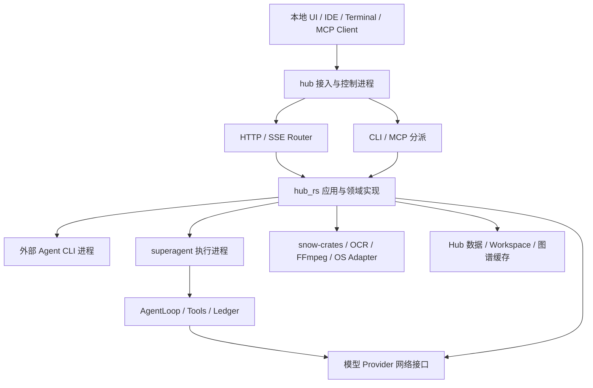

# SuperAgent / Hub-RS 系统架构设计

> 2026-10-30 维护说明：当前演进基线为 `feature/ai-core-workbench`，已接入[官方 OpenSpec 规格库](openspec/README.md)。下文路径、符合性与测试数字仍属于 2026-09-07 审查快照，不可用作最新认证。当前需求理解与验收闭环见[实现说明](docs/architecture/task-understanding-evidence.md)和[本轮 OpenSpec 设计](openspec/changes/evolve-task-understanding-evidence/design.md)，新回归结果记录在实现说明中。

> 更新：2026-09-07。实现审查基线：`1d267bfec29f53bbb6a0f7e91ea14082caca336a`。
> 定位：本地模块化单体，包含 `hub` 控制入口、`superagent` 执行入口及本地原生媒体依赖。
> 当前判断：**领域机制部分形成，整体尚未符合目标 DDD 边界**。目录拆分不代表职责收口，编译通过不代表所有能力可用。

## 1. 文档导航与事实口径

| 文档 | 职责 |
|---|---|
| 本文 | 全项目架构总览、当前模块落点、目标结构和演进顺序；作为架构入口 |
| [OpenSpec 规格库](openspec/README.md) | 当前能力行为契约与变更流程入口 |
| [需求理解与执行证据闭环](docs/architecture/task-understanding-evidence.md) | 当前分支的需求契约、计划修订、验证门禁及本轮回归记录 |
| [执行对话与工作循环校准](docs/architecture/execution-coaching.md) | 状态感知重读、质量命令与失败诊断边界、临时配置实战评测 |
| [Hub 原生能力接线变更](openspec/changes/connect-hub-native-capabilities/design.md) | 显式 Run 工作区、项目记忆、原生能力诊断及真实 worker 验收 |
| [技能执行链路修复](openspec/changes/repair-skill-execution/design.md) | 统一技能发现与真实资源定位；本地应用调查和规则交付分阶段验证 |
| [项目目录结构与文件分组指南](docs/architecture/项目目录结构与文件分组指南.md) | 各层及九个领域的子目录、现有代码迁移映射、Rust 可见性、测试与迁移注意事项 |
| [领域边界与迁移契约](docs/architecture/领域边界与迁移契约.md) | 各领域负责/不负责什么、状态归属、允许依赖、失败恢复和验收规则 |
| [当前代码符合性审查](docs/reviews/2026-09-07-当前架构符合性审查.md) | 当前符合情况、源码证据、问题优先级和验证结果 |
| [源码清单与指纹](docs/reviews/2026-09-07-current-architecture-evidence.json) | 274 个 src Rust 文件、行数、SHA-256 和通配导出位置；不是完整调用图 |
| [领域词汇](CONTEXT.md) | Session、Run、Task、Evidence 等稳定概念及不变量 |
| [API 契约](API_CONTRACTS.md) | 外部请求与响应兼容要求，实际行为以相应版本的契约测试为证据 |
| [CLI 同步规范](本地智能体CLI代理模型同步规范.md) | 本地智能体配置同步的专门规则；与新边界不一致处必须显式记录和迁移 |
| [历史架构原文](docs/architecture/history/系统架构设计-整理前-1d267bf.md) | 原文完整存档，仅作历史追溯，不作为当前实现或目标约束入口 |

当前事实、目标契约和认证结果分开记录。历史版本的 117/226 个测试、旧路径或启动问题不代表本版本状态。本文不对不在本仓库的 Web/IDE 产品实现作认证；snow-crates 与 vendor 只审查依赖归属，未逐一完成其平台实现认证。

## 2. 部署与进程架构

`Cargo.toml` 定义 `hub`、`superagent` 两个二进制，共享 `hub_rs` 库：

- `src/bin/hub.rs` 调用 `cli::dispatch()`，承载 HTTP、MCP、交互终端及 RTK 分派。
- `src/bin/superagent.rs` 装配自主 AgentLoop；Supervisor/Worker/IPC 实现位于 `services/brain/`。
- `src/server.rs` 装配 AppState、HTTP Router、回环监听和停机信号。
- `start-hub.ps1` 以 `hub.exe service 3001` 启动服务；启动状态不等于所有外部能力 Ready。
- `snow-crates/` 是独立 workspace，声明采集、OCR、拼图、UI selector、录制等库；根项目仅通过 Cargo 中实际列出的 path dependency 使用其中部分库。存在的 crate 不等于 Hub 已接入的功能。
- `vendor/paddleocr_rs_onnx` 是本地原生适配依赖；RTK 为 Git 依赖。它们属于基础设施/Adapter，不拥有 Hub 的 Task、Account 或 Workspace 业务状态。



此图描述当前部署角色，不表示进程间已经具有统一持久化协调。当前停机已调用取消入口，但尚未等待所有后台 Adapter/录制资源回收，不能宣称 drain 完成。

## 3. 当前代码结构与目标归属

| 层级或领域 | 当前主要路径 | 目标归属和现状 |
|---|---|---|
| 接入、装配 | `src/bin/`、`cli.rs`、`mcp_server.rs`、`server.rs`、`routes/` | 接入协议与 bootstrap；部分 route 仍承担复杂用例 |
| 模型网关 | `services/llm_provider/`、`protocol_converter/`、`routes/proxy/`、`brain/model_*`、`brain/provider_*`、`brain/gateway_eval_runtime.rs` | 统一 Canonical 调用域；当前代理与 Agent 路径共享策略类型，但仍分别执行请求/刷新/收据流程 |
| 视觉与媒体 | `services/visual_pipeline/`、`snow-crates/`、`vendor/` | 三阶段 Provider Adapter 已存在；Recording 仍有进程级全局状态 |
| 本地智能体接入 | `services/agent/backend.rs`、`backends/`、`acp/`、`app_server.rs`、`stream_json.rs`、`json_lines.rs`、`proc.rs` | 保留 AgentBackend 协议与进程生命周期；将配置期代码从执行期概念中分离 |
| 自主智能体内核 | `services/brain/executor.rs`、`session_*`、`cognitive_runtime.rs`、`compaction_runtime.rs`、`tool_*`、`subagent_runtime.rs`、`steering_queue.rs` | 决策、工具收据、会话恢复、子执行；不长期拥有网关与项目知识实现 |
| 项目理解 | `analysis_service.rs`、`code_intelligence.rs`、`graph_service.rs`、`vector_service.rs`、`understand_service.rs`、分析器、`brain/knowledge_corpus/`、`supermemory_store.rs` | 有版本化分析与语料机制；图查询仍多处直接读 Schema，知识实现位置与领域归属不一致 |
| 逆向与变更规划 | `reverse_engineering/`、`requirement_analyzer.rs`、`routes/reverse.rs` | 需求→证据→方案→验收；当前直接依赖图 DB 路径和 Supermemory，影响分析仍有 TODO |
| 能力扩展与同步 | `services/agent/config_sync/`、`skills*.rs`、`mcp.rs`、`installer.rs`、`routes/skills.rs`、`mcp_skills.rs` | 有 Coordinator/Adapter/Transaction 起点；锁内版本检查、部分失败和回滚协议不完整 |
| 身份与凭据 | `services/cli_auth/`、`keyring_auth.rs`、`auth_validator.rs`、`subscription.rs`、`config/llm_settings.rs`、`routes/settings/` | 登录与凭据域；当前网关调用方仍直接刷新和保存配置 |
| 工作区与变更 | `workspace_capability.rs`、`workspace_guard.rs`、`destructive_ops.rs`、`change_set.rs`、`file_service.rs`、`git_service.rs`、`routes/agents/diff.rs` | 登记授权、路径保护、Baseline/Verify/Apply；多处还接收原始字符串路径，QA 未统一接入 |
| 共享 Task 和用例 | `task_manager.rs`、`progress.rs`、`analysis_service.rs`、部分 routes | 是 Application 能力，不是所有领域的万能状态机；需要提取完整用例 |
| 配置与观测 | `config/`、`models/`、`usage_tracker.rs`、`cost_calculator.rs`、`token_filter.rs`、`i18n.rs` | 技术机制按需共用，领域策略保留本域；models 目录不意味着全部类型应共享 |

目录是当前落点，不是最终授权边界。完整文件清单见指纹证据；跨层引用与动态执行未由该清单自动证明。

## 4. 九个领域的目标边界

| 领域 | 拥有 | 不拥有 | 公开交互 |
|---|---|---|---|
| 模型网关 | Route、Attempt、Health、能力证据、协议适配 | 登录事务、用户任务计划、Session | 规范模型请求、流、脱敏 Attempt Receipt |
| 视觉与媒体 | Recording、设备租约、编码、Artifact | 项目修改、账户路由、Agent 决策 | Capture/OCR/Translate、Recording 操作与收据 |
| 本地智能体接入 | CLI 协议会话、Child 与回收 | Hub Run 决策、配置同步事务 | ExecOptions、事件、最终执行收据 |
| 自主智能体内核 | RunPlan、Session Ledger、工具配对、预算、子执行、Evolution | 项目图谱 Schema、厂商协议 | Start/Steer/Cancel/Resume 与运行快照 |
| 项目理解 | 源码指纹、索引、文档/分块、证据 | 项目源码修改、需求执行计划 | Index/Ingest/Query 与带版本 Citation |
| 逆向与变更规划 | 需求方案、计划版本、验收条件 | 执行进程、Apply、图数据库内部结构 | 版本化变更意图与验证计划 |
| 扩展与同步 | Manifest、版本、SyncPlan/Receipt、逐目标恢复 | 原始秘密值、运行中 Tool 状态 | Discover/Preview/ApplySync/Recover |
| 身份与凭据 | Account、LoginAttempt、刷新互斥、Credential | Provider Health、Skill 安装 | 账户摘要、登录控制、受限凭据访问 |
| 工作区与变更 | Workspace Capability、Baseline、Change Set、Verification/Apply Receipt | 全系统磁盘、媒体设备、模型决策 | Authorize/Prepare/Inspect/Verify/Apply |

这些名称定义目标契约，不表示同名 Rust API 已存在。各模块默认私有，明确导出 facade；禁止通配重导出扩大实现依赖。只在真实替换点定义 Trait，避免为每个函数制造接口。

## 5. 应用用例与依赖方向

接入 → Application 用例 → 领域接口 → 领域内部 Adapter。Application 拥有阶段、operation_id、总体 deadline、取消传播和补偿，不拥有领域内部可变对象。各入口不得相互调用。

允许的主要业务依赖：

- 逆向规划 → 项目理解、模型网关；不得打开图 DB 或直接 Apply。
- 内核 → 项目证据、模型网关、工作区、注入工具和 Agent Adapter；不得复制它们的策略。
- 项目理解 → 已授权文件读取、模型网关、自己的存储 Adapter。
- 媒体 → 模型网关（LLM 翻译）、自身 SDK/网络 Adapter；普通非 LLM 翻译不经过模型协议层。
- 模型网关 → 身份的凭据接口；身份不得回调网关形成循环。
- 扩展同步 → 身份的受限交付接口、目标配置 Adapter；不传递原始 Token 到通用日志/预览。
- 工作区 → Git/文件/质量执行 Adapter；不依赖 Agent 来完成 Apply。

入口兼容层可以保留当前路径，但不能继续复制业务流程。新依赖必须同步更新边界契约或 ADR，并说明如何避免循环。

## 6. 核心流程与一致性

### 6.1 需求到安全变更

用户需求 → 带源码指纹的证据 → 版本化方案 → 授权 Workspace → Baseline 与隔离副本 → Agent 执行 → Change Set → Verify → 用户选择 Apply。

Application 关联各阶段。内核 Run Plan 是执行期计划，逆向方案是需求期计划，两者以版本传递，不能共享可变状态。当前 `routes/agents/run.rs` 和 `diff.rs` 仍承担大量编排；目标是提取用例并保留 API 外形。

Verification Receipt 必须绑定待应用内容指纹；当前 Apply 已比较指纹，应保留。后续还需覆盖验证期间修改、检查到应用间竞态、多文件部分提交与恢复。

### 6.2 模型请求

入口协议 → Canonical Request → 能力与 Route → 身份凭据 → Provider Adapter → Canonical Response/Stream → 入口响应。

当前 `LlmProvider` 与 proxy dispatch 各自执行尝试循环和认证处理；目标为同一个调用用例，HTTP/SSE 只做格式转换。普通调用不自动触发收费能力 Probe；上下文错误由内核恢复，有限 failover 不得叠加成无界重试。

### 6.3 录屏

Created → Recording → Stopping → Encoding → Completed / Failed / Cancelled；中断恢复另记 interrupted。暂停可增加显式状态，但不得靠 engine 是否为空隐含全部业务语义。

设备与 FFmpeg Child 归媒体域。停止采集、编码器退出和有效 Artifact 发布是不同事实。当前 record_manager 使用 ACTIVE_SESSION/LAST_EXPORT 全局状态，有失败保留片段和输出检查，但尚无持久化 Recording 状态机及 Task 统一投影。

### 6.4 配置同步与认证

Inspect → SyncPlan → 用户或已授权用例确认 → Lock → 再检查 revision → Snapshot → Commit → ReadBack → Receipt。跨多个目标记录逐项结果，不承诺全局原子。

默认 Hub 声明配置向目标生成；反向导入显式发起。回滚前比较本次写入后的指纹，禁止覆盖用户后续改动。认证秘密值由身份 Adapter 交付，配置预览只含引用或脱敏摘要。当前 Coordinator 已有计划、锁和备份，但 revision 在加锁前检查，需要补锁内复核。

### 6.5 Task、事件与停机

Task 是外部句柄，Run 是一次智能体执行，Session 是长期会话；录屏、索引和同步可以有 Task 而没有 Run。领域产生执行事实，Task Runtime 维护投影，Adapter 拥有资源，Application 协调单次终态。

事件需要单调序号、版本和关联 ID；历史快照与订阅原子建立，lag 补读并去重。取消请求不等于资源已回收。目标停机为停止准入 → 发送取消 → 有界等待 Adapter/录制/子任务完成 → 记录超时与未回收资源 → 退出；当前代码只完成其中部分步骤。

## 7. 存储与权限

| 数据 | 归属与位置类别 | 一致性要求 |
|---|---|---|
| Account / Token | 身份域配置和 Credential Store | 刷新集中互斥、脱敏、失败保留旧配置 |
| Session / Tool receipts | 内核账本，Hub app data | 先记录调用、结果配对、检查点与中断恢复 |
| Task / events | Task Runtime，Hub app data | 单次终态、序号、投影恢复 |
| 图谱 | 项目理解，RuntimeConfig 图缓存路径 | Schema 验证、源码指纹、过期标识 |
| Knowledge Corpus | 项目理解，SupermemoryStore | Manifest 与 Chunk 同一提交、哈希幂等 |
| Baseline / Change Set | 工作区域，隔离运行目录 | 版本绑定、冲突检测、Apply 恢复记录 |
| 截图/录屏 | 媒体 Artifact Store / 导出目标 | 设备与文件生命周期、输出验证、清理配额 |
| Skill/MCP 配置 | 扩展域，目标 CLI 专用配置 | 受管字段、锁内版本检查、条件回滚 |

默认数据根由 AppPaths/RuntimeConfig 解析；环境变量与持久化路径不应由每个调用者重新推断。图谱与 Corpus 当前是不同存储，不能因都支持检索而假定同一个 SQLite Schema。

WorkspaceCapabilityRegistry 负责“可使用哪些项目”，WorkspaceGuard 负责“目标路径是否在已授权根内”。Guard 不应接受任意调用者路径构造授权。当前 HTTP 和 MCP 准入策略不同，后续明确传递同一个授权上下文；不用全局单例跨进程共享可变对象。

当前只具备部分应用层路径门控；cwd 不是 OS 沙盒。项目文件、应用数据、凭据、媒体导出分别授权，不引入接管所有磁盘的万能 VFS。DestructiveOps 必须只使用 Guard 绑定的规范路径，不再同时接受另一个未经绑定的 project。

## 8. 通用机制与代码组织

目标目录是迁移方向，不是当前已完成结构：

```text
src/
  interfaces/       # HTTP / SSE / CLI / MCP
  application/      # 用例、Task 投影、取消和阶段恢复
  domains/
    model_gateway/  media/  agent_connectors/  agent_runtime/
    project_intelligence/  reverse_engineering/  extensions/
    identity/  workspace/
  shared_kernel/    # 少量 ID、事件信封和取消契约
  infrastructure/   # 文件锁、原子写、时钟、进程和网络机制
  bootstrap/        # 配置及依赖装配
```

先通过 facade 和测试建立边界，再按需迁目录/crate。原子写是通用机制，MCP 合并是扩展规则；进程执行是机制，录制失败保留片段是媒体规则；HTTP Client 是机制，Provider 重试是网关规则。不要将全部 DTO、错误类型和业务策略放进 common。

当前源码有 37 处通配重导出（文本清单统计），Provider 能力策略仍有多份常量副本。这些需逐步收口，不能以重命名文件代替治理。

## 9. 当前符合性与验证

已具备的部分机制：AgentBackend 接口、Canonical 协议适配、领域化会话/工具机制、三阶段视觉 Trait、Task 序号回放、配置同步 Coordinator、Workspace 登记与部分路径保护、Apply 指纹校验。

尚未符合的主要边界：单一模型调用用例、统一身份刷新、QA 工作区准入、DestructiveOps 授权绑定、锁内配置版本校验、全流程停机回收、统一图谱查询接口、录制状态持久化和显式封装。

本版本验证：

- `cargo check --lib --bins --locked`：通过。
- `cargo test --lib --locked -- --test-threads=1`：**测试目标编译失败，未执行测试**。Responses 测试重复导入 json，并缺少 StreamExt，产生 1 个 E0252、3 个 E0599。
- 未运行真实账户登录、真实 Provider、所有外部 CLI、桌面采集、snow-crates 全 workspace 或所有 feature 组合认证。

因此不能将之前的 226 passed 用作本版本通过记录。当前原生默认配置面向 Windows；其他平台能力需要明确构建/运行矩阵。

## 10. 迁移优先级和完成标准

| 顺序 | 工作 | 完成门禁 |
|---|---|---|
| 1 | 恢复测试构建；绑定 QA/DestructiveOps 授权；修复同步锁内版本规则 | 拒绝越权路径、参数错配和并发覆盖的契约测试 |
| 2 | 提取统一模型调用与身份凭据 facade | Proxy/Agent/翻译/分析请求共用策略，协议测试不减少 |
| 3 | Agent/Apply/同步用例移出路由，停机有界 join | 取消竞态、终态、回收及失败补偿测试 |
| 4 | 图谱查询和语料接口收口，规范证据版本 | stale 证据、Schema 错误、导入/重建恢复测试 |
| 5 | Recording 状态机、Artifact 发布和恢复 | 停止/编码/导出分别失败时正确回收和报告 |
| 6 | 显式导出、合并策略副本，逐域整理目录 | 公共路径兼容、禁止依赖检查、构建与契约矩阵 |

每个边界必须写清负责/不负责、唯一状态所有者、输入输出、依赖、权限、deadline、取消、幂等、失败恢复和测试。此轮是代码审查与文档整理，不改变上述产品行为。
